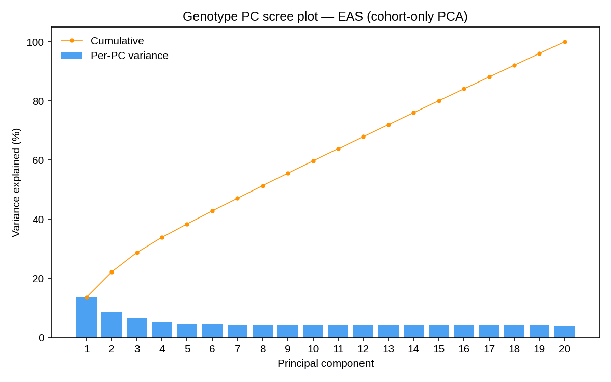
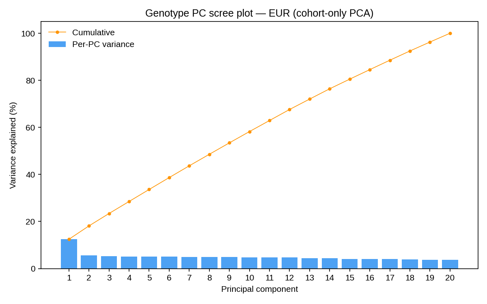
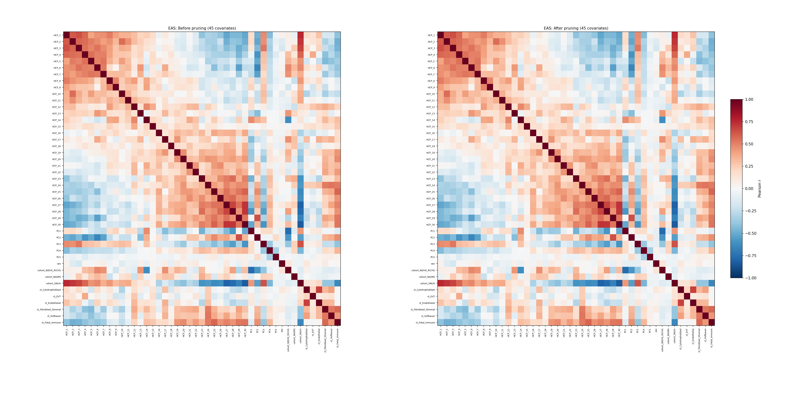
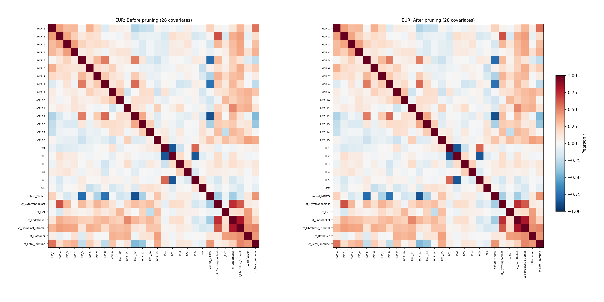

# Multi-ancestry placental xQTL analysis {#xqtl-mapping}

Book chapter rebuilt locally from <code>reports/report_placenta_xqtl.Rmd</code>.

## Executive summary

This report summarizes the multi-ancestry placental xQTL analysis:
cohort-only genotype PCA on LD-pruned variants within each ancestry
stratum, a conventional covariate set (first 5 genotype PCs + HCP
factors + sex, maternal age, and cell-type fractions; maternal cell
fraction excluded before correlation pruning at \|r\| \> 0.9; HCP count
optimized per ancestry × modality via module 25b; no covariate cap), a
MAF ≥ 0.01 filter with a ≥ 5 minor-allele-count floor at the genotype
intersection, Storey q-values (computed with the R `qvalue` package),
and per-phenotype normalization of all modalities (TMM →
variance-stabilizing transformation for the two count-based expression
modalities; rank-based inverse-normal transformation for the ratio-based
modalities; isoform usage mapped as within-gene relative-abundance
ratios). Mapping covers 36 ancestry × modality × layer cells (EAS n ≈
281, EUR n ≈ 136). The results narrative follows the figure progression
of the developing-brain xQTL atlas (Wen et al., Science 2024): cohort
landscape → calibration → the modality-wise regulation landscape →
cross-ancestry regulation → the discovery catalog → functional
characterization.

**Headline result: 8116 phenotype-level associations reach FDR ≤ 5%** in
the discovery layer (ungrouped scan for the 8 multi-phenotype
modalities + the per-gene expression scan): 3606 in EAS and 4510 in EUR,
implicating 1757 / 2243 unique genes respectively. This phenotype-level
set is the input to cross-ancestry SuSHiE fine-mapping (Methods). At
gene level, the combined cross-modality catalog contains **1404 EAS and
1654 EUR eGenes** at FDR ≤ 5%, with per-modality grouped eGenes as the
breakdown. Strongest association per ancestry: EAS: PGM1 (expression,
grouped layer, q = 5.4e-29); EUR: ERAP1 (alt_polyA, ungrouped layer, q =
1.8e-35). Storey calibration estimates a signal fraction (π1) of 0–34%
across cells. In high-signal cells Storey q-values are correspondingly
more liberal than Benjamini–Hochberg (by up to the estimated π0); the
per-cell comparison is in Calibration.

The splicing modality splits by ancestry. At its modality-matched HCP
count (HCP count optimization), EUR splicing yields 35 FDR ≤ 5% eGenes —
under expression-derived covariates the layer carried no detectable
signal, so the EUR splicing null was a covariate-specification artifact,
now resolved. EAS splicing remains near-null in both the grouped (5
eGenes, best q = 0.0021) and ungrouped (5 phenotype-level hits) layers,
its eGene yield is flat across the HCP grid, and its p-values depart
only mildly from the null at the median (genomic-control λ = 1.51;
Calibration). Three lines of evidence bear on the residual EAS null:

1.  **The machinery detects splicing signal where it exists** — the same
    pipeline and covariate machinery yield the EUR splicing catalog
    above at n ≈ 136, a *higher* detection floor (r² ≈ 0.19) than EAS
    (r² ≈ 0.10 at n = 281; Power analysis). A pure sample-power
    explanation is therefore insufficient for EAS: EUR splicing effects
    cleared a higher bar. The leading candidate is EAS-specific
    attenuation of the splicing phenotypes — EAS pools four cohorts
    spanning single- and paired-end protocols, and junction-level
    quantification is the most protocol-sensitive of the nine
    modalities.
2.  **The EAS null is not a covariate artifact** — eGene yield does not
    improve at any HCP count on the grid (HCP count optimization), and
    the mild median λ elevation with only a handful of FDR-significant
    hits is the signature of diffuse, individually weak effects rather
    than of residual confounding (which would inflate the median without
    bound) or of a dead layer (λ ≈ 1, no tail). The FDR-significant hits
    in the other modalities carry estimated r² of 0.00–3.59 — exactly
    the class of outsize effect the floor permits.
3.  **Signal replicates across ancestries** — cross-ancestry rank
    concordance of gene-level signal on the combined layer is Spearman ρ
    = 0.18 (top-100 overlap 31/100), with same-variant slope concordance
    0.54 — the pattern expected of real, partially shared genetic
    regulation, not of artifact-driven signal.

**Carrier-count audit: clean.** The MAC ≥ 5 floor (applied at the
genotype intersection in module 23) propagated to every mapping output —
minimum minor-allele carrier count across all tested pairs is 27 (EAS)
and 13 (EUR). \# Methods

*Adapted from the project methods document
(methods_placenta_xqtl.docx).*

### Study cohorts and data

Placental RNA-seq and genotype data were assembled from four cohorts
(Table 1). NIEHS_RICHS contributed placenta RNA-seq and array genotypes
under dbGaP controlled access. GUSTO contributed placenta RNA-seq and
array genotypes through the study investigators. SNUH contributed
placenta RNA-seq and genotypes available under SRA BioProject
PRJNA820329 (102 RNA-seq runs). NIGMS contributed placenta RNA-seq and
whole-exome sequencing (WXS) under SRA BioProject PRJNA671171 (154
RNA-seq runs and 95 WXS runs); each NIGMS subject was sampled at two
placental sites, and the replicate libraries were averaged per
individual before mapping. All genotype and transcriptomic data were
processed against the GRCh38 no-alt analysis set (GCA_000001405.15).

| Cohort | Data types | Access | Accession / route |
|------------------|------------------|------------------|------------------|
| NIEHS_RICHS | Placenta RNA-seq, array genotypes | Controlled access | dbGaP (accession to be added on publication) |
| GUSTO | Placenta RNA-seq, array genotypes | On request | GUSTO study investigators |
| SNUH | Placenta RNA-seq, genotypes | Public | SRA BioProject PRJNA820329 |
| NIGMS | Placenta RNA-seq (2 sampling sites per subject), WXS | Public | SRA BioProject PRJNA671171 |

Table 1. Study cohorts, data types, and access routes.

### Genotype processing and imputation

Array genotypes were lifted over to GRCh38 where required. For NIGMS,
WXS reads were retrieved from SRA, aligned to GRCh38 with BWA, processed
to per-sample gVCFs with GATK, and jointly genotyped per chromosome.
Each cohort was filtered before imputation to biallelic SNPs with
per-variant missingness of at most 0.05, minor allele frequency (MAF) of
at least 0.01, and Hardy-Weinberg equilibrium (HWE) test P above 1 x
10^-6, and variants were left-aligned and normalized against the
reference genome with bcftools norm. Genotypes were imputed on either
the TOPMed (NIGMS, NIEHS_RICHS) or SEAD (GUSTO, SNUH) imputation
servers. Imputed variants with imputation Rsq of at least 0.4 were
retained and converted to plink2 binary format (pgen).

### Ancestry assignment and cross-cohort genotype pooling

Genetic ancestry was assigned within each cohort with PC-AiR as
implemented in GENESIS, using kinship estimated with KING in SNPRelate
and 1000 Genomes phase 3 samples as the unrelated reference set. Each
sample was assigned to one of five continental ancestry strata (AFR,
AMR, EAS, EUR, SAS). For each stratum, the Rsq-passing variants of each
cohort were subset to the assigned samples, multiallelic sites were
split per cohort so that imputed dosages were partitioned correctly, and
cohort VCFs were merged across cohorts with bcftools merge and
normalized against GRCh38. Pooled genotypes were filtered to MAF of at
least 0.01, HWE P above 1 x 10^-6, and per-variant missingness of at
most 0.05, and palindromic duplicate sites were removed. The resulting
per-ancestry pgen files define the genotype identifier space used by all
downstream steps.

### RNA-seq processing

RNA-seq reads for SNUH and NIGMS were retrieved from SRA with prefetch
and fasterq-dump; GUSTO and NIEHS_RICHS FASTQs were already local.
Adapters and low-quality bases were trimmed with Trim Galore 0.6.10.
Reads were aligned to GRCh38 with STAR 2.7.4a in basic two-pass mode.
Transcript abundance was quantified with Salmon 1.10.2 against the
HPLRv2 long-read placental transcriptome annotation using automatic
library-type detection, selective alignment with validateMappings, and
20 bootstrap replicates per sample.

### Transcriptomic phenotyping

Nine RNA modalities were quantified per sample with an in-house rewrite
of the PANTRY phenotyping pipeline (github.com/PejLab/Pantry) adapted to
the local compute cluster. Gene expression was quantified from Salmon
with tximport, both as gene-level TPM (used for detection filtering) and
as gene-level lengthScaledTPM count-scaled abundances (tximport
countsFromAbundance = “lengthScaledTPM”), the latter serving as the
TMM-VST normalization input. Isoform expression was taken as
transcript-level TPM after quantification uncertainty correction (see
below), with TPM recomputed from the QU-corrected counts and Salmon
effective lengths; the QU-corrected transcript counts themselves served
as the TMM-VST normalization input for isoform expression. Isoform usage
was computed as within-gene relative abundance ratios after correcting
transcript counts for quantification uncertainty: edgeR catchSalmon was
used to estimate per-transcript overdispersion from the Salmon bootstrap
replicates, and counts were divided by the estimated overdispersion
(Chen et al., Nucleic Acids Res 2023). Alternative transcription start
site and alternative polyadenylation usage were quantified with
txrevise: event annotations were constructed in two event groups, each
split into upstream, contained, and downstream positional classes, and
event abundance was quantified with Salmon against the six resulting
transcript indices. Splice junction usage was quantified by extracting
junctions from the STAR alignments with RegTools and clustering them
with leafCutter (minimum 30 reads per cluster, minimum cluster ratio
0.001); intron usage ratios within clusters were carried as phenotypes.
Intron retention was quantified with MAJIQ. RNA editing levels were
computed at REDIportal sites (TABLE1_hg38_v3) from samtools mpileup
output as the proportion of edited reads per site. RNA stability was
approximated per gene as the ratio of exonic to intronic read counts
from featureCounts. Because splice junctions and retained introns are
defined by the observed data in each cohort, splicing and intron
retention features were harmonized across cohorts by stable genomic
coordinates before pooling. Phenotypes were exported as bgzipped,
tabix-indexed BED files with gene-level phenotype groupings where
applicable.

### Cell-type deconvolution

Cell-type proportions were estimated from bulk gene expression with
MuSiC, using a published placental single-cell RNA-seq reference
(GSE182381). The estimated fractions were carried into the mapping
covariates.

### RNA to DNA sample linkage

RNA-seq sample identifiers were linked to genotype sample identifiers
within each cohort using cohort-specific keys: SRA run-to-subject
metadata for SNUH and NIGMS, and array subject identifiers for
NIEHS_RICHS and GUSTO. The linkage table was checked for match rates,
duplicates, and missing values before mapping.

### Phenotype pooling and normalization

Within each ancestry stratum, per-cohort phenotype matrices were pooled
and normalized in a single pass. The two count-based expression
modalities (gene expression and isoform expression) followed the
PsychENCODE/isoTWAS convention (Bhattacharya et al., Nat Genet 2023):
after the detection filter, pooled count matrices — gene-level
lengthScaledTPM counts from tximport for gene expression, and
QU-corrected transcript counts for isoform expression — were normalized
with edgeR TMM followed by the DESeq2 variance-stabilizing
transformation, with TMM effective library sizes supplied to DESeq2 as
size factors (counts themselves never pre-divided), and no subsequent
rank transformation. The six ratio-based modalities followed the
conventions of the developing-brain xQTL atlas (Wen et al., Science
2024): filtered matrices were quantile normalized across the pooled
stratum, and each phenotype was then rank inverse-normal transformed
separately within each cohort, so every cohort enters mapping on an
identical standard-normal scale. Gene and isoform expression were
filtered to features with TPM above 0.1 in more than 25% of samples (the
filter is computed on the TPM matrices and the retained feature set is
carried onto the count matrices), and ratio-based modalities were
filtered to features detected in at least 40% of samples. For
expression, sample outliers were removed from the normalized matrix
using signed bicor network connectivity (z below -3). Cohort effects are
absorbed by cohort indicator covariates in the mapping model — and, for
the VST-normalized expression modalities, by cohort indicators included
as known covariates during hidden-factor estimation — rather than by
adjusting the phenotype matrix.

### Genotype principal components and sample quality control

Within each stratum, pooled genotypes were LD-pruned (plink2
indep-pairwise 200 50 0.2) and 20 principal components (PCs) were
computed exactly; the first five PCs were retained as covariates.
Genotype and phenotype sample sets were intersected on the linkage map,
and variants were further required to have a minor allele count of at
least 5 in the intersected samples. Samples more than 6 standard
deviations from the mean on any of the first five genotype PCs were
excluded.

### Covariate assembly and hidden factor estimation

Mapping covariates comprised the first five genotype PCs, sex, maternal
age, estimated cell-type fractions (with the dominant cell type as the
compositional reference and the maternal fraction excluded), cohort
indicator covariates, and hidden confounding factors estimated from the
normalized expression matrix with Rhcpp, using Picard alignment
quality-control metrics and cohort indicators as known covariates.
Covariates with near-zero variance were dropped, and the remaining set
was pruned iteratively at pairwise absolute correlation above 0.9, with
retention priority given to sex and maternal age, then genotype PCs,
then cell types, then hidden factors. The number of hidden factors was
optimized separately for each ancestry and modality: factors were
re-estimated at each k in {0…5…100} by 5, chromosome 1 was mapped with
tensorQTL under each candidate covariate set (the full genome was mapped
for modalities with fewer than 300 chromosome-1 phenotypes), and the k
yielding the most eGenes at Storey q of at most 0.05 was selected, with
ties resolved to the smaller k.

### cis-xQTL mapping

cis-QTL mapping was performed per ancestry stratum and modality with
tensorQTL 1.0.10 under GTEx conventions: a cis window of 1 Mb on either
side of the phenotype start, MAF of at least 0.01, nominal and
permutation passes, and Storey q-values computed on the permutation
beta-approximated P values with the R qvalue package. For modalities
with gene-level phenotype groupings, grouped permutation (group_s) was
used to select one lead variant per gene; the remaining modalities were
mapped ungrouped. Multiple independent signals per gene (grouped layers)
or per phenotype (ungrouped layer) were identified with the stepwise
conditional mode (map_independent). Three result layers were produced
per ancestry: grouped, ungrouped, and a combined cross-modality layer in
which phenotype identifiers are namespaced by modality.

### Cross-ancestry fine-mapping

FDR-significant lead phenotypes (q of at most 0.05) were pooled across
ancestries per modality — from the primary per-gene scan for expression
and from the ungrouped phenotype-level scan for all other modalities —
and each locus was fine-mapped jointly across ancestries with SuSHiE
(version 0.20 or later) in individual-level mode, using in-sample
linkage disequilibrium from the intersected genotypes and the exact
tested cis windows. The number of effects per locus was set to min(10,
max(5, n_independent + 2)), where n_independent is the number of
stepwise-conditional signals at the locus, and credible sets were
filtered at a purity threshold of 0.5. Per-variant posterior inclusion
probabilities (PIPs), credible-set membership, per-ancestry effect
weights, and the cross-ancestry effect-size correlation were recorded
for each locus.

### Functional enrichment of fine-mapped variants

High-confidence variants (PIP of at least 0.9) were compared against all
fine-mapped variants for enrichment in functional annotations. Variant
consequences were annotated with fastVEP (GRCh38) and grouped into
splice, loss-of-function, missense, synonymous, UTR, intron, regulatory,
flanking, and intergenic classes. Regulatory annotations comprised
ENCODE SCREEN candidate cis-regulatory element classes and placenta
open-chromatin regions. Enrichment was tested with Fisher exact tests as
the primary analysis, logistic regression adjusting for log10 distance
to the transcription start site as a sensitivity analysis, and
PIP-weighted enrichment; Benjamini-Hochberg FDR was applied within each
test family.

### Report-integration targeted lookups

To support cross-ancestry and cross-modality report panels without
shipping genome-wide summary statistics, targeted association lookups
were performed (script 35): for each FDR-significant lead (variant,
phenotype) pair, the same pair’s slope, standard error, and nominal P
value were recomputed in the other ancestry stratum and, for
grouped-layer leads, across the gene’s phenotypes in every other
modality within the same ancestry, by ordinary least squares on
covariate-residualized genotypes and phenotypes. All unique lead
variants were annotated with fastVEP consequence classes and intersected
with ENCODE cCRE classes and placenta open-chromatin regions, and
per-gene loss-of-function constraint metrics (pLI, LOEUF) were taken
from gnomAD v2.1.1. Regional association scans (plus-minus 1 Mb) with
linkage disequilibrium (r^2) to the lead variant were computed for two
showcase loci (ERAP2 and the top shared non-expression-driver locus).

### Software and computing

All pipeline stages were run on the MD Anderson seadragon
high-performance computing cluster (LSF scheduler, RHEL8). Analyses used
R 4.3.1 (GENESIS, GWASTools, SNPRelate, sva, Rhcpp, edgeR, tximport,
rtracklayer, MuSiC, qvalue, data.table) and Python 3 (tensorqtl 1.0.10,
sushie, pandas, pyarrow, genotypeio). The complete analysis codebase,
including per-stage scripts, configuration files, and a step-by-step
manifest, is available at github.com/sbresnahan/Placenta_xQTL_atlas.

## Cohort and data landscape

*Cohort compilation and sample QC, in the style of DevBrain Fig. S1
(dataset compilation) and Fig. 2A (genotype PCA).*

### Sample attrition

| stage                                        | EAS | EUR | Total |
|:---------------------------------------------|----:|----:|------:|
| Raw FASTQ libraries                          |  NA |  NA |   605 |
| Salmon quantified                            |  NA |  NA |   605 |
| QU-corrected                                 |  NA |  NA |   605 |
| Assembled modality BEDs                      |  NA |  NA |   605 |
| Ancestry-assigned (EAS/EUR)                  | 287 | 166 |   453 |
| Normalization inputs (expression)            | 281 | 136 |   417 |
| Genotype intersection + PCA-outlier survival | 281 | 136 |   417 |
| QTL inputs (expression)                      | 281 | 136 |   417 |
| Final mapping set (individuals)              | 281 | 136 |   417 |

Sample attrition from raw FASTQ libraries to the final mapping sets.
Pre-ancestry stages are cohort-wide run counts; post-ancestry stages
count individuals (technical replicates share one array_id column).

| modality           | INT | QTL input | INT | QTL input |
|:-------------------|----:|----------:|----:|----------:|
| alt_polyA          | 283 |       281 | 145 |       136 |
| alt_TSS            | 283 |       281 | 145 |       136 |
| expression         | 281 |       281 | 136 |       136 |
| intron_retention   | 283 |       281 | 145 |       136 |
| isoform_expression | 282 |       281 | 141 |       136 |
| isoforms           | 282 |       281 | 141 |       136 |
| RNA_editing        | 283 |       281 | 145 |       136 |
| splicing           | 282 |       280 | 143 |       135 |
| stability          | 283 |       281 | 145 |       136 |

Per-modality retention at the normalization (INT) and QTL-input stages,
in individuals (unique array_id; run-level counts are in
attrition_summary.tsv).

Of the 606 raw libraries, 605 were Salmon-quantified and QU-corrected
and appear in the assembled modality BEDs (one metadata-only entry,
SRR13696952, was never quantified). Ancestry assignment and the genotype
intersection with PCA-outlier removal leave 285 EAS and 156 EUR RNA-seq
samples; collapsing technical replicates to one column per individual
gives the final mapping sets of **281 EAS and 136 EUR individuals**.

Two stage-specific notes. (1) Normalization (INT) runs upstream of the
genotype intersection on one run per individual, so INT-stage membership
(282 EAS / 141 EUR for the non-expression modalities; the expression INT
BEDs were no longer present at archive time and are carried forward from
the genotype-intersection stage) counts a single run per individual,
whereas QTL-input membership (285 EAS / 156 EUR) flags every QC-passing
run whose individual survives to mapping — both runs of a
technical-replicate pair map to the same individual (array_id) column.
Run-level counts can therefore exceed INT-stage counts without any
sample gain; phenotype values for replicated individuals come from the
single normalized run, run-level covariates are averaged across the
pair, and the operative mapping sets are the per-individual counts. (2)
Splicing is the only modality with QTL-input attrition (284 EAS / 155
EUR), from junction-level harmonization.

### Cohort composition and genotype processing

| entity      | level    | stage                         | n_variants | n_samples |
|:------------|:---------|:---------------------------|-----------:|----------:|
| GUSTO       | cohort   | post-imputation (Rsq \>= 0.4) |   32438826 |      1073 |
| MALI        | cohort   | post-imputation (Rsq \>= 0.4) |     679175 |       746 |
| MALI_G3A    | cohort   | post-imputation (Rsq \>= 0.4) |    2183144 |       746 |
| NIEHS_RICHS | cohort   | post-imputation (Rsq \>= 0.4) |   12685458 |       149 |
| NIGMS       | cohort   | post-imputation (Rsq \>= 0.4) |   11655358 |        59 |
| SNUH        | cohort   | post-imputation (Rsq \>= 0.4) |   11746974 |       102 |
| EAS         | ancestry | pooled per-ancestry QC        |    3819786 |       283 |
| EUR         | ancestry | pooled per-ancestry QC        |    1413586 |       146 |

Variant and sample counts across genotype processing stages (line counts
of the stage pvar/psam files; extraction script 35).

Variant counts are stable across chromosomes and cohorts after the Rsq
\>= 0.4 filter; pooling per ancestry retains the union of cohort
QC-passing variants that survive the pooled MAF/HWE filters.

Imputation yield per Mb is uniform across chromosomes within each
cohort; cohort-level offsets reflect array/WXS backbone density, not
chromosome-specific imputation failure.

### Genotype PCA

DevBrain Fig. 2A analog. Two views: (i) the PC-AiR coordinates computed
against the 1000 Genomes reference during ancestry assignment (module
01_genotype_imputation; shared axes across cohorts), shown when the
staged PC-AiR table is present in the archive; (ii) each stratum’s
cohort-only PCA (LD-pruned variants; Methods) — **within-stratum**
coordinates, faceted with free scales.

PC-AiR coordinates (computed against the 1000 Genomes reference during
ancestry assignment) for the 417 mapped individuals, colored by assigned
superpopulation with 95% ellipses. The two mapping strata separate
cleanly along the ancestry-informative axes.

Within-stratum PC1–PC2 scatter for the final mapping sets (281 EAS, 136
EUR individuals, post 6-SD outlier removal). No residual substructure
clusters are visible at this scale in either stratum.

Scree plots (cohort-only PCA, LD-pruned variants): PC1 carries ≈ 13–14%
of pruned-variant variance in both strata, with a smooth, shallow decay
thereafter (PC2 ≈ 6–9%) and no sharp elbow — the expected spectrum
within ancestry-stratified subsets, and the basis for the first-5-PCs
rule.

Genotype PCs colored by cohort. On both the shared PC-AiR axes (left)
and the pooled within-stratum axes (right), cohorts of the same assigned
ancestry occupy distinct but adjacent regions — GUSTO and SNUH resolve
within EAS, NIEHS_RICHS and NIGMS within EUR — reflecting fine-scale
ancestry composition and platform differences between cohorts. This
structure is absorbed by the within-stratum genotype PCs (PC1-5) carried
as covariates in every QTL model; the spread of NIEHS_RICHS along pooled
EUR PC1 is continuous within-cohort ancestry variation, not a discrete
batch.

### Covariate QC

| ancestry | n_covariates | n_samples | genotype_PCs            | n_HCP | n_celltypes |
|:--------|------------:|---------:|:----------------------|------:|-----------:|
| EAS      |           45 |       281 | PC1, PC2, PC3, PC4, PC5 |    30 |           6 |
| EUR      |           28 |       136 | PC1, PC2, PC3, PC4, PC5 |    15 |           6 |

Final covariate sets (expression arm shown). Maternal cell-fraction
covariate excluded before pruning by analysis decision; HCP count is
ancestry × modality-specific from module 25b (per-modality k\* in the
HCP-optimization section); no covariate cap.

| ancestry | covariate           | reason              | correlated_with | r_value |
|:---------|:-------------------|:-------------------|:---------------|:--------|
| EAS      | Syncytiotrophoblast | reference_cell_type | NA              | NA      |
| EAS      | ct_Maternal         | excluded            | NA              | NA      |
| EUR      | Syncytiotrophoblast | reference_cell_type | NA              | NA      |
| EUR      | ct_Maternal         | excluded            | NA              | NA      |

Covariate pruning log: analysis-decision exclusions, reference cell
type, and correlation pruning (\|r\| \> 0.9; HCPs lowest priority — no
covariate cap).

| ancestry | sample_id   | pc  | sd_distance |
|:---------|:------------|:----|------------:|
| EAS      | SRR13696981 | PC5 |       13.35 |
| EAS      | SRR13696981 | PC4 |        8.49 |
| EAS      | SRR13696981 | PC3 |        8.00 |
| EUR      | SRR13696886 | PC2 |       10.82 |
| EUR      | SRR14000138 | PC4 |        7.96 |
| EUR      | SRR14000134 | PC5 |        7.27 |
| EUR      | SRR13696881 | PC3 |        6.84 |
| EUR      | SRR13696876 | PC3 |        6.73 |
| EUR      | SRR14000134 | PC4 |        6.63 |

PCA outliers excluded (6-SD rule on PC1–PC5, cohort-only PCA).

Outlier exclusion on the cohort-only PCs (6-SD rule on PC1–PC5) removed
1 EAS and 5 EUR samples. Pruning dropped 2 covariates in EAS (1
excluded, 1 reference_cell_type) and 2 in EUR (1 excluded, 1
reference_cell_type); both ancestries retained all of PC1–PC5: TRUE,
TRUE. Correlated-HCP drops (if any) reduce effective k below the nominal
per-modality k\* — see the HCP-optimization section.

Covariate correlation matrices before/after pruning: no \|r\| \> 0.9
pairs remain in the final sets.

| ancestry | covariate_id          |  median |      q1 |      q3 |
|:---------|:----------------------|--------:|--------:|--------:|
| EAS      | ct_Cytotrophoblast    | -0.0050 | -0.0093 | -0.0003 |
| EAS      | ct_EVT                | -0.0058 | -0.0058 | -0.0011 |
| EAS      | ct_Endothelial        | -0.0062 | -0.0141 |  0.0032 |
| EAS      | ct_Fetal_Immune       | -0.0081 | -0.0364 |  0.0192 |
| EAS      | ct_Fibroblast_Stromal | -0.0222 | -0.0558 |  0.0222 |
| EAS      | ct_Hofbauer           | -0.0023 | -0.0132 |  0.0072 |
| EAS      | sex                   |  0.0000 |  0.0000 |  1.0000 |
| EUR      | ct_Cytotrophoblast    | -0.0042 | -0.0102 |  0.0065 |
| EUR      | ct_EVT                | -0.0019 | -0.0019 | -0.0006 |
| EUR      | ct_Endothelial        | -0.0042 | -0.0139 |  0.0066 |
| EUR      | ct_Fetal_Immune       | -0.0047 | -0.0152 |  0.0084 |
| EUR      | ct_Fibroblast_Stromal | -0.0052 | -0.0133 |  0.0081 |
| EUR      | ct_Hofbauer           | -0.0033 | -0.0038 |  0.0026 |
| EUR      | sex                   |  0.0000 |  0.0000 |  1.0000 |

Fixed-covariate distributions per ancestry (final model values; sex is
the numeric code, ct\_\* are deconvolution cell-type proportions).

### Phenotype processing QC

*Before/after view of the two saved processing stages per modality: the
pooled unnormalized matrix (input to module 20) and the final normalized
BED used for mapping (TMM -\> VST for gene/isoform expression; QN +
within-cohort INT for the ratio-based modalities). Distribution panels
show up to 5,000 sampled values per cohort with quartile guides; PCA
panels are computed on a 5,000-feature subsample with per-feature
z-scoring so before/after geometry is comparable (extraction script 35,
section qc).*

| ancestry | modality           | stage                | n_features | n_samples |
|:---------|:-------------------|:---------------------|-----------:|----------:|
| EAS      | expression         | normalized (VST/INT) |      13048 |       281 |
| EAS      | isoforms           | pooled unnormalized  |      51454 |       283 |
| EAS      | isoforms           | normalized (VST/INT) |      21063 |       281 |
| EAS      | isoform_expression | pooled unnormalized  |      51454 |       283 |
| EAS      | isoform_expression | normalized (VST/INT) |      37217 |       281 |
| EAS      | splicing           | pooled unnormalized  |     154123 |       282 |
| EAS      | splicing           | normalized (VST/INT) |      56258 |       280 |
| EAS      | intron_retention   | pooled unnormalized  |     116555 |       283 |
| EAS      | intron_retention   | normalized (VST/INT) |       3818 |       281 |
| EAS      | alt_TSS            | pooled unnormalized  |      42880 |       283 |
| EAS      | alt_TSS            | normalized (VST/INT) |      29868 |       281 |
| EAS      | alt_polyA          | pooled unnormalized  |      39315 |       283 |
| EAS      | alt_polyA          | normalized (VST/INT) |      26322 |       281 |
| EAS      | RNA_editing        | pooled unnormalized  |     239431 |       283 |
| EAS      | RNA_editing        | normalized (VST/INT) |       3120 |       281 |
| EAS      | stability          | pooled unnormalized  |      10658 |       283 |
| EAS      | stability          | normalized (VST/INT) |       4501 |       281 |
| EUR      | expression         | normalized (VST/INT) |      13734 |       136 |
| EUR      | isoforms           | pooled unnormalized  |      51211 |       145 |
| EUR      | isoforms           | normalized (VST/INT) |      22756 |       136 |
| EUR      | isoform_expression | pooled unnormalized  |      51211 |       145 |
| EUR      | isoform_expression | normalized (VST/INT) |      41150 |       136 |
| EUR      | splicing           | pooled unnormalized  |     125735 |       143 |
| EUR      | splicing           | normalized (VST/INT) |      79006 |       135 |
| EUR      | intron_retention   | pooled unnormalized  |      91686 |       145 |
| EUR      | intron_retention   | normalized (VST/INT) |      10765 |       136 |
| EUR      | alt_TSS            | pooled unnormalized  |      42293 |       145 |
| EUR      | alt_TSS            | normalized (VST/INT) |      37279 |       136 |
| EUR      | alt_polyA          | pooled unnormalized  |      38760 |       145 |
| EUR      | alt_polyA          | normalized (VST/INT) |      33027 |       136 |
| EUR      | RNA_editing        | pooled unnormalized  |     216518 |       145 |
| EUR      | RNA_editing        | normalized (VST/INT) |      17951 |       136 |
| EUR      | stability          | pooled unnormalized  |      10585 |       145 |
| EUR      | stability          | normalized (VST/INT) |       7687 |       136 |

Features and samples per modality at each saved processing stage.

Feature-count changes between stages range from -236,311 to -2,898
features per ancestry x modality (per-stratum detection filters at
normalization); sample counts change by -9 to -2 (genotype intersection
and outlier exclusion between the pooled and final BEDs).

Per-cohort value distributions before (left column) and after (right
column) normalization. For the ratio-based modalities (QN +
within-cohort INT), cohort-specific location/scale shifts visible in the
pooled unnormalized stage collapse onto a common standard-normal-like
distribution after processing; quantile normalization aligns the
distributions, and the per-cohort inverse-normal transform removes
residual cohort location/scale differences by construction. For the two
expression modalities (terminal TMM -\> VST), cohort scale differences
are NOT removed by construction — cohort enters through indicator
covariates in the mapping model and in hidden-factor estimation, and
cohort variance heterogeneity is re-verified by the diagnostic gate
(29b-29f). Expression has no pooled-unnormalized stage (pooled
unnormalized BEDs are saved only for the non-expression modalities), so
its panel shows the final stage only.

Sample PCA per modality (rows: processing stage; columns: ancestry
stratum), colored by cohort. For the ratio-based modalities (QN +
within-cohort INT), cohort clustering in the pooled-unnormalized row
that disappears in the normalized row indicates successful cohort-scale
harmonization; residual clustering would motivate revisiting the cohort
covariates in the mapping model. For the two expression modalities
(terminal TMM -\> VST), cohort structure may persist in the normalized
row by design — it is absorbed by cohort indicator covariates rather
than by the phenotype transform.

### Sequencing QC

Per-sample subject-bias correlations (GC content and gene length,
Mostafavi et al. 2013 convention) and core Picard metrics are summarized
per cohort; these sequencing metrics enter the HCP prior matrix, so
cohort-level outliers here would propagate into the HCP covariates.

## Pipeline and calibration

*Processing pipeline and mapping calibration, in the style of DevBrain
Fig. S2 (pipeline) and Figs. S3/S5/S6 (per-modality mapping QC: HCP
optimization, permutation calibration, signal fraction).*

### Pipeline recap

- **Phenotypes**: 9 RNA modalities (gene expression, isoform usage,
  isoform expression, splice junction usage, intron retention,
  alternative TSS, alternative polyA, RNA editing, RNA stability),
  harmonized to genotyped samples (array_id), with NIGMS technical
  replicates averaged per individual. The two isoform modalities are
  both built from QU-corrected Salmon transcript counts (mean count ≥
  10), length-normalized to TPM (count / effective length, scaled per
  sample to sum to 10^6): **isoform usage** is within-gene
  relative-abundance ratios (transcript TPM / gene-total TPM; PANTRY
  convention, mean ratio in \[0.05, 0.95\]) and **isoform expression**
  is the pre-ratio transcript TPM abundance (DevBrain §3.3 convention).
  Per ancestry stratum: feature filtering (isoform usage: usage \> 0.1
  in \> 25% of samples; isoform expression: TPM \> 0.1 in \> 25% of
  samples, DevBrain §3.3; ratio modalities: detected in ≥ 40%, DevBrain
  §3.4). The two count-based expression modalities (gene expression,
  isoform expression) are then normalized by edgeR TMM -\> DESeq2 VST on
  the pooled count matrices (gene-level lengthScaledTPM counts;
  QU-corrected transcript counts), terminal — no rank-based INT — with
  cohort indicators as known covariates in HCP estimation and in the
  mapping model (PsychENCODE/isoTWAS convention). The ratio-based
  modalities are batch-median NA-imputed, quantile-normalized across the
  pooled stratum + rank-based inverse-normal transformed per phenotype
  **within each cohort**, with cohort indicator covariates in the
  mapping model absorbing residual cohort effects. For the INT
  modalities no log2 pre-transform is applied: rank-based INT is
  invariant to any monotone transform, so log2/VST would be exact no-ops
  on the mapped scale.
- **Genotypes**: ancestry-stratified plink2 pgen; variants filtered to
  **MAF ≥ 0.01 with MAC ≥ 5** (≥ 5 minor alleles) at the genotype
  intersection — the count floor excludes low-carrier tests, which can
  produce spurious associations, while MAF 0.01 keeps the variant pool
  as large as defensible. tensorQTL’s own MAF ≥ 0.01 filter applies on
  top at mapping time.
- **Genotype PCA**: cohort-only PCA per ancestry on LD-pruned variants
  (plink2 `--indep-pairwise 200 50 0.2`, then `--pca 20 exact`) — the
  GTEx convention.
- **Covariates**: per ancestry × modality, first-5 genotype PCs + HCP
  factors 1–k\* (k\* selected per ancestry × modality by module 25b,
  chr1 eGene maximization on each modality’s own HCPs) + sex + maternal
  age + cell-type fractions (Syncytiotrophoblast as reference). The
  maternal cell-fraction covariate (`ct_Maternal`) is excluded BEFORE
  pruning by analysis decision (coded `--exclude-covariates`); the
  remaining pool is correlation-pruned (iterative max-\|r\| \> 0.9
  removal, protecting sex \> PCs \> cell types \> HCPs — correlated HCPs
  are dropped, so effective k can fall below nominal k\*) with **no
  covariate cap** (details and QC below).
- **Mapping** (tensorQTL, cis window ±1 Mb): (i) **per-modality
  grouped** — all phenotypes of a gene within a modality tested as one
  group (permutation-calibrated gene-level p-value; the row label is the
  *driver phenotype*); (ii) **combined** — all phenotypes of a gene
  across all modalities as one cross-modality group (PANTRY’s headline
  design);
  \(iii\) **ungrouped** — per-phenotype lead variants for
  transcript-level resolution, and the discovery layer of record for
  fine-mapping;
  \(iv\) **stepwise** (`cis.map_independent`) for conditionally
  independent signals, entered at FDR ≤ 5% and run on the grouped,
  ungrouped, and combined layers alike.
- **Multiple testing**: **Storey q-values** on the
  permutation-calibrated p-value (pval_beta), computed with the R
  `qvalue` package (default lambda) — the GTEx convention, and
  statistically identical to tensorQTL’s own `calculate_qvalues`. (On
  this cluster the rpy2/conda-R route to `qvalue` hits an unresolvable
  libstdc++/GLIBCXX conflict, so q-values are computed through a
  file-based bridge to the singularity R container used elsewhere in the
  pipeline.)

### HCP count optimization (module 25b)

### Permutation-calibrated p-value QQ plots

Two reference points calibrate the reading. **EAS splicing — the
lowest-signal layer (a handful of FDR ≤ 5% hits) — departs from the
diagonal only mildly** (genomic-control λ at the median = 1.51), while
every signal-bearing layer, EUR splicing now included (λ = 1.72),
departs upward broadly and early with λ at the median of 1.27–2.26 — the
expected QQ signature when a substantial fraction of tests are true
associations (Storey π1 up to 34%; below). The EAS splicing curve is the
calibration control: technical inflation from the shared mapping
machinery would bend it like the signal-bearing layers, and it is
instead the flattest curve on the plot — the calibration is honest where
signal is weakest, and the EUR splicing departure matches the signature
of its FDR-significant catalog rather than of artifact.

### Signal fraction (Storey π1) per layer

| layer     | ancestry | modality           |     n |   pi1 | min_q |
|:----------|:---------|:-------------------|------:|------:|------:|
| combined  | EAS      | combined           | 12711 | 0.315 | 0.000 |
| combined  | EUR      | combined           | 13186 | 0.342 | 0.000 |
| grouped   | EAS      | isoform_expression | 12343 | 0.271 | 0.000 |
| grouped   | EAS      | expression         | 12568 | 0.245 | 0.000 |
| grouped   | EAS      | RNA_editing        |   353 | 0.241 | 0.000 |
| grouped   | EAS      | splicing           |  5284 | 0.173 | 0.002 |
| grouped   | EAS      | intron_retention   |  1808 | 0.165 | 0.000 |
| grouped   | EAS      | alt_polyA          |  7276 | 0.148 | 0.000 |
| grouped   | EAS      | isoforms           |  9060 | 0.118 | 0.000 |
| grouped   | EAS      | stability          |  4493 | 0.110 | 0.000 |
| grouped   | EAS      | alt_TSS            |  7720 | 0.109 | 0.000 |
| grouped   | EUR      | expression         | 13128 | 0.281 | 0.000 |
| grouped   | EUR      | RNA_editing        |   883 | 0.280 | 0.000 |
| grouped   | EUR      | isoform_expression | 13121 | 0.271 | 0.000 |
| grouped   | EUR      | splicing           |  7611 | 0.242 | 0.000 |
| grouped   | EUR      | alt_polyA          |  7353 | 0.174 | 0.000 |
| grouped   | EUR      | intron_retention   |  2608 | 0.137 | 0.000 |
| grouped   | EUR      | stability          |  7365 | 0.134 | 0.000 |
| grouped   | EUR      | alt_TSS            |  7883 | 0.110 | 0.000 |
| grouped   | EUR      | isoforms           |  9232 | 0.108 | 0.000 |
| ungrouped | EAS      | isoform_expression | 36441 | 0.139 | 0.000 |
| ungrouped | EAS      | intron_retention   |  3812 | 0.122 | 0.000 |
| ungrouped | EAS      | stability          |  4493 | 0.108 | 0.000 |
| ungrouped | EAS      | isoforms           | 20673 | 0.091 | 0.000 |
| ungrouped | EAS      | alt_polyA          | 25552 | 0.084 | 0.000 |
| ungrouped | EAS      | RNA_editing        |  3120 | 0.071 | 0.000 |
| ungrouped | EAS      | alt_TSS            | 29057 | 0.070 | 0.000 |
| ungrouped | EAS      | splicing           | 56149 | 0.000 | 0.005 |
| ungrouped | EUR      | isoform_expression | 39514 | 0.173 | 0.000 |
| ungrouped | EUR      | stability          |  7365 | 0.132 | 0.000 |
| ungrouped | EUR      | RNA_editing        | 17472 | 0.117 | 0.000 |
| ungrouped | EUR      | isoforms           | 21884 | 0.092 | 0.000 |
| ungrouped | EUR      | alt_polyA          | 31816 | 0.088 | 0.000 |
| ungrouped | EUR      | intron_retention   | 10341 | 0.084 | 0.000 |
| ungrouped | EUR      | alt_TSS            | 35773 | 0.046 | 0.000 |
| ungrouped | EUR      | splicing           | 75424 | 0.034 | 0.000 |

Storey pi1 (estimated fraction of true associations) on
permutation-calibrated p-values.

π1 estimates are 0–34% across all cells, with the largest fractions in
EUR combined combined and EAS combined combined. Storey q-values diverge
from BH exactly where they should: in high-π1 cells the estimated π0 \<
1 deflates q-values relative to BH (max \|q − BH\| across the combined
layer = 0.48, at the null end of the ranked list where BH q-values
approach 1). At the FDR ≤ 5% boundary the π0 lift admits 1404 vs 1189
(EAS) and 1654 vs 1351 (EUR) combined-layer eGenes for Storey vs BH —
the expected, conservative behavior.

### Power analysis

| ancestry | modality           | n_tested | alpha | min_r2_our_n | min_r2_pantry_n |
|:---------|:------------------|---------:|------:|------------:|---------------:|
| EAS      | expression         |    12568 |     0 |        0.099 |           0.064 |
| EAS      | isoforms           |     9060 |     0 |        0.097 |           0.063 |
| EAS      | isoform_expression |    12343 |     0 |        0.099 |           0.064 |
| EAS      | splicing           |     5284 |     0 |        0.093 |           0.060 |
| EAS      | intron_retention   |     1808 |     0 |        0.085 |           0.055 |
| EAS      | alt_TSS            |     7720 |     0 |        0.096 |           0.062 |
| EAS      | alt_polyA          |     7276 |     0 |        0.095 |           0.062 |
| EAS      | RNA_editing        |      353 |     0 |        0.073 |           0.047 |
| EAS      | stability          |     4493 |     0 |        0.092 |           0.059 |
| EUR      | expression         |    13128 |     0 |        0.192 |           0.064 |
| EUR      | isoforms           |     9232 |     0 |        0.188 |           0.063 |
| EUR      | isoform_expression |    13121 |     0 |        0.192 |           0.064 |
| EUR      | splicing           |     7611 |     0 |        0.185 |           0.062 |
| EUR      | intron_retention   |     2608 |     0 |        0.171 |           0.057 |
| EUR      | alt_TSS            |     7883 |     0 |        0.186 |           0.062 |
| EUR      | alt_polyA          |     7353 |     0 |        0.185 |           0.062 |
| EUR      | RNA_editing        |      883 |     0 |        0.156 |           0.051 |
| EUR      | stability          |     7365 |     0 |        0.185 |           0.062 |
| EAS      | combined           |    12711 |     0 |        0.099 |           0.064 |
| EUR      | combined           |    13186 |     0 |        0.192 |           0.064 |

Minimum detectable effect (r², 80% power) at our sample sizes vs
PANTRY’s n=445, per layer.

At n ≈ 136 (EUR), only xQTLs explaining ≳ 19% of phenotype variance are
detectable at genome-wide thresholds; the larger EAS stratum (n ≈ 281)
brings the floor to ≈ 10% — versus ≈ 6% at PANTRY’s n = 445. For
reference, PANTRY (n = 445) reported 6,798 eGenes and a 66% discovery
gain from non-expression modalities; GTEx tissues at n ≈ 150 typically
report hundreds to ~2,000 eGenes. The yield (8116 FDR ≤ 5%
phenotype-level associations; 3058 combined-layer eGenes) sits within
that range.

### Carrier-count audit: MAC floor propagation

| ancestry | layer     | min_carriers | n_lt5 | n_total |
|:---------|:----------|-------------:|------:|--------:|
| EAS      | combined  |           27 |     0 |   12711 |
| EAS      | grouped   |           27 |     0 |   60905 |
| EAS      | ungrouped |           27 |     0 |  179297 |
| EUR      | combined  |           13 |     0 |   13186 |
| EUR      | grouped   |           13 |     0 |   69184 |
| EUR      | ungrouped |           13 |     0 |  239589 |

Minimum minor-allele carrier counts per layer (mapping sample sets).

The MAC ≥ 5 floor is applied at the genotype intersection in module 23
(before outlier exclusion). The floor propagated cleanly: every tested
pair in every layer retains ≥ 27 minor-allele carriers in EAS and ≥ 13
in EUR — no post-hoc carrier filtering is needed.

## The landscape of placental xQTL regulation

*Modality-wise discovery landscape, following DevBrain Fig. 1. Two
panels that manuscript draws from external datasets are adapted or
omitted: eGene overlap and effect-size correlation against
GTEx/PsychENCODE adult brain (1B/1C) have no external placenta xQTL
resource — GTEx lacks placenta and the largest published placenta eQTL
set (Peng 2017) is the RICHS cohort, already inside this atlas — and are
omitted; discovery context is instead given against the published
placenta eQTL literature (1A analog, below). Inversion QTLs (1J) are not
assayed by this pipeline.*

### Phenotypes and genes tested per modality

| ancestry | modality           | genes_tested |
|:---------|:-------------------|-------------:|
| EAS      | RNA_editing        |          353 |
| EAS      | alt_TSS            |         7720 |
| EAS      | alt_polyA          |         7276 |
| EAS      | combined           |        12711 |
| EAS      | expression         |        12568 |
| EAS      | intron_retention   |         1808 |
| EAS      | isoform_expression |        12343 |
| EAS      | isoforms           |         9060 |
| EAS      | splicing           |         5284 |
| EAS      | stability          |         4493 |
| EUR      | RNA_editing        |          883 |
| EUR      | alt_TSS            |         7883 |
| EUR      | alt_polyA          |         7353 |
| EUR      | combined           |        13186 |
| EUR      | expression         |        13128 |
| EUR      | intron_retention   |         2608 |
| EUR      | isoform_expression |        13121 |
| EUR      | isoforms           |         9232 |
| EUR      | splicing           |         7611 |
| EUR      | stability          |         7365 |

Genes tested per ancestry × modality (grouped layers).

Note the ancestry asymmetry: EUR contributes roughly 1.5–5.6× more
phenotypes than EAS in the ungrouped layer (ancestry-specific phenotype
filtering; 1.5× for splicing up to 5.6× for RNA editing), while the gene
universes are similar (~12–13k genes). Mapping sample sizes vary
slightly by modality (EAS 272, EUR 131 across layers, inferred from
allele-count/frequency denominators) because each modality’s phenotype
matrix harmonizes to a slightly different sample set.

### Discovery in the context of published placenta eQTL studies

*DevBrain Fig. 1A analog: eGene discovery versus sample size. Published
values are hardcoded from the papers (captions/abstracts); note that
Peng 2017 (RICHS) and Choi 2024 (SNUH) cohorts contribute to this atlas,
so their points mark the ancestry-stratified predecessors of the present
analysis rather than independent references.*

This study’s per-stratum expression-layer eGene counts (1,123 EAS at n =
281; 1,528 EUR at n = 136) sit on the literature discovery-versus-size
trend; the atlas additionally contributes the eight non-expression
modalities that none of the published studies assay.

### xQTL associations per modality — q-value tiers

*Discovery panel on the ungrouped (phenotype-level) layer — the
fine-mapping input set — with expression contributed by its per-gene
primary scan. DevBrain reports the analogous discovery counts per
modality at FDR ≤ 5%.*

At FDR ≤ 5% the phenotype-level discovery layer contains **8116
associations** (3606 EAS, 4510 EUR) across 1757 / 2243 unique genes; the
combined cross-modality layer adds 3058 gene-level eGenes. The figure
shows the full q-value landscape: phenotypes binned by q-value per
ancestry × modality. Splicing splits by ancestry: EUR splicing reaches
the q ≤ 0.05 tier, while EAS splicing remains near-null — best q-value
0.0054 — so the EAS splicing bar sits almost entirely in the q \> 0.50
tier.

### Conditionally independent signals per gene

*DevBrain Fig. 1H analog: the distribution of conditionally independent
signals per tested unit, from the stepwise (`cis.map_independent`) scans
— now run on the grouped, ungrouped, and combined layers alike.*

Stepwise regression (cis.map_independent) ran on 15,356 FDR-qualifying
units across the three layers; 964 (6.3%) carry a conditionally
independent secondary signal (rank ≥ 2).

Units are gene groups in the grouped/combined layers and individual
phenotypes in the ungrouped layer; only FDR ≤ 5% entrants undergo the
stepwise scan. The design-level view below shows how many phenotypes
each gene contributes to its group (the multiple-testing unit).

Primary (rank-1) signals are closer to the phenotype start than
secondary signals (median 31.95 vs 52.67 kb; Wilcoxon p = 6.6e-23) — the
allelic-heterogeneity pattern DevBrain reports (their fig. S3M/N).

Combined groups integrate a median of ~4–5 phenotypes per gene (max \>
100) — the cross-modality burden-sharing the PANTRY design exploits.
(Stability shows a flat box at 1 by design: one phenotype per gene.)

### Lead-variant distance from the TSS

*DevBrain Fig. 1E analog: signed distance of each lead variant from its
target’s start versus association strength, every tested gene shown —
significant xQTLs cluster sharply at the TSS.*

Every tested gene’s lead variant (grouped layers; non-significant bulk
thinned to 1,500 points per modality for plotting). The vertical
enrichment of points above the FDR ≤ 5% line near 0 kb is the expected
TSS-proximal concentration of causal cis-regulatory variants.

### Cross-modality overlap of xGenes

*DevBrain Fig. 1D analog: overlap among the modality-specific gene-level
catalogs (grouped layers, FDR ≤ 5%), per ancestry.*

### Functional annotation enrichment of lead variants

*DevBrain Fig. 1F analog: enrichment of fastVEP consequence classes and
regulatory-element overlaps (ENCODE cCRE classes, placenta OCRs) among
FDR ≤ 5% lead variants versus all tested lead variants — Fisher exact
log2 odds ratios per ancestry × modality. Rendered only when
lead_variant_annotations.tsv.gz is present in the archive (extraction
script 35, with the fastVEP two-pass).*

Positive log2OR = over-representation among significant leads; bars are
Wald 95% CIs on the log odds ratio (cells with fewer than 3 annotated
foreground variants, or fewer than 20 foreground variants per ancestry ×
modality cell, are omitted; p-values unadjusted). The expected
cis-regulatory signature is enrichment of regulatory-region/cCRE/OCR
classes and depletion of intergenic sequence.

### Cross-modality sharing of xQTL effects

*DevBrain Fig. 1H analog: Storey π1 replication rate of each modality’s
FDR ≤ 5% lead (variant, gene) pairs against the nominal association of
the same variant across the gene’s phenotypes in every other grouped
modality, per ancestry. Rendered only when cross_modality_lookup.tsv.gz
is present.*

π1 = 1 − π0 (Storey, λ = 0.5) on replication-modality nominal p-values
of each discovery modality’s FDR ≤ 5% leads; the diagonal
(self-replication) is not computed and cells with fewer than 20 tested
pairs are left blank. High off-diagonal π1 indicates that one modality’s
regulatory variants recur as nominal associations in another — the
cross-phenotype sharing the combined layer exploits.

### Constraint of xGenes

*DevBrain Fig. 1G analog: gnomAD v2.1.1 loss-of-function constraint
(LOEUF) of combined-layer eGenes, split by driver modality, versus
tested non-eGenes. Rendered only when gene_constraint.tsv is present.*

Lower LOEUF = stronger constraint. eGenes are less constrained than
tested non-eGenes (median LOEUF 0.56 vs 0.42 in EAS, Wilcoxon p =
1.8e-29; 0.53 vs 0.42 in EUR, p = 5.2e-18) — the dosage-sensitivity
enrichment DevBrain reports for brain eGenes.

### Fine-mapped credible sets versus conditional signals

*This panel moved to the companion fine-mapping report
(`report_finemap`), which presents all SuSHiE credible-set analyses,
including the credible-set versus conditional-signal comparison.*

## Cross-ancestry regulation

*Following DevBrain Fig. 2: per-ancestry discovery (2B analog) and
cross-ancestry effect-size concordance (2C analog). When the enriched
archive is present (extraction script 35 + aggregated SuSHiE outputs),
this section additionally renders the lead-slope replication scatter
(2C), showcase-locus tracks (2E), and credible-set summaries (2D
analog); without it those panels skip with a note and the gene-level
hexbin is the fallback concordance view. Cross-ancestry analysis here is
comparative only (no pooled p-value combination).*

### Per-ancestry discovery comparison

| set      |    n |
|:---------|-----:|
| EAS only |  831 |
| shared   |  572 |
| EUR only | 1078 |

Combined-layer eGene overlap between ancestries (genes tested in both:
12,574).

Of the 1403 EAS and 1650 EUR combined-layer eGenes, **572 are shared**
(Fisher exact vs the tested-in-both universe: odds ratio 6.44, p =
1.8e-173) — shared eGenes are more frequent than expected under
independence. The larger EUR discovery counts track its larger phenotype
universe (ancestry-specific filtering; Landscape) rather than a larger
mapping sample — EAS is the bigger stratum.

### Ancestry-specific versus shared eGenes

*DevBrain fig. S4 analog (adapted): composition of the EAS-only, shared,
and EUR-only combined-layer eGene sets — gene biotype (panel a) and,
when the constraint table is present, gnomAD LOEUF (panel b).*

Shared eGenes are less constrained than ancestry-specific ones (median
LOEUF 0.62 shared vs 0.51 specific; Wilcoxon p = 7.7e-06) — genes with
cross-ancestry regulatory signal trend toward dosage sensitivity.

### Cross-ancestry effect-size concordance

*DevBrain Fig. 2C analog: consistency of xQTL effects between the two
ancestry strata. When the cross-ancestry lookup table is present this is
shown as the DevBrain discovery-vs-replication lead-slope scatter;
otherwise the gene-level −log10(p) hexbin below is the fallback view.*

Each point is an FDR ≤ 5% discovery-layer lead (variant, phenotype)
pair; the y-axis is the same pair’s slope in the other ancestry from a
targeted lookup (bars: ±1.96·SE). Slopes are on
inverse-normal-transformed phenotypes — both strata share the transform,
so slopes (not aFC) are the comparable effect scale here, a deliberate
deviation from DevBrain’s aFC panel. Of 3,331 looked-up pairs, 1,147
(34.4%) replicate at nominal p \< 0.05 and direction agrees in 76.4%.

| modality           | n_genes | same_variant | rank_spearman | top100_overlap |
|:-------------------|--------:|-------------:|--------------:|---------------:|
| expression         |   12419 |           51 |         0.196 |             26 |
| isoforms           |    8999 |           12 |         0.055 |             29 |
| isoform_expression |   12204 |           41 |         0.162 |             24 |
| splicing           |    5187 |            2 |         0.028 |              0 |
| intron_retention   |    1451 |            2 |         0.067 |             23 |
| alt_TSS            |    7612 |            9 |         0.043 |             15 |
| alt_polyA          |    7187 |           11 |         0.062 |             37 |
| RNA_editing        |     352 |            1 |         0.142 |             39 |
| stability          |    4367 |            4 |         0.056 |             23 |
| combined           |   12574 |           57 |         0.180 |             31 |

Cross-ancestry concordance per layer: genes tested in both ancestries,
same-lead-variant count, Spearman correlation of -log10(pval_beta), and
top-100 gene overlap.

Rank concordance ranges from 0.028 to 0.196 across layers (top-100
overlap at or below chance). Layers with non-trivial rank concordance
indicate shared sub-threshold signal; see the table.

### Showcase loci

*DevBrain Fig. 2E analog: regional association tracks for two showcase
loci — ERAP2 (the literature-recurrent placenta eQTL) and the top shared
non-expression-driver locus — per ancestry, points colored by LD (r²) to
the lead variant (diamond), gene models below. Rendered only when the
per-locus regional scans (locus\_*.tsv.gz, extraction script 35) are in
the archive.\*

The lead variant (purple diamond) sits in a TSS-proximal LD block;
ancestry differences in the tracks reflect both LD structure and true
effect heterogeneity, which the joint SuSHiE fine-mapping quantifies
formally.

### SuSHiE credible-set summary

*This panel moved to the companion fine-mapping report
(`report_finemap`): credible-set sizes, cross-ancestry effect
correlations, PIP diagnostics, locus tracks, and functional enrichment
of fine-mapped variants and genes.*

## Discovery catalog

### FDR-significant associations

| ancestry | layer | modality_display | gene_id | gene_symbol | phenotype_id | target | variant_id | af | ma_count | slope | pval_nominal | pval_beta | qval | variant_to_target_kb |
|:--|:--|:-------|:---|:---|:----------------|:---------|:----|--:|--:|--:|---:|--:|-:|----:|
| EAS | combined | combined (driver: expression) | ENSG00000079739 | PGM1 | expression\_\_ENSG00000079739.17 |  | 1:63612754:A:G | 0.127 | 71 | -0.529 | 0 | 0 | 0 | 19 |
| EAS | combined | combined (driver: expression) | ENSG00000077942 | FBLN1 | expression\_\_ENSG00000077942.19 |  | 22:45483551:C:T | 0.554 | 249 | 0.483 | 0 | 0 | 0 | 19 |
| EAS | combined | combined (driver: alt_polyA) | ENSG00000167653 | PSCA | alt_polyA\_\_ENSG00000167653.5\_\_grp_2_downstream_ENST00000513264.1 | grp_2_downstream_ENST00000513264.1 | 8:142680513:C:T | 0.405 | 226 | -0.858 | 0 | 0 | 0 | 10 |
| EAS | combined | combined (driver: expression) | ENSG00000290199 | ENSG00000290199 | expression\_\_ENSG00000290199.1 |  | 22:23915150:G:A | 0.447 | 250 | 1.373 | 0 | 0 | 0 | 59 |
| EAS | combined | combined (driver: isoform_expression) | ENSG00000125991 | ERGIC3 | isoform_expression\_\_ENSG00000125991.21\_\_ENST00000489071.5 | ENST00000489071.5 | 20:35549038:C:T | 0.132 | 74 | 1.326 | 0 | 0 | 0 | 7 |
| EAS | combined | combined (driver: alt_polyA) | ENSG00000170291 | ELP5 | alt_polyA\_\_ENSG00000170291.16\_\_grp_2_downstream_ENST00000574255.6 | grp_2_downstream_ENST00000574255.6 | 17:7254884:T:G | 0.656 | 192 | -0.895 | 0 | 0 | 0 | 3 |
| EAS | combined | combined (driver: expression) | ENSG00000164308 | ERAP2 | expression\_\_ENSG00000164308.17 |  | 5:96909814:A:G | 0.546 | 254 | -1.140 | 0 | 0 | 0 | 34 |
| EAS | combined | combined (driver: isoform_expression) | ENSG00000100461 | RBM23 | isoform_expression\_\_ENSG00000100461.18\_\_ENST00000346528.9 | ENST00000346528.9 | 14:22918419:T:C | 0.786 | 119 | 1.443 | 0 | 0 | 0 | 1 |
| EAS | combined | combined (driver: alt_polyA) | ENSG00000055950 | MRPL43 | alt_polyA\_\_ENSG00000055950.17\_\_grp_2_downstream_ENST00000299179.9 | grp_2_downstream_ENST00000299179.9 | 10:100963159:G:C | 0.532 | 261 | 0.823 | 0 | 0 | 0 | 24 |
| EAS | combined | combined (driver: isoform_expression) | ENSG00000143337 | TOR1AIP1 | isoform_expression\_\_ENSG00000143337.19\_\_ENST00000528443.6 | ENST00000528443.6 | 1:179878267:T:G | 0.253 | 141 | 2.937 | 0 | 0 | 0 | 4 |
| EAS | combined | combined (driver: alt_polyA) | ENSG00000166598 | HSP90B1 | alt_polyA\_\_ENSG00000166598.16\_\_grp_1_downstream_HPLRT_270ba7eb207 | grp_1_downstream_HPLRT_270ba7eb207 | 12:103950188:A:ACGT | 0.434 | 243 | 0.693 | 0 | 0 | 0 | 20 |
| EAS | combined | combined (driver: isoform_expression) | ENSG00000099974 | DDTL | isoform_expression\_\_ENSG00000099974.8\_\_ENST00000215770.6 | ENST00000215770.6 | 22:23915150:G:A | 0.447 | 250 | -1.634 | 0 | 0 | 0 | 52 |
| EAS | combined | combined (driver: isoform_expression) | ENSG00000129493 | HEATR5A | isoform_expression\_\_ENSG00000129493.15\_\_HPLRT_85f4903f168 | HPLRT_85f4903f168 | 14:31389003:C:T | 0.332 | 185 | 0.549 | 0 | 0 | 0 | 32 |
| EAS | combined | combined (driver: expression) | ENSG00000100376 | FAM118A | expression\_\_ENSG00000100376.12 |  | 22:45387842:G:A | 0.203 | 111 | 0.857 | 0 | 0 | 0 | 79 |
| EAS | combined | combined (driver: isoform_expression) | ENSG00000160221 | GATD3 | isoform_expression\_\_ENSG00000160221.18\_\_ENST00000480786.1 | ENST00000480786.1 | 21:44062075:C:T | 0.275 | 154 | 1.139 | 0 | 0 | 0 | 72 |
| EAS | combined | combined (driver: isoform_expression) | ENSG00000198015 | MRPL42 | isoform_expression\_\_ENSG00000198015.14\_\_ENST00000552938.1 | ENST00000552938.1 | 12:93510753:A:G | 0.247 | 137 | 2.014 | 0 | 0 | 0 | 43 |
| EAS | combined | combined (driver: isoform_expression) | ENSG00000165055 | METTL2B | isoform_expression\_\_ENSG00000165055.16\_\_ENST00000480046.5 | ENST00000480046.5 | 7:128477173:G:A | 0.296 | 165 | 2.483 | 0 | 0 | 0 | 0 |
| EAS | combined | combined (driver: expression) | ENSG00000178301 | AQP11 | expression\_\_ENSG00000178301.4 |  | 11:77557811:C:T | 0.282 | 158 | 0.874 | 0 | 0 | 0 | 32 |
| EAS | combined | combined (driver: alt_polyA) | ENSG00000132199 | ENOSF1 | alt_polyA\_\_ENSG00000132199.20\_\_grp_2_downstream_ENST00000584259.6 | grp_2_downstream_ENST00000584259.6 | 18:673086:A:G | 0.385 | 215 | -0.630 | 0 | 0 | 0 | 40 |
| EAS | combined | combined (driver: expression) | ENSG00000111671 | SPSB2 | expression\_\_ENSG00000111671.10 |  | 12:6870803:T:C | 0.239 | 130 | 0.584 | 0 | 0 | 0 | 19 |
| EAS | combined | combined (driver: isoform_expression) | ENSG00000166435 | XRRA1 | isoform_expression\_\_ENSG00000166435.17\_\_ENST00000531449.5 | ENST00000531449.5 | 11:74844011:C:T | 0.578 | 236 | 0.717 | 0 | 0 | 0 | 105 |
| EAS | combined | combined (driver: isoform_expression) | ENSG00000129484 | PARP2 | isoform_expression\_\_ENSG00000129484.14\_\_ENST00000250416.9 | ENST00000250416.9 | 14:20344308:C:A | 0.176 | 97 | 1.996 | 0 | 0 | 0 | 1 |
| EAS | combined | combined (driver: isoforms) | ENSG00000089127 | OAS1 | isoforms\_\_ENSG00000089127.15\_\_ENST00000202917.10 | ENST00000202917.10 | 12:112943944:T:C | 0.747 | 141 | -0.890 | 0 | 0 | 0 | 38 |
| EAS | combined | combined (driver: expression) | ENSG00000112303 | VNN2 | expression\_\_ENSG00000112303.14 |  | 6:132733307:C:T | 0.306 | 171 | -0.626 | 0 | 0 | 0 | 30 |
| EAS | combined | combined (driver: RNA_editing) | ENSG00000129925 | PGAP6 | RNA_editing\_\_ENSG00000129925.11\_\_chr16_377516 | chr16_377516 | 16:377657:G:A | 0.309 | 172 | 0.849 | 0 | 0 | 0 | 0 |
| EAS | combined | combined (driver: expression) | ENSG00000119535 | CSF3R | expression\_\_ENSG00000119535.20 |  | 1:36495025:G:A | 0.504 | 277 | 0.349 | 0 | 0 | 0 | 12 |
| EAS | combined | combined (driver: isoform_expression) | ENSG00000115274 | INO80B | isoform_expression\_\_ENSG00000115274.15\_\_HPLRT_dbf973ecab9 | HPLRT_dbf973ecab9 | 2:74462912:G:A | 0.825 | 98 | -1.562 | 0 | 0 | 0 | 8 |
| EAS | combined | combined (driver: alt_TSS) | ENSG00000138398 | PPIG | alt_TSS\_\_ENSG00000138398.17\_\_grp_1_upstream_ENST00000676756.1 | grp_1_upstream_ENST00000676756.1 | 2:169577357:A:G | 0.198 | 109 | 0.958 | 0 | 0 | 0 | 7 |
| EAS | combined | combined (driver: isoform_expression) | ENSG00000137869 | CYP19A1 | isoform_expression\_\_ENSG00000137869.16\_\_HPLRT_c4606ab1a07 | HPLRT_c4606ab1a07 | 15:51278656:G:A | 0.312 | 174 | -1.437 | 0 | 0 | 0 | 60 |
| EAS | combined | combined (driver: expression) | ENSG00000106066 | CPVL | expression\_\_ENSG00000106066.15 |  | 7:29153130:A:G | 0.359 | 201 | -0.386 | 0 | 0 | 0 | 42 |
| EAS | combined | combined (driver: expression) | ENSG00000197728 | RPS26 | expression\_\_ENSG00000197728.11 |  | 12:56007301:G:A | 0.791 | 117 | -0.612 | 0 | 0 | 0 | 34 |
| EAS | combined | combined (driver: expression) | ENSG00000155542 | SETD9 | expression\_\_ENSG00000155542.12 |  | 5:56909530:A:G | 0.605 | 221 | 0.562 | 0 | 0 | 0 | 0 |
| EAS | combined | combined (driver: isoform_expression) | ENSG00000133112 | TPT1 | isoform_expression\_\_ENSG00000133112.17\_\_HPLRT_d6ee045bc24 | HPLRT_d6ee045bc24 | 13:45340822:T:C | 0.326 | 182 | -1.542 | 0 | 0 | 0 | 0 |
| EAS | combined | combined (driver: expression) | ENSG00000146411 | SLC2A12 | expression\_\_ENSG00000146411.6 |  | 6:134098874:G:A | 0.138 | 75 | 0.767 | 0 | 0 | 0 | 46 |
| EAS | combined | combined (driver: expression) | ENSG00000293493 | VNN3P | expression\_\_ENSG00000293493.1 |  | 6:132731144:A:G | 0.253 | 141 | -0.906 | 0 | 0 | 0 | 6 |
| EAS | combined | combined (driver: alt_TSS) | ENSG00000118680 | MYL12B | alt_TSS\_\_ENSG00000118680.14\_\_grp_1_upstream_ENST00000400175.9 | grp_1_upstream_ENST00000400175.9 | 18:3262492:A:C | 0.566 | 242 | 0.566 | 0 | 0 | 0 | 1 |
| EAS | combined | combined (driver: intron_retention) | ENSG00000183668 | PSG9 | intron_retention\_\_ENSG00000183668.18\_\_IR_ENSG00000183668_chr19_43269136_43269367\_-\_56775 | IR_ENSG00000183668_chr19_43269136_43269367\_-\_56775 | 19:43303030:G:T | 0.369 | 206 | 0.790 | 0 | 0 | 0 | 33 |
| EAS | combined | combined (driver: alt_polyA) | ENSG00000105750 | ZNF85 | alt_polyA\_\_ENSG00000105750.15\_\_grp_1_downstream_ENST00000328178.13 | grp_1_downstream_ENST00000328178.13 | 19:20922291:A:G | 0.478 | 267 | -0.541 | 0 | 0 | 0 | 1 |
| EAS | combined | combined (driver: expression) | ENSG00000174080 | CTSF | expression\_\_ENSG00000174080.12 |  | 11:66545555:A:G | 0.273 | 153 | -0.618 | 0 | 0 | 0 | 23 |
| EAS | combined | combined (driver: expression) | ENSG00000080007 | DDX43 | expression\_\_ENSG00000080007.8 |  | 6:73394696:A:C | 0.161 | 90 | -0.803 | 0 | 0 | 0 | 0 |
| EAS | combined | combined (driver: RNA_editing) | ENSG00000149115 | TNKS1BP1 | RNA_editing\_\_ENSG00000149115.14\_\_chr11_57309990 | chr11_57309990 | 11:57305789:G:A | 0.304 | 170 | 0.890 | 0 | 0 | 0 | 4 |
| EAS | combined | combined (driver: expression) | ENSG00000147813 | NAPRT | expression\_\_ENSG00000147813.16 |  | 8:143589752:G:A | 0.530 | 262 | 0.778 | 0 | 0 | 0 | 11 |
| EAS | combined | combined (driver: expression) | ENSG00000118804 | STBD1 | expression\_\_ENSG00000118804.9 |  | 4:76281659:A:G | 0.437 | 244 | -0.738 | 0 | 0 | 0 | 25 |
| EAS | combined | combined (driver: isoform_expression) | ENSG00000206503 | HLA-A | isoform_expression\_\_ENSG00000206503.14\_\_ENST00000376806.9 | ENST00000376806.9 | 6:29948713:A:G | 0.215 | 118 | 1.893 | 0 | 0 | 0 | 7 |
| EAS | combined | combined (driver: isoforms) | ENSG00000176731 | RBIS | isoforms\_\_ENSG00000176731.12\_\_ENST00000612977.4 | ENST00000612977.4 | 8:85218394:A:G | 0.486 | 271 | -0.769 | 0 | 0 | 0 | 2 |
| EAS | combined | combined (driver: isoform_expression) | ENSG00000151208 | DLG5 | isoform_expression\_\_ENSG00000151208.17\_\_ENST00000476354.2 | ENST00000476354.2 | 10:77836272:T:G | 0.203 | 111 | 0.582 | 0 | 0 | 0 | 90 |
| EAS | combined | combined (driver: isoform_expression) | ENSG00000119943 | PYROXD2 | isoform_expression\_\_ENSG00000119943.13\_\_ENST00000370575.5 | ENST00000370575.5 | 10:98381270:T:C | 0.526 | 265 | 0.420 | 0 | 0 | 0 | 34 |
| EAS | combined | combined (driver: expression) | ENSG00000137185 | ZSCAN9 | expression\_\_ENSG00000137185.13 |  | 6:28219323:C:A | 0.588 | 231 | 0.676 | 0 | 0 | 0 | 6 |
| EAS | combined | combined (driver: expression) | ENSG00000154099 | DNAAF1 | expression\_\_ENSG00000154099.18 |  | 16:84176210:T:C | 0.343 | 192 | 1.272 | 0 | 0 | 0 | 31 |
| EAS | combined | combined (driver: RNA_editing) | ENSG00000135046 | ANXA1 | RNA_editing\_\_ENSG00000135046.14\_\_chr9_73160319 | chr9_73160319 | 9:73160319:A:G | 0.192 | 107 | 0.892 | 0 | 0 | 0 | 0 |
| EAS | combined | combined (driver: isoform_expression) | ENSG00000160284 | SPATC1L | isoform_expression\_\_ENSG00000160284.15\_\_ENST00000330205.10 | ENST00000330205.10 | 21:46203934:T:G | 0.437 | 244 | -0.623 | 0 | 0 | 0 | 19 |
| EAS | combined | combined (driver: RNA_editing) | ENSG00000205629 | LCMT1 | RNA_editing\_\_ENSG00000205629.12\_\_chr16_25147778 | chr16_25147778 | 16:25114437:T:C | 0.350 | 196 | 0.796 | 0 | 0 | 0 | 33 |
| EAS | combined | combined (driver: expression) | ENSG00000168765 | GSTM4 | expression\_\_ENSG00000168765.19 |  | 1:109652492:G:C | 0.285 | 159 | 0.485 | 0 | 0 | 0 | 4 |
| EAS | combined | combined (driver: isoform_expression) | ENSG00000119986 | AVPI1 | isoform_expression\_\_ENSG00000119986.7\_\_HPLRT_9dba883405c | HPLRT_9dba883405c | 10:97667532:C:T | 0.230 | 128 | 1.748 | 0 | 0 | 0 | 20 |
| EAS | combined | combined (driver: isoform_expression) | ENSG00000156171 | DRAM2 | isoform_expression\_\_ENSG00000156171.15\_\_HPLRT_a8773b56079 | HPLRT_a8773b56079 | 1:111139496:C:T | 0.414 | 231 | 1.642 | 0 | 0 | 0 | 1 |
| EAS | combined | combined (driver: isoforms) | ENSG00000100744 | GSKIP | isoforms\_\_ENSG00000100744.15\_\_ENST00000555181.6 | ENST00000555181.6 | 14:96331387:G:A | 0.594 | 227 | 0.780 | 0 | 0 | 0 | 32 |
| EAS | combined | combined (driver: expression) | ENSG00000183876 | ARSI | expression\_\_ENSG00000183876.9 |  | 5:150323238:C:G | 0.250 | 133 | 0.627 | 0 | 0 | 0 | 16 |
| EAS | combined | combined (driver: isoform_expression) | ENSG00000164841 | TMEM74 | isoform_expression\_\_ENSG00000164841.5\_\_ENST00000297459.4 | ENST00000297459.4 | 8:108875310:C:T | 0.695 | 170 | -1.604 | 0 | 0 | 0 | 88 |
| EAS | combined | combined (driver: expression) | ENSG00000214026 | MRPL23 | expression\_\_ENSG00000214026.11 |  | 11:1956322:G:A | 0.159 | 85 | -0.372 | 0 | 0 | 0 | 10 |
| EAS | combined | combined (driver: expression) | ENSG00000117226 | GBP3 | expression\_\_ENSG00000117226.12 |  | 1:89033890:A:G | 0.203 | 111 | -0.549 | 0 | 0 | 0 | 11 |
| EAS | combined | combined (driver: RNA_editing) | ENSG00000144381 | HSPD1 | RNA_editing\_\_ENSG00000144381.18\_\_chr2_197497294 | chr2_197497294 | 2:197446138:A:G | 0.541 | 257 | 0.716 | 0 | 0 | 0 | 51 |
| EAS | combined | combined (driver: expression) | ENSG00000189157 | FAM47E | expression\_\_ENSG00000189157.14 |  | 4:76278261:C:A | 0.398 | 222 | -0.369 | 0 | 0 | 0 | 64 |
| EAS | combined | combined (driver: intron_retention) | ENSG00000140400 | MAN2C1 | intron_retention\_\_ENSG00000140400.18\_\_IR_ENSG00000140400_chr15_75358619_75358703\_-\_37809 | IR_ENSG00000140400_chr15_75358619_75358703\_-\_37809 | 15:75372230:A:T | 0.634 | 204 | -0.788 | 0 | 0 | 0 | 4 |
| EAS | combined | combined (driver: alt_polyA) | ENSG00000128294 | TPST2 | alt_polyA\_\_ENSG00000128294.16\_\_grp_1_downstream_ENST00000398110.6 | grp_1_downstream_ENST00000398110.6 | 22:26525759:A:G | 0.412 | 230 | -0.641 | 0 | 0 | 0 | 71 |
| EAS | combined | combined (driver: isoform_expression) | ENSG00000260238 | PMF1-BGLAP | isoform_expression\_\_ENSG00000260238.6\_\_ENST00000368276.8 | ENST00000368276.8 | 1:156236330:G:A | 0.191 | 107 | 1.489 | 0 | 0 | 0 | 23 |
| EAS | combined | combined (driver: isoform_expression) | ENSG00000160255 | ITGB2 | isoform_expression\_\_ENSG00000160255.19\_\_ENST00000397846.7 | ENST00000397846.7 | 21:44908184:T:C | 0.760 | 134 | -1.830 | 0 | 0 | 0 | 24 |
| EAS | combined | combined (driver: expression) | ENSG00000140950 | MEAK7 | expression\_\_ENSG00000140950.16 |  | 16:84499495:A:G | 0.545 | 254 | -0.303 | 0 | 0 | 0 | 55 |
| EAS | combined | combined (driver: expression) | ENSG00000144115 | THNSL2 | expression\_\_ENSG00000144115.18 |  | 2:88147373:G:T | 0.773 | 127 | 0.523 | 0 | 0 | 0 | 23 |
| EAS | combined | combined (driver: expression) | ENSG00000084764 | MAPRE3 | expression\_\_ENSG00000084764.12 |  | 2:27035383:T:G | 0.165 | 88 | -0.696 | 0 | 0 | 0 | 65 |
| EAS | combined | combined (driver: expression) | ENSG00000166140 | ZFYVE19 | expression\_\_ENSG00000166140.17 |  | 15:40815217:T:G | 0.224 | 122 | 0.336 | 0 | 0 | 0 | 8 |
| EAS | combined | combined (driver: expression) | ENSG00000214078 | CPNE1 | expression\_\_ENSG00000214078.13 |  | 20:35624405:C:A | 0.066 | 37 | -0.342 | 0 | 0 | 0 | 41 |
| EAS | combined | combined (driver: expression) | ENSG00000185615 | PDIA2 | expression\_\_ENSG00000185615.16 |  | 16:283138:T:C | 0.145 | 78 | -0.643 | 0 | 0 | 0 | 0 |
| EAS | combined | combined (driver: expression) | ENSG00000139899 | CBLN3 | expression\_\_ENSG00000139899.11 |  | 14:24429149:C:A | 0.647 | 197 | 0.359 | 0 | 0 | 0 | 2 |
| EAS | combined | combined (driver: stability) | ENSG00000204525 | HLA-C | stability\_\_ENSG00000204525.18 |  | 6:31276194:A:G | 0.845 | 87 | -0.969 | 0 | 0 | 0 | 4 |
| EAS | combined | combined (driver: expression) | ENSG00000120669 | SOHLH2 | expression\_\_ENSG00000120669.16 |  | 13:36222035:C:A | 0.408 | 228 | 0.622 | 0 | 0 | 0 | 7 |
| EAS | combined | combined (driver: alt_polyA) | ENSG00000152422 | XRCC4 | alt_polyA\_\_ENSG00000152422.16\_\_grp_1_downstream_ENST00000396027.9 | grp_1_downstream_ENST00000396027.9 | 5:83353124:G:A | 0.704 | 165 | 0.818 | 0 | 0 | 0 | 276 |
| EAS | combined | combined (driver: isoform_expression) | ENSG00000141002 | TCF25 | isoform_expression\_\_ENSG00000141002.20\_\_ENST00000263347.11 | ENST00000263347.11 | 16:89891227:T:C | 0.252 | 141 | -0.813 | 0 | 0 | 0 | 18 |
| EAS | combined | combined (driver: expression) | ENSG00000116661 | FBXO2 | expression\_\_ENSG00000116661.11 |  | 1:11653506:G:A | 0.730 | 151 | -0.857 | 0 | 0 | 0 | 2 |
| EAS | combined | combined (driver: alt_polyA) | ENSG00000261371 | PECAM1 | alt_polyA\_\_ENSG00000261371.6\_\_grp_2_downstream_ENST00000563924.6 | grp_2_downstream_ENST00000563924.6 | 17:64330939:A:G | 0.651 | 195 | -0.587 | 0 | 0 | 0 | 83 |
| EAS | combined | combined (driver: alt_polyA) | ENSG00000196236 | XPNPEP3 | alt_polyA\_\_ENSG00000196236.13\_\_grp_1_downstream_ENST00000357137.9 | grp_1_downstream_ENST00000357137.9 | 22:40876139:T:C | 0.288 | 161 | -0.787 | 0 | 0 | 0 | 19 |
| EAS | combined | combined (driver: isoform_expression) | ENSG00000089157 | RPLP0 | isoform_expression\_\_ENSG00000089157.16\_\_HPLRT_73964298dc9 | HPLRT_73964298dc9 | 12:120198746:C:A | 0.571 | 240 | -1.507 | 0 | 0 | 0 | 2 |
| EAS | combined | combined (driver: alt_TSS) | ENSG00000178852 | EFCAB13 | alt_TSS\_\_ENSG00000178852.16\_\_grp_2_upstream_HPLRT_c76cc8559b7 | grp_2_upstream_HPLRT_c76cc8559b7 | 17:47361520:CAGTG:C | 0.231 | 128 | 0.823 | 0 | 0 | 0 | 38 |
| EAS | combined | combined (driver: RNA_editing) | ENSG00000164733 | CTSB | RNA_editing\_\_ENSG00000164733.23\_\_chr8_11845033 | chr8_11845033 | 8:11849518:A:G | 0.528 | 264 | -0.779 | 0 | 0 | 0 | 4 |
| EAS | combined | combined (driver: expression) | ENSG00000214944 | ARHGEF28 | expression\_\_ENSG00000214944.10 |  | 5:73638729:C:T | 0.407 | 227 | 0.624 | 0 | 0 | 0 | 13 |
| EAS | combined | combined (driver: isoform_expression) | ENSG00000114423 | CBLB | isoform_expression\_\_ENSG00000114423.23\_\_ENST00000394030.8 | ENST00000394030.8 | 3:105967052:C:T | 0.371 | 207 | -0.440 | 0 | 0 | 0 | 98 |
| EAS | combined | combined (driver: stability) | ENSG00000035115 | SH3YL1 | stability\_\_ENSG00000035115.22 |  | 2:254215:G:A | 0.223 | 124 | -0.677 | 0 | 0 | 0 | 12 |
| EAS | combined | combined (driver: expression) | ENSG00000271503 | CCL5 | expression\_\_ENSG00000271503.7 |  | 17:35874860:C:A | 0.124 | 69 | 0.907 | 0 | 0 | 0 | 6 |
| EAS | combined | combined (driver: expression) | ENSG00000146085 | MMUT | expression\_\_ENSG00000146085.8 |  | 6:49485938:G:A | 0.253 | 141 | 0.197 | 0 | 0 | 0 | 23 |
| EAS | combined | combined (driver: alt_TSS) | ENSG00000188846 | RPL14 | alt_TSS\_\_ENSG00000188846.14\_\_grp_1_upstream_ENST00000396203.7 | grp_1_upstream_ENST00000396203.7 | 3:40453373:C:A | 0.120 | 64 | -0.868 | 0 | 0 | 0 | 4 |
| EAS | combined | combined (driver: RNA_editing) | ENSG00000198561 | CTNND1 | RNA_editing\_\_ENSG00000198561.16\_\_chr11_57761957 | chr11_57761957 | 11:57790196:C:T | 0.120 | 67 | 1.011 | 0 | 0 | 0 | 28 |
| EAS | combined | combined (driver: stability) | ENSG00000084072 | PPIE | stability\_\_ENSG00000084072.17 |  | 1:39750562:A:G | 0.237 | 130 | -0.759 | 0 | 0 | 0 | 58 |
| EAS | combined | combined (driver: expression) | ENSG00000037474 | NSUN2 | expression\_\_ENSG00000037474.15 |  | 5:6615430:T:C | 0.611 | 217 | -0.212 | 0 | 0 | 0 | 18 |
| EAS | combined | combined (driver: isoform_expression) | ENSG00000265681 | RPL17 | isoform_expression\_\_ENSG00000265681.8\_\_ENST00000581373.5 | ENST00000581373.5 | 18:49497540:C:T | 0.433 | 242 | 1.112 | 0 | 0 | 0 | 5 |
| EAS | combined | combined (driver: expression) | ENSG00000123415 | SMUG1 | expression\_\_ENSG00000123415.16 |  | 12:54182016:C:A | 0.413 | 231 | 0.338 | 0 | 0 | 0 | 7 |
| EAS | combined | combined (driver: expression) | ENSG00000165171 | METTL27 | expression\_\_ENSG00000165171.11 |  | 7:73825966:C:T | 0.618 | 214 | -0.474 | 0 | 0 | 0 | 17 |
| EAS | combined | combined (driver: alt_polyA) | ENSG00000198131 | ZNF544 | alt_polyA\_\_ENSG00000198131.15\_\_grp_2_downstream_HPLRT_79015a2679b | grp_2_downstream_HPLRT_79015a2679b | 19:58280350:A:G | 0.448 | 251 | -0.676 | 0 | 0 | 0 | 52 |
| EAS | combined | combined (driver: stability) | ENSG00000100445 | SDR39U1 | stability\_\_ENSG00000100445.18 |  | 14:24440269:C:G | 0.819 | 101 | 0.809 | 0 | 0 | 0 | 3 |
| EAS | combined | combined (driver: isoforms) | ENSG00000139428 | MMAB | isoforms\_\_ENSG00000139428.12\_\_ENST00000537496.5 | ENST00000537496.5 | 12:109499143:C:T | 0.143 | 80 | 0.966 | 0 | 0 | 0 | 74 |
| EAS | combined | combined (driver: alt_TSS) | ENSG00000162772 | ATF3 | alt_TSS\_\_ENSG00000162772.18\_\_grp_1_upstream_HPLRT_193703bdedc | grp_1_upstream_HPLRT_193703bdedc | 1:212608047:G:T | 0.225 | 120 | -0.687 | 0 | 0 | 0 | 43 |
| EAS | combined | combined (driver: isoform_expression) | ENSG00000180822 | PSMG4 | isoform_expression\_\_ENSG00000180822.12\_\_ENST00000419065.6 | ENST00000419065.6 | 6:3264292:C:T | 0.570 | 240 | 1.151 | 0 | 0 | 0 | 33 |

FDR ≤ 5% associations across layers (top 100 of 15,039 shown; full table
in tables/fdr_hits.tsv). Grouped/combined rows are gene-level; ungrouped
rows are phenotype-level.

Per-gene context tables show each FDR-significant gene across all layers
and both ancestries (grouped/combined rows are gene-level; ungrouped
rows are phenotype-level leads). Read the pattern per gene: a hit
confined to one layer and one ancestry is ancestry- and
modality-specific; a hit that also passes in the combined layer survives
the cross-modality grouping burden.

##### EAS — CFH

| ancestry | modality | layer | variant_id | af | ma_count | pval_beta | qval |
|:-------|:--------------|:--------|:--------------|-----:|-------:|--------:|-----:|
| EAS | isoform_expression | ungrouped | 1:196431123:C:T | 0.321 | 180 | 0.000 | 0.011 |
| EAS | expression | grouped | 1:196431123:C:T | 0.321 | 180 | 0.001 | 0.011 |
| EAS | isoform_expression | grouped | 1:196431123:C:T | 0.321 | 180 | 0.001 | 0.012 |
| EAS | expression | combined | 1:196431123:C:T | 0.321 | 179 | 0.089 | 0.201 |
| EAS | isoform_expression | ungrouped | 1:196431123:C:T | 0.321 | 180 | 0.083 | 0.461 |
| EAS | splicing | grouped | 1:196146705:A:C | 0.072 | 39 | 0.139 | 0.473 |
| EAS | isoforms | ungrouped | 1:197269719:C:G | 0.076 | 42 | 0.172 | 0.700 |
| EAS | isoforms | grouped | 1:197269719:C:G | 0.076 | 42 | 0.241 | 0.703 |
| EAS | alt_polyA | grouped | 1:197326511:A:T | 0.053 | 29 | 0.429 | 0.715 |
| EAS | intron_retention | grouped | 1:196705584:T:A | 0.084 | 47 | 0.871 | 0.727 |
| EAS | isoforms | ungrouped | 1:197269719:C:G | 0.076 | 42 | 0.226 | 0.732 |
| EAS | splicing | ungrouped | 1:196146705:A:C | 0.072 | 39 | 0.023 | 0.776 |
| EAS | alt_polyA | ungrouped | 1:197326511:A:T | 0.053 | 29 | 0.288 | 0.786 |
| EAS | alt_polyA | ungrouped | 1:197326511:A:T | 0.053 | 29 | 0.289 | 0.787 |
| EAS | isoform_expression | ungrouped | 1:196166608:A:T | 0.071 | 38 | 0.726 | 0.787 |
| EAS | alt_polyA | ungrouped | 1:197326511:A:T | 0.053 | 29 | 0.293 | 0.789 |
| EAS | alt_polyA | ungrouped | 1:197326511:A:T | 0.053 | 29 | 0.326 | 0.806 |
| EAS | intron_retention | ungrouped | 1:196705584:T:A | 0.084 | 47 | 0.869 | 0.825 |
| EAS | splicing | ungrouped | 1:196651787:C:T | 0.515 | 271 | 0.091 | 0.891 |
| EAS | splicing | ungrouped | 1:195942506:A:C | 0.057 | 31 | 0.228 | 0.956 |
| EAS | splicing | ungrouped | 1:196437945:C:T | 0.314 | 175 | 0.231 | 0.956 |
| EAS | splicing | ungrouped | 1:196437945:C:T | 0.314 | 175 | 0.336 | 0.986 |
| EAS | splicing | ungrouped | 1:195773247:A:G | 0.206 | 110 | 0.411 | 0.999 |
| EAS | splicing | ungrouped | 1:195949277:A:AGAT | 0.064 | 34 | 0.637 | 1.000 |
| EAS | splicing | ungrouped | 1:195725527:A:AT | 0.305 | 170 | 0.782 | 1.000 |
| EUR | isoform_expression | combined | 1:196272374:C:A | 0.052 | 14 | 0.259 | 0.296 |
| EUR | splicing | grouped | 1:197179631:T:C | 0.943 | 15 | 0.105 | 0.346 |
| EUR | isoform_expression | grouped | 1:196727803:G:A | 0.400 | 108 | 0.218 | 0.348 |
| EUR | expression | grouped | 1:197042981:G:A | 0.326 | 88 | 0.245 | 0.350 |
| EUR | isoform_expression | ungrouped | 1:196727803:G:A | 0.400 | 108 | 0.081 | 0.377 |
| EUR | isoforms | ungrouped | 1:196380295:A:AT | 0.077 | 21 | 0.027 | 0.449 |
| EUR | isoforms | grouped | 1:196380295:A:AT | 0.077 | 21 | 0.072 | 0.502 |
| EUR | isoforms | ungrouped | 1:196462026:C:A | 0.085 | 23 | 0.042 | 0.508 |
| EUR | isoform_expression | ungrouped | 1:196272374:C:A | 0.052 | 14 | 0.216 | 0.519 |
| EUR | isoform_expression | ungrouped | 1:197439530:C:T | 0.146 | 39 | 0.305 | 0.565 |
| EUR | alt_polyA | grouped | 1:196272374:C:A | 0.052 | 14 | 0.338 | 0.588 |
| EUR | splicing | ungrouped | 1:197179631:T:C | 0.943 | 15 | 0.019 | 0.642 |
| EUR | isoforms | ungrouped | 1:196272374:C:A | 0.052 | 14 | 0.119 | 0.661 |
| EUR | alt_polyA | ungrouped | 1:196272374:C:A | 0.052 | 14 | 0.157 | 0.690 |
| EUR | alt_polyA | ungrouped | 1:196272374:C:A | 0.052 | 14 | 0.165 | 0.698 |
| EUR | alt_polyA | ungrouped | 1:196272374:C:A | 0.052 | 14 | 0.166 | 0.700 |
| EUR | alt_polyA | ungrouped | 1:196272374:C:A | 0.052 | 14 | 0.172 | 0.705 |
| EUR | splicing | ungrouped | 1:197621060:A:G | 0.600 | 108 | 0.129 | 0.851 |
| EUR | alt_polyA | ungrouped | 1:197257903:G:A | 0.204 | 53 | 0.576 | 0.864 |
| EUR | splicing | ungrouped | 1:197621060:A:G | 0.600 | 108 | 0.158 | 0.877 |
| EUR | splicing | ungrouped | 1:196246779:C:A | 0.089 | 24 | 0.200 | 0.892 |
| EUR | splicing | ungrouped | 1:196246779:C:A | 0.089 | 24 | 0.261 | 0.920 |
| EUR | splicing | ungrouped | 1:197501626:T:A | 0.220 | 59 | 0.429 | 0.961 |
| EUR | splicing | ungrouped | 1:197501626:T:A | 0.220 | 59 | 0.476 | 0.965 |
| EUR | splicing | ungrouped | 1:197162525:T:C | 0.931 | 18 | 0.912 | 1.000 |

CFH (ENSG00000000971) across layers and ancestries.

##### EAS — SEMA3F

| ancestry | modality | layer | variant_id | af | ma_count | pval_beta | qval |
|:-------|:---------------|:--------|:------------|-----:|-------:|--------:|-----:|
| EAS | isoform_expression | grouped | 3:50139156:C:T | 0.056 | 31 | 0.000 | 0.000 |
| EAS | isoform_expression | ungrouped | 3:50139156:C:T | 0.056 | 31 | 0.000 | 0.000 |
| EAS | expression | grouped | 3:50164491:G:T | 0.053 | 29 | 0.000 | 0.000 |
| EAS | expression | combined | 3:50164491:G:T | 0.053 | 29 | 0.000 | 0.000 |
| EUR | isoform_expression | grouped | 3:50186792:A:G | 0.607 | 106 | 0.000 | 0.001 |
| EUR | expression | grouped | 3:50186792:A:G | 0.607 | 106 | 0.000 | 0.001 |
| EUR | expression | combined | 3:50186792:A:G | 0.608 | 105 | 0.000 | 0.001 |
| EUR | isoform_expression | ungrouped | 3:50186792:A:G | 0.607 | 106 | 0.000 | 0.002 |
| EUR | stability | grouped | 3:50437143:G:A | 0.096 | 26 | 0.062 | 0.389 |
| EUR | stability | ungrouped | 3:50437143:G:A | 0.096 | 26 | 0.062 | 0.392 |

SEMA3F (ENSG00000001617) across layers and ancestries.

##### EAS — HS3ST1

| ancestry | modality | layer | variant_id | af | ma_count | pval_beta | qval |
|:-------|:---------------|:--------|:------------|-----:|-------:|--------:|-----:|
| EAS | expression | grouped | 4:11612730:C:A | 0.223 | 120 | 0.000 | 0.003 |
| EAS | expression | combined | 4:11612730:C:A | 0.222 | 119 | 0.001 | 0.009 |
| EAS | isoform_expression | grouped | 4:11612983:T:C | 0.230 | 124 | 0.008 | 0.057 |
| EAS | isoform_expression | ungrouped | 4:11612983:T:C | 0.230 | 124 | 0.009 | 0.141 |
| EUR | expression | grouped | 4:10499346:A:G | 0.056 | 15 | 0.552 | 0.485 |
| EUR | isoform_expression | grouped | 4:10499346:A:G | 0.056 | 15 | 0.650 | 0.502 |
| EUR | stability | combined | 4:10493097:A:C | 0.054 | 14 | 0.948 | 0.505 |
| EUR | isoform_expression | ungrouped | 4:10499346:A:G | 0.056 | 15 | 0.653 | 0.677 |
| EUR | stability | grouped | 4:10446016:A:G | 0.078 | 21 | 0.724 | 0.751 |
| EUR | stability | ungrouped | 4:10446016:A:G | 0.078 | 21 | 0.718 | 0.755 |

HS3ST1 (ENSG00000002587) across layers and ancestries.

##### EAS — AOC1

| ancestry | modality | layer | variant_id | af | ma_count | pval_beta | qval |
|:-------|:--------------|:--------|:-------------|-----:|-------:|--------:|-----:|
| EAS | isoform_expression | combined | 7:150860534:G:A | 0.500 | 280 | 0.000 | 0.000 |
| EAS | isoform_expression | ungrouped | 7:150859904:C:T | 0.495 | 277 | 0.000 | 0.000 |
| EAS | isoform_expression | grouped | 7:150859904:C:T | 0.495 | 277 | 0.000 | 0.000 |
| EAS | isoform_expression | ungrouped | 7:150830813:T:C | 0.082 | 44 | 0.000 | 0.001 |
| EAS | isoform_expression | ungrouped | 7:150858459:C:T | 0.458 | 257 | 0.000 | 0.011 |
| EAS | isoform_expression | ungrouped | 7:150830474:A:C | 0.103 | 55 | 0.000 | 0.015 |
| EAS | expression | grouped | 7:150844993:G:T | 0.726 | 153 | 0.011 | 0.081 |
| EAS | isoform_expression | ungrouped | 7:150830474:A:C | 0.103 | 55 | 0.010 | 0.151 |
| EAS | alt_polyA | ungrouped | 7:150858459:C:T | 0.458 | 257 | 0.005 | 0.196 |
| EAS | alt_polyA | grouped | 7:150858459:C:T | 0.458 | 257 | 0.025 | 0.314 |
| EAS | alt_polyA | ungrouped | 7:151655393:A:C | 0.217 | 119 | 0.022 | 0.405 |
| EAS | splicing | grouped | 7:150373574:T:C | 0.455 | 254 | 0.321 | 0.533 |
| EAS | isoform_expression | ungrouped | 7:150503097:T:C | 0.768 | 130 | 0.307 | 0.655 |
| EAS | isoforms | ungrouped | 7:150859904:C:T | 0.495 | 277 | 0.146 | 0.683 |
| EAS | isoforms | grouped | 7:150859904:C:T | 0.495 | 277 | 0.254 | 0.711 |
| EAS | alt_polyA | ungrouped | 7:150861621:A:G | 0.643 | 200 | 0.178 | 0.721 |
| EAS | isoform_expression | ungrouped | 7:150802179:C:A | 0.090 | 49 | 0.562 | 0.748 |
| EAS | alt_polyA | ungrouped | 7:150014098:C:T | 0.210 | 117 | 0.230 | 0.756 |
| EAS | alt_polyA | ungrouped | 7:151726259:G:A | 0.896 | 58 | 0.256 | 0.771 |
| EAS | alt_TSS | grouped | 7:150727519:C:T | 0.198 | 109 | 0.618 | 0.789 |
| EAS | alt_TSS | ungrouped | 7:150727519:C:T | 0.198 | 109 | 0.209 | 0.822 |
| EAS | alt_TSS | ungrouped | 7:150862199:G:A | 0.600 | 224 | 0.236 | 0.833 |
| EAS | isoforms | ungrouped | 7:151177925:C:T | 0.287 | 161 | 0.591 | 0.857 |
| EAS | splicing | ungrouped | 7:150373574:T:C | 0.455 | 254 | 0.049 | 0.863 |
| EAS | splicing | ungrouped | 7:150373574:T:C | 0.455 | 254 | 0.069 | 0.874 |
| EAS | alt_TSS | ungrouped | 7:150862199:G:A | 0.600 | 224 | 0.406 | 0.876 |
| EAS | alt_polyA | ungrouped | 7:151716612:T:G | 0.123 | 67 | 0.615 | 0.879 |
| EAS | alt_TSS | ungrouped | 7:150862199:G:A | 0.600 | 224 | 0.432 | 0.883 |
| EAS | alt_TSS | ungrouped | 7:151698263:T:C | 0.149 | 82 | 0.804 | 0.937 |
| EAS | alt_TSS | ungrouped | 7:151182021:G:A | 0.056 | 30 | 0.864 | 0.945 |
| EAS | splicing | ungrouped | 7:151212652:G:A | 0.120 | 64 | 0.236 | 0.956 |
| EAS | splicing | ungrouped | 7:151531432:T:C | 0.142 | 77 | 0.296 | 0.981 |
| EAS | splicing | ungrouped | 7:151536153:G:A | 0.135 | 73 | 0.330 | 0.985 |
| EAS | splicing | ungrouped | 7:151091590:A:G | 0.336 | 188 | 0.428 | 1.000 |
| EAS | splicing | ungrouped | 7:150373574:T:C | 0.455 | 254 | 0.500 | 1.000 |
| EAS | splicing | ungrouped | 7:151448778:A:G | 0.052 | 28 | 0.589 | 1.000 |
| EAS | splicing | ungrouped | 7:151149678:C:CA | 0.077 | 42 | 0.618 | 1.000 |
| EUR | alt_polyA | ungrouped | 7:150860534:G:A | 0.299 | 81 | 0.000 | 0.000 |
| EUR | alt_polyA | grouped | 7:150860534:G:A | 0.299 | 81 | 0.000 | 0.000 |
| EUR | alt_polyA | ungrouped | 7:150858827:A:G | 0.304 | 82 | 0.000 | 0.000 |
| EUR | alt_polyA | combined | 7:150860534:G:A | 0.297 | 80 | 0.000 | 0.000 |
| EUR | isoform_expression | ungrouped | 7:150847272:A:G | 0.696 | 82 | 0.000 | 0.000 |
| EUR | isoform_expression | grouped | 7:150847272:A:G | 0.696 | 82 | 0.000 | 0.000 |
| EUR | expression | grouped | 7:150836677:C:A | 0.466 | 126 | 0.000 | 0.000 |
| EUR | alt_polyA | ungrouped | 7:150858827:A:G | 0.304 | 82 | 0.000 | 0.000 |
| EUR | isoform_expression | ungrouped | 7:150845558:G:A | 0.541 | 124 | 0.000 | 0.001 |
| EUR | alt_TSS | ungrouped | 7:150860534:G:A | 0.299 | 81 | 0.000 | 0.023 |
| EUR | alt_TSS | grouped | 7:150860534:G:A | 0.299 | 81 | 0.000 | 0.031 |
| EUR | alt_TSS | ungrouped | 7:150860534:G:A | 0.299 | 81 | 0.000 | 0.062 |
| EUR | isoform_expression | ungrouped | 7:150824515:A:G | 0.810 | 51 | 0.006 | 0.093 |
| EUR | isoform_expression | ungrouped | 7:150858827:A:G | 0.304 | 82 | 0.016 | 0.172 |
| EUR | splicing | grouped | 7:150824515:A:G | 0.808 | 51 | 0.236 | 0.412 |
| EUR | isoform_expression | ungrouped | 7:150860534:G:A | 0.299 | 81 | 0.192 | 0.501 |
| EUR | isoform_expression | ungrouped | 7:150846050:A:G | 0.705 | 80 | 0.487 | 0.633 |
| EUR | isoform_expression | ungrouped | 7:150860577:C:G | 0.307 | 83 | 0.583 | 0.659 |
| EUR | isoform_expression | ungrouped | 7:151056377:A:G | 0.875 | 34 | 0.712 | 0.689 |
| EUR | splicing | ungrouped | 7:150824515:A:G | 0.808 | 51 | 0.035 | 0.699 |
| EUR | alt_polyA | ungrouped | 7:151193154:G:A | 0.261 | 71 | 0.214 | 0.739 |
| EUR | isoforms | ungrouped | 7:149827824:G:A | 0.112 | 29 | 0.258 | 0.759 |
| EUR | isoforms | grouped | 7:149827824:G:A | 0.112 | 29 | 0.573 | 0.779 |
| EUR | alt_polyA | ungrouped | 7:151260388:G:A | 0.055 | 15 | 0.353 | 0.808 |
| EUR | splicing | ungrouped | 7:150827593:T:C | 0.344 | 92 | 0.090 | 0.810 |
| EUR | isoforms | ungrouped | 7:150774800:A:G | 0.067 | 18 | 0.497 | 0.815 |
| EUR | alt_TSS | ungrouped | 7:150541082:C:A | 0.463 | 125 | 0.185 | 0.843 |
| EUR | alt_TSS | ungrouped | 7:150857799:G:A | 0.201 | 53 | 0.203 | 0.850 |
| EUR | alt_TSS | ungrouped | 7:150541082:C:A | 0.463 | 125 | 0.210 | 0.852 |
| EUR | isoforms | ungrouped | 7:150960898:A:G | 0.254 | 69 | 0.730 | 0.856 |
| EUR | splicing | ungrouped | 7:150738355:C:T | 0.340 | 91 | 0.146 | 0.868 |
| EUR | alt_polyA | ungrouped | 7:150792987:T:C | 0.130 | 34 | 0.618 | 0.874 |
| EUR | alt_TSS | ungrouped | 7:150857799:G:A | 0.201 | 53 | 0.286 | 0.879 |
| EUR | alt_polyA | ungrouped | 7:151007755:G:A | 0.307 | 83 | 0.722 | 0.891 |
| EUR | splicing | ungrouped | 7:150738355:C:T | 0.340 | 91 | 0.252 | 0.914 |
| EUR | splicing | ungrouped | 7:151455579:A:G | 0.436 | 117 | 0.354 | 0.943 |
| EUR | splicing | ungrouped | 7:150897570:C:A | 0.188 | 50 | 0.684 | 0.988 |
| EUR | splicing | ungrouped | 7:150671110:G:A | 0.063 | 17 | 0.911 | 1.000 |
| EUR | splicing | ungrouped | 7:150822511:G:T | 0.811 | 51 | 0.916 | 1.000 |
| EUR | splicing | ungrouped | 7:150280642:A:G | 0.111 | 30 | 0.990 | 1.000 |

AOC1 (ENSG00000002726) across layers and ancestries.

##### EAS — M6PR

| ancestry | modality | layer | variant_id | af | ma_count | pval_beta | qval |
|:-------|:--------------|:--------|:--------------|-----:|-------:|--------:|-----:|
| EAS | isoforms | combined | 12:8903814:A:G | 0.327 | 183 | 0.000 | 0.000 |
| EAS | isoforms | ungrouped | 12:8905678:A:G | 0.326 | 183 | 0.000 | 0.000 |
| EAS | isoforms | grouped | 12:8905678:A:G | 0.326 | 183 | 0.000 | 0.000 |
| EAS | isoform_expression | ungrouped | 12:8902075:G:C | 0.322 | 181 | 0.000 | 0.000 |
| EAS | isoform_expression | grouped | 12:8902075:G:C | 0.322 | 181 | 0.000 | 0.000 |
| EAS | expression | grouped | 12:8946399:G:GAAC | 0.304 | 171 | 0.000 | 0.003 |
| EAS | stability | ungrouped | 12:8932074:A:T | 0.399 | 224 | 0.002 | 0.050 |
| EAS | isoforms | ungrouped | 12:8905678:A:G | 0.326 | 183 | 0.001 | 0.054 |
| EAS | stability | grouped | 12:8932074:A:T | 0.399 | 224 | 0.002 | 0.055 |
| EAS | isoform_expression | ungrouped | 12:8946399:G:GAAC | 0.304 | 171 | 0.003 | 0.067 |
| EAS | isoforms | ungrouped | 12:9588904:A:G | 0.531 | 263 | 0.016 | 0.327 |
| EAS | isoforms | ungrouped | 12:8998238:T:C | 0.448 | 251 | 0.045 | 0.499 |
| EAS | isoform_expression | ungrouped | 12:8946399:G:GAAC | 0.304 | 171 | 0.134 | 0.534 |
| EAS | isoform_expression | ungrouped | 12:8946399:G:GAAC | 0.304 | 171 | 0.137 | 0.536 |
| EAS | alt_TSS | ungrouped | 12:8862121:T:C | 0.056 | 31 | 0.041 | 0.625 |
| EAS | splicing | grouped | 12:8081516:C:T | 0.052 | 28 | 0.681 | 0.626 |
| EAS | alt_TSS | grouped | 12:8862121:T:C | 0.056 | 31 | 0.142 | 0.637 |
| EAS | isoform_expression | ungrouped | 12:8929985:A:G | 0.309 | 173 | 0.376 | 0.686 |
| EAS | alt_polyA | ungrouped | 12:8529323:T:TA | 0.078 | 42 | 0.192 | 0.734 |
| EAS | isoform_expression | ungrouped | 12:9162909:C:A | 0.054 | 30 | 0.602 | 0.758 |
| EAS | isoform_expression | ungrouped | 12:8200236:C:T | 0.432 | 243 | 0.645 | 0.768 |
| EAS | alt_polyA | ungrouped | 12:9065605:G:T | 0.091 | 50 | 0.280 | 0.784 |
| EAS | alt_polyA | grouped | 12:8529323:T:TA | 0.078 | 42 | 0.768 | 0.795 |
| EAS | alt_polyA | ungrouped | 12:9168529:T:G | 0.842 | 88 | 0.381 | 0.823 |
| EAS | alt_polyA | ungrouped | 12:9803120:C:A | 0.085 | 47 | 0.514 | 0.862 |
| EAS | alt_TSS | ungrouped | 12:9157979:GT:G | 0.455 | 255 | 0.358 | 0.866 |
| EAS | alt_polyA | ungrouped | 12:9241470:T:A | 0.142 | 76 | 0.692 | 0.893 |
| EAS | splicing | ungrouped | 12:8081516:C:T | 0.052 | 28 | 0.101 | 0.903 |
| EAS | splicing | ungrouped | 12:9782384:G:A | 0.091 | 50 | 0.117 | 0.904 |
| EAS | alt_polyA | ungrouped | 12:8996148:C:T | 0.079 | 44 | 0.791 | 0.910 |
| EAS | alt_polyA | ungrouped | 12:8125585:A:T | 0.509 | 275 | 0.910 | 0.924 |
| EAS | splicing | ungrouped | 12:9120982:C:G | 0.118 | 64 | 0.164 | 0.926 |
| EAS | alt_TSS | ungrouped | 12:8862121:T:C | 0.056 | 31 | 0.854 | 0.944 |
| EAS | alt_TSS | ungrouped | 12:9828566:A:G | 0.247 | 134 | 0.991 | 0.953 |
| EAS | splicing | ungrouped | 12:8033257:A:C | 0.070 | 37 | 0.315 | 0.985 |
| EAS | splicing | ungrouped | 12:8051979:G:A | 0.116 | 63 | 0.364 | 0.990 |
| EAS | splicing | ungrouped | 12:9871364:AT:A | 0.184 | 98 | 0.532 | 1.000 |
| EAS | splicing | ungrouped | 12:8050677:T:G | 0.131 | 72 | 0.612 | 1.000 |
| EAS | splicing | ungrouped | 12:8607340:C:T | 0.172 | 92 | 0.747 | 1.000 |
| EAS | splicing | ungrouped | 12:9228049:CACTT:C | 0.156 | 86 | 0.885 | 1.000 |
| EAS | splicing | ungrouped | 12:9871364:AT:A | 0.184 | 98 | 0.905 | 1.000 |
| EAS | splicing | ungrouped | 12:8527016:G:C | 0.051 | 28 | 0.910 | 1.000 |
| EAS | splicing | ungrouped | 12:8541599:T:C | 0.356 | 199 | 0.916 | 1.000 |
| EAS | splicing | ungrouped | 12:8541599:T:C | 0.356 | 199 | 0.954 | 1.000 |
| EUR | isoform_expression | ungrouped | 12:8929985:A:G | 0.096 | 26 | 0.000 | 0.000 |
| EUR | isoform_expression | grouped | 12:8929985:A:G | 0.096 | 26 | 0.000 | 0.000 |
| EUR | stability | ungrouped | 12:8929985:A:G | 0.096 | 26 | 0.001 | 0.021 |
| EUR | stability | grouped | 12:8929985:A:G | 0.096 | 26 | 0.001 | 0.021 |
| EUR | stability | combined | 12:8929985:A:G | 0.096 | 26 | 0.062 | 0.146 |
| EUR | expression | grouped | 12:9767236:A:G | 0.407 | 110 | 0.195 | 0.318 |
| EUR | splicing | grouped | 12:9175841:GC:G | 0.058 | 15 | 0.170 | 0.381 |
| EUR | isoform_expression | ungrouped | 12:9798150:GTTC:G | 0.091 | 24 | 0.207 | 0.513 |
| EUR | isoforms | grouped | 12:8905678:A:G | 0.173 | 45 | 0.095 | 0.538 |
| EUR | isoforms | ungrouped | 12:8905678:A:G | 0.173 | 45 | 0.051 | 0.540 |
| EUR | isoform_expression | ungrouped | 12:9001336:G:A | 0.328 | 89 | 0.287 | 0.556 |
| EUR | isoform_expression | ungrouped | 12:9150844:A:G | 0.180 | 49 | 0.473 | 0.629 |
| EUR | RNA_editing | grouped | 12:8923911:A:G | 0.250 | 67 | 0.925 | 0.660 |
| EUR | alt_polyA | grouped | 12:9155492:ATTG:A | 0.158 | 41 | 0.708 | 0.692 |
| EUR | splicing | ungrouped | 12:9175841:GC:G | 0.058 | 15 | 0.033 | 0.695 |
| EUR | alt_polyA | ungrouped | 12:9155492:ATTG:A | 0.158 | 41 | 0.183 | 0.713 |
| EUR | isoform_expression | ungrouped | 12:8859925:C:A | 0.478 | 129 | 0.895 | 0.727 |
| EUR | isoforms | ungrouped | 12:8929985:A:G | 0.096 | 26 | 0.304 | 0.774 |
| EUR | alt_polyA | ungrouped | 12:8924673:A:G | 0.250 | 66 | 0.300 | 0.785 |
| EUR | alt_polyA | ungrouped | 12:9800927:C:G | 0.054 | 14 | 0.331 | 0.800 |
| EUR | alt_polyA | ungrouped | 12:9366690:T:A | 0.088 | 23 | 0.421 | 0.830 |
| EUR | alt_TSS | grouped | 12:9243324:A:G | 0.386 | 105 | 0.852 | 0.843 |
| EUR | RNA_editing | ungrouped | 12:8923911:A:G | 0.250 | 67 | 0.924 | 0.859 |
| EUR | alt_polyA | ungrouped | 12:8858075:G:A | 0.295 | 80 | 0.587 | 0.866 |
| EUR | splicing | ungrouped | 12:9241192:A:G | 0.593 | 109 | 0.172 | 0.881 |
| EUR | alt_polyA | ungrouped | 12:9756690:C:T | 0.056 | 15 | 0.691 | 0.886 |
| EUR | alt_TSS | ungrouped | 12:9243324:A:G | 0.386 | 105 | 0.399 | 0.903 |
| EUR | alt_polyA | ungrouped | 12:9171109:A:G | 0.748 | 68 | 0.859 | 0.912 |
| EUR | alt_TSS | ungrouped | 12:9451113:G:A | 0.117 | 31 | 0.511 | 0.922 |
| EUR | alt_TSS | ungrouped | 12:8858075:G:A | 0.295 | 80 | 0.565 | 0.930 |
| EUR | splicing | ungrouped | 12:8857224:G:A | 0.201 | 54 | 0.299 | 0.934 |
| EUR | splicing | ungrouped | 12:9320561:G:A | 0.489 | 132 | 0.330 | 0.939 |
| EUR | alt_TSS | ungrouped | 12:8540737:G:A | 0.763 | 64 | 0.720 | 0.947 |
| EUR | splicing | ungrouped | 12:8542421:A:G | 0.115 | 30 | 0.379 | 0.949 |
| EUR | splicing | ungrouped | 12:9171109:A:G | 0.754 | 66 | 0.413 | 0.957 |
| EUR | splicing | ungrouped | 12:9347245:G:A | 0.108 | 29 | 0.817 | 0.999 |

M6PR (ENSG00000003056) across layers and ancestries.

##### EAS — TFPI

| ancestry | modality | layer | variant_id | af | ma_count | pval_beta | qval |
|:-------|:--------------|:-------|:----------------|-----:|-------:|-------:|-----:|
| EAS | expression | grouped | 2:187505505:T:C | 0.185 | 99 | 0.000 | 0.004 |
| EAS | RNA_editing | grouped | 2:187460546:C:T | 0.135 | 74 | 0.009 | 0.065 |
| EAS | RNA_editing | ungrouped | 2:187460546:C:T | 0.135 | 74 | 0.001 | 0.074 |
| EAS | isoform_expression | ungrouped | 2:187288581:G:A | 0.129 | 72 | 0.004 | 0.075 |
| EAS | isoform_expression | combined | 2:186755570:A:T | 0.101 | 55 | 0.038 | 0.122 |
| EAS | isoform_expression | grouped | 2:187288581:G:A | 0.129 | 72 | 0.047 | 0.184 |
| EAS | RNA_editing | ungrouped | 2:187378906:A:G | 0.784 | 121 | 0.007 | 0.290 |
| EAS | RNA_editing | ungrouped | 2:187505505:T:C | 0.185 | 99 | 0.008 | 0.294 |
| EAS | RNA_editing | ungrouped | 2:187357066:T:C | 0.118 | 64 | 0.008 | 0.296 |
| EAS | isoform_expression | ungrouped | 2:186730640:A:G | 0.137 | 74 | 0.032 | 0.304 |
| EAS | isoform_expression | ungrouped | 2:186642381:CTTG:C | 0.077 | 42 | 0.045 | 0.352 |
| EAS | RNA_editing | ungrouped | 2:187357066:T:C | 0.118 | 64 | 0.028 | 0.483 |
| EAS | isoform_expression | ungrouped | 2:187231844:A:C | 0.061 | 34 | 0.128 | 0.526 |
| EAS | isoform_expression | ungrouped | 2:187872112:G:C | 0.148 | 80 | 0.129 | 0.528 |
| EAS | isoform_expression | ungrouped | 2:187862107:G:A | 0.428 | 240 | 0.139 | 0.539 |
| EAS | isoform_expression | ungrouped | 2:187869370:C:T | 0.771 | 128 | 0.172 | 0.574 |
| EAS | alt_polyA | ungrouped | 2:187365965:C:T | 0.365 | 205 | 0.069 | 0.583 |
| EAS | isoforms | ungrouped | 2:186880811:T:G | 0.176 | 96 | 0.088 | 0.607 |
| EAS | isoform_expression | ungrouped | 2:186998141:T:A | 0.065 | 35 | 0.238 | 0.619 |
| EAS | alt_polyA | ungrouped | 2:187334996:TAGAAAC:T | 0.066 | 37 | 0.088 | 0.619 |
| EAS | splicing | grouped | 2:187555933:A:G | 0.170 | 91 | 0.668 | 0.624 |
| EAS | RNA_editing | ungrouped | 2:187505505:T:C | 0.185 | 99 | 0.072 | 0.626 |
| EAS | alt_polyA | ungrouped | 2:187265888:A:G | 0.181 | 98 | 0.094 | 0.631 |
| EAS | isoform_expression | ungrouped | 2:187952331:C:T | 0.459 | 258 | 0.279 | 0.640 |
| EAS | isoforms | ungrouped | 2:188089813:T:TACAC | 0.073 | 39 | 0.172 | 0.699 |
| EAS | alt_polyA | grouped | 2:187365965:C:T | 0.365 | 205 | 0.391 | 0.702 |
| EAS | isoform_expression | ungrouped | 2:188014478:C:A | 0.928 | 40 | 0.424 | 0.706 |
| EAS | isoform_expression | ungrouped | 2:187814246:G:A | 0.109 | 59 | 0.439 | 0.711 |
| EAS | isoform_expression | ungrouped | 2:187491108:G:A | 0.052 | 29 | 0.568 | 0.749 |
| EAS | isoforms | grouped | 2:186880811:T:G | 0.176 | 96 | 0.349 | 0.753 |
| EAS | isoform_expression | ungrouped | 2:187462224:C:T | 0.203 | 109 | 0.591 | 0.756 |
| EAS | alt_TSS | ungrouped | 2:186940264:A:G | 0.371 | 208 | 0.102 | 0.756 |
| EAS | alt_TSS | grouped | 2:186940264:A:G | 0.371 | 208 | 0.568 | 0.780 |
| EAS | isoform_expression | ungrouped | 2:187776986:G:A | 0.052 | 28 | 0.700 | 0.781 |
| EAS | isoform_expression | ungrouped | 2:186605584:C:T | 0.793 | 116 | 0.813 | 0.804 |
| EAS | isoform_expression | ungrouped | 2:187663958:T:G | 0.183 | 102 | 0.818 | 0.805 |
| EAS | isoform_expression | ungrouped | 2:187924694:A:C | 0.670 | 185 | 0.818 | 0.805 |
| EAS | isoforms | ungrouped | 2:187274349:C:G | 0.060 | 33 | 0.401 | 0.810 |
| EAS | isoform_expression | ungrouped | 2:186883006:T:C | 0.615 | 216 | 0.870 | 0.814 |
| EAS | alt_polyA | ungrouped | 2:188325024:T:C | 0.186 | 104 | 0.353 | 0.815 |
| EAS | isoform_expression | ungrouped | 2:187311048:A:T | 0.861 | 78 | 0.917 | 0.823 |
| EAS | isoform_expression | ungrouped | 2:187128877:A:T | 0.190 | 102 | 0.931 | 0.824 |
| EAS | isoforms | ungrouped | 2:188330481:G:A | 0.242 | 135 | 0.436 | 0.826 |
| EAS | alt_TSS | ungrouped | 2:188290120:G:C | 0.061 | 34 | 0.283 | 0.847 |
| EAS | RNA_editing | ungrouped | 2:187466457:A:T | 0.132 | 73 | 0.346 | 0.857 |
| EAS | alt_polyA | ungrouped | 2:188269809:G:A | 0.240 | 131 | 0.504 | 0.859 |
| EAS | alt_polyA | ungrouped | 2:187378906:A:G | 0.784 | 121 | 0.535 | 0.865 |
| EAS | RNA_editing | ungrouped | 2:187417603:T:A | 0.135 | 74 | 0.383 | 0.870 |
| EAS | alt_TSS | ungrouped | 2:186940264:A:G | 0.371 | 208 | 0.387 | 0.872 |
| EAS | splicing | ungrouped | 2:187555933:A:G | 0.170 | 91 | 0.070 | 0.874 |
| EAS | splicing | ungrouped | 2:187406358:A:T | 0.066 | 36 | 0.097 | 0.902 |
| EAS | RNA_editing | ungrouped | 2:186851389:C:T | 0.136 | 74 | 0.467 | 0.903 |
| EAS | alt_polyA | ungrouped | 2:187808735:T:C | 0.100 | 54 | 0.747 | 0.904 |
| EAS | isoforms | ungrouped | 2:188210116:T:C | 0.107 | 58 | 0.908 | 0.909 |
| EAS | RNA_editing | ungrouped | 2:187555933:A:G | 0.172 | 92 | 0.532 | 0.922 |
| EAS | alt_polyA | ungrouped | 2:187265888:A:G | 0.181 | 98 | 0.934 | 0.926 |
| EAS | alt_TSS | ungrouped | 2:187371273:A:C | 0.179 | 99 | 0.794 | 0.935 |
| EAS | splicing | ungrouped | 2:187862107:G:A | 0.428 | 239 | 0.185 | 0.936 |
| EAS | RNA_editing | ungrouped | 2:186790763:C:T | 0.107 | 59 | 0.632 | 0.936 |
| EAS | splicing | ungrouped | 2:187535005:T:C | 0.306 | 171 | 0.192 | 0.938 |
| EAS | RNA_editing | ungrouped | 2:187555933:A:G | 0.172 | 92 | 0.683 | 0.940 |
| EAS | RNA_editing | ungrouped | 2:186883006:T:C | 0.615 | 216 | 0.710 | 0.941 |
| EAS | alt_TSS | ungrouped | 2:187734904:A:C | 0.170 | 91 | 0.838 | 0.942 |
| EAS | alt_TSS | ungrouped | 2:186594770:C:G | 0.052 | 28 | 0.877 | 0.946 |
| EAS | alt_TSS | ungrouped | 2:188294276:G:A | 0.943 | 32 | 0.880 | 0.946 |
| EAS | splicing | ungrouped | 2:187976712:C:T | 0.360 | 201 | 0.208 | 0.948 |
| EAS | alt_TSS | ungrouped | 2:188069500:G:A | 0.053 | 29 | 0.912 | 0.949 |
| EAS | splicing | ungrouped | 2:187734058:G:C | 0.165 | 88 | 0.216 | 0.950 |
| EAS | splicing | ungrouped | 2:187262865:C:T | 0.810 | 106 | 0.216 | 0.950 |
| EAS | RNA_editing | ungrouped | 2:187491108:G:A | 0.052 | 29 | 0.736 | 0.951 |
| EAS | alt_TSS | ungrouped | 2:186912223:G:A | 0.130 | 70 | 0.949 | 0.953 |
| EAS | splicing | ungrouped | 2:188095560:T:C | 0.222 | 119 | 0.231 | 0.956 |
| EAS | RNA_editing | ungrouped | 2:187917489:G:A | 0.650 | 196 | 0.862 | 0.964 |
| EAS | RNA_editing | ungrouped | 2:188098421:T:C | 0.127 | 69 | 0.969 | 0.973 |
| EAS | RNA_editing | ungrouped | 2:187554863:G:A | 0.339 | 190 | 0.990 | 0.975 |
| EAS | splicing | ungrouped | 2:186697079:G:A | 0.814 | 103 | 0.289 | 0.980 |
| EAS | splicing | ungrouped | 2:187235912:C:T | 0.333 | 186 | 0.416 | 1.000 |
| EAS | splicing | ungrouped | 2:187890036:A:T | 0.096 | 51 | 0.420 | 1.000 |
| EAS | splicing | ungrouped | 2:187302544:A:ACAC | 0.184 | 99 | 0.430 | 1.000 |
| EAS | splicing | ungrouped | 2:188163660:G:A | 0.060 | 33 | 0.586 | 1.000 |
| EAS | splicing | ungrouped | 2:187265888:A:G | 0.180 | 97 | 0.591 | 1.000 |
| EAS | splicing | ungrouped | 2:187819780:A:G | 0.101 | 56 | 0.631 | 1.000 |
| EAS | splicing | ungrouped | 2:187814246:G:A | 0.109 | 59 | 0.702 | 1.000 |
| EAS | splicing | ungrouped | 2:187562964:C:T | 0.161 | 86 | 0.705 | 1.000 |
| EAS | splicing | ungrouped | 2:186697079:G:A | 0.814 | 103 | 0.763 | 1.000 |
| EAS | splicing | ungrouped | 2:187977925:C:T | 0.337 | 188 | 0.766 | 1.000 |
| EAS | splicing | ungrouped | 2:187506200:A:G | 0.182 | 97 | 0.810 | 1.000 |
| EAS | splicing | ungrouped | 2:187924694:A:C | 0.671 | 184 | 0.868 | 1.000 |
| EAS | splicing | ungrouped | 2:188279446:A:ATT | 0.187 | 100 | 0.889 | 1.000 |
| EAS | splicing | ungrouped | 2:188095560:T:C | 0.222 | 119 | 0.942 | 1.000 |
| EAS | splicing | ungrouped | 2:186697079:G:A | 0.814 | 103 | 0.967 | 1.000 |
| EAS | splicing | ungrouped | 2:186818027:T:C | 0.127 | 69 | 0.985 | 1.000 |
| EUR | RNA_editing | combined | 2:187491108:G:A | 0.053 | 14 | 0.000 | 0.000 |
| EUR | RNA_editing | ungrouped | 2:187491108:G:A | 0.052 | 14 | 0.000 | 0.000 |
| EUR | RNA_editing | grouped | 2:187491108:G:A | 0.052 | 14 | 0.000 | 0.000 |
| EUR | expression | grouped | 2:187378906:A:G | 0.559 | 120 | 0.000 | 0.000 |
| EUR | RNA_editing | ungrouped | 2:187378906:A:G | 0.559 | 120 | 0.000 | 0.000 |
| EUR | isoform_expression | ungrouped | 2:187378906:A:G | 0.559 | 120 | 0.000 | 0.001 |
| EUR | isoform_expression | grouped | 2:187378906:A:G | 0.559 | 120 | 0.000 | 0.003 |
| EUR | RNA_editing | ungrouped | 2:187223160:A:G | 0.489 | 132 | 0.000 | 0.005 |
| EUR | RNA_editing | ungrouped | 2:187378906:A:G | 0.559 | 120 | 0.000 | 0.005 |
| EUR | RNA_editing | ungrouped | 2:187378906:A:G | 0.559 | 120 | 0.000 | 0.007 |
| EUR | RNA_editing | ungrouped | 2:187468337:G:A | 0.299 | 81 | 0.000 | 0.012 |
| EUR | isoform_expression | ungrouped | 2:187378906:A:G | 0.559 | 120 | 0.001 | 0.016 |
| EUR | RNA_editing | ungrouped | 2:187378906:A:G | 0.559 | 120 | 0.000 | 0.028 |
| EUR | RNA_editing | ungrouped | 2:187378906:A:G | 0.559 | 120 | 0.000 | 0.032 |
| EUR | RNA_editing | ungrouped | 2:187423532:G:A | 0.052 | 14 | 0.000 | 0.033 |
| EUR | RNA_editing | ungrouped | 2:187378906:A:G | 0.559 | 120 | 0.001 | 0.059 |
| EUR | RNA_editing | ungrouped | 2:187223160:A:G | 0.489 | 132 | 0.001 | 0.071 |
| EUR | RNA_editing | ungrouped | 2:187378906:A:G | 0.559 | 120 | 0.001 | 0.072 |
| EUR | RNA_editing | ungrouped | 2:187223160:A:G | 0.489 | 132 | 0.002 | 0.082 |
| EUR | isoform_expression | ungrouped | 2:187378906:A:G | 0.559 | 120 | 0.006 | 0.093 |
| EUR | isoform_expression | ungrouped | 2:187378906:A:G | 0.559 | 120 | 0.007 | 0.098 |
| EUR | RNA_editing | ungrouped | 2:187378906:A:G | 0.559 | 120 | 0.003 | 0.109 |
| EUR | RNA_editing | ungrouped | 2:187378906:A:G | 0.559 | 120 | 0.003 | 0.110 |
| EUR | RNA_editing | ungrouped | 2:187378906:A:G | 0.559 | 120 | 0.003 | 0.111 |
| EUR | RNA_editing | ungrouped | 2:187378906:A:G | 0.559 | 120 | 0.003 | 0.118 |
| EUR | RNA_editing | ungrouped | 2:187378906:A:G | 0.559 | 120 | 0.003 | 0.119 |
| EUR | RNA_editing | ungrouped | 2:187479006:CAG:C | 0.052 | 14 | 0.003 | 0.119 |
| EUR | RNA_editing | ungrouped | 2:187378906:A:G | 0.559 | 120 | 0.003 | 0.122 |
| EUR | RNA_editing | ungrouped | 2:187223160:A:G | 0.489 | 132 | 0.004 | 0.136 |
| EUR | RNA_editing | ungrouped | 2:187223160:A:G | 0.489 | 132 | 0.004 | 0.136 |
| EUR | alt_polyA | ungrouped | 2:187327975:G:A | 0.064 | 17 | 0.003 | 0.140 |
| EUR | RNA_editing | ungrouped | 2:187223160:A:G | 0.489 | 132 | 0.004 | 0.147 |
| EUR | RNA_editing | ungrouped | 2:187378906:A:G | 0.559 | 120 | 0.005 | 0.156 |
| EUR | stability | ungrouped | 2:187468337:G:A | 0.299 | 81 | 0.011 | 0.178 |
| EUR | stability | grouped | 2:187468337:G:A | 0.299 | 81 | 0.011 | 0.179 |
| EUR | RNA_editing | ungrouped | 2:187467965:A:G | 0.305 | 83 | 0.009 | 0.227 |
| EUR | alt_polyA | ungrouped | 2:186634282:CAT:C | 0.222 | 59 | 0.008 | 0.239 |
| EUR | RNA_editing | ungrouped | 2:187378906:A:G | 0.559 | 120 | 0.010 | 0.240 |
| EUR | RNA_editing | ungrouped | 2:187223160:A:G | 0.489 | 132 | 0.011 | 0.253 |
| EUR | RNA_editing | ungrouped | 2:187378906:A:G | 0.559 | 120 | 0.011 | 0.255 |
| EUR | alt_polyA | grouped | 2:187327975:G:A | 0.064 | 17 | 0.033 | 0.278 |
| EUR | RNA_editing | ungrouped | 2:187378906:A:G | 0.559 | 120 | 0.014 | 0.279 |
| EUR | isoform_expression | ungrouped | 2:187378906:A:G | 0.559 | 120 | 0.041 | 0.281 |
| EUR | RNA_editing | ungrouped | 2:187378906:A:G | 0.559 | 120 | 0.015 | 0.282 |
| EUR | RNA_editing | ungrouped | 2:187223160:A:G | 0.489 | 132 | 0.016 | 0.290 |
| EUR | RNA_editing | ungrouped | 2:187223160:A:G | 0.489 | 132 | 0.016 | 0.292 |
| EUR | alt_polyA | ungrouped | 2:186634282:CAT:C | 0.222 | 59 | 0.012 | 0.294 |
| EUR | RNA_editing | ungrouped | 2:187378906:A:G | 0.559 | 120 | 0.017 | 0.297 |
| EUR | RNA_editing | ungrouped | 2:187296602:G:A | 0.068 | 18 | 0.019 | 0.313 |
| EUR | RNA_editing | ungrouped | 2:187423532:G:A | 0.052 | 14 | 0.023 | 0.338 |
| EUR | RNA_editing | ungrouped | 2:187378906:A:G | 0.559 | 120 | 0.026 | 0.359 |
| EUR | RNA_editing | ungrouped | 2:187468337:G:A | 0.299 | 81 | 0.028 | 0.366 |
| EUR | splicing | grouped | 2:188137645:G:A | 0.076 | 20 | 0.239 | 0.412 |
| EUR | isoform_expression | ungrouped | 2:188320932:A:G | 0.114 | 30 | 0.106 | 0.417 |
| EUR | RNA_editing | ungrouped | 2:187378906:A:G | 0.559 | 120 | 0.042 | 0.419 |
| EUR | RNA_editing | ungrouped | 2:187378906:A:G | 0.559 | 120 | 0.042 | 0.420 |
| EUR | RNA_editing | ungrouped | 2:187378906:A:G | 0.559 | 120 | 0.043 | 0.423 |
| EUR | intron_retention | grouped | 2:187371273:A:C | 0.331 | 89 | 0.086 | 0.432 |
| EUR | RNA_editing | ungrouped | 2:187467965:A:G | 0.305 | 83 | 0.047 | 0.438 |
| EUR | RNA_editing | ungrouped | 2:187223160:A:G | 0.489 | 132 | 0.048 | 0.439 |
| EUR | isoform_expression | ungrouped | 2:187423532:G:A | 0.052 | 14 | 0.123 | 0.439 |
| EUR | isoform_expression | ungrouped | 2:187371273:A:C | 0.331 | 89 | 0.125 | 0.441 |
| EUR | RNA_editing | ungrouped | 2:187378906:A:G | 0.559 | 120 | 0.054 | 0.454 |
| EUR | isoform_expression | ungrouped | 2:187423532:G:A | 0.052 | 14 | 0.138 | 0.454 |
| EUR | RNA_editing | ungrouped | 2:187468337:G:A | 0.299 | 81 | 0.056 | 0.458 |
| EUR | alt_polyA | ungrouped | 2:186633835:A:G | 0.243 | 66 | 0.035 | 0.460 |
| EUR | RNA_editing | ungrouped | 2:187223160:A:G | 0.489 | 132 | 0.058 | 0.464 |
| EUR | alt_TSS | ungrouped | 2:187378906:A:G | 0.559 | 120 | 0.009 | 0.465 |
| EUR | alt_polyA | ungrouped | 2:186824356:T:A | 0.117 | 31 | 0.039 | 0.477 |
| EUR | RNA_editing | ungrouped | 2:187378906:A:G | 0.559 | 120 | 0.064 | 0.479 |
| EUR | RNA_editing | ungrouped | 2:187378906:A:G | 0.559 | 120 | 0.066 | 0.483 |
| EUR | isoform_expression | ungrouped | 2:187478106:G:A | 0.060 | 16 | 0.186 | 0.497 |
| EUR | RNA_editing | ungrouped | 2:187468337:G:A | 0.299 | 81 | 0.081 | 0.516 |
| EUR | alt_TSS | ungrouped | 2:187378906:A:G | 0.559 | 120 | 0.013 | 0.519 |
| EUR | RNA_editing | ungrouped | 2:187223160:A:G | 0.489 | 132 | 0.087 | 0.524 |
| EUR | RNA_editing | ungrouped | 2:187378906:A:G | 0.559 | 120 | 0.095 | 0.536 |
| EUR | isoform_expression | ungrouped | 2:187378906:A:G | 0.559 | 120 | 0.271 | 0.548 |
| EUR | isoform_expression | ungrouped | 2:186652928:T:C | 0.365 | 99 | 0.276 | 0.551 |
| EUR | alt_TSS | grouped | 2:187378906:A:G | 0.559 | 120 | 0.067 | 0.560 |
| EUR | RNA_editing | ungrouped | 2:187382921:T:C | 0.078 | 21 | 0.115 | 0.564 |
| EUR | RNA_editing | ungrouped | 2:187378906:A:G | 0.559 | 120 | 0.129 | 0.584 |
| EUR | RNA_editing | ungrouped | 2:187223160:A:G | 0.489 | 132 | 0.130 | 0.585 |
| EUR | RNA_editing | ungrouped | 2:187378906:A:G | 0.559 | 120 | 0.136 | 0.590 |
| EUR | isoform_expression | ungrouped | 2:188331468:A:G | 0.199 | 54 | 0.361 | 0.590 |
| EUR | RNA_editing | ungrouped | 2:187327975:G:A | 0.064 | 17 | 0.137 | 0.591 |
| EUR | RNA_editing | ungrouped | 2:187467965:A:G | 0.305 | 83 | 0.148 | 0.603 |
| EUR | isoform_expression | ungrouped | 2:187371273:A:C | 0.331 | 89 | 0.398 | 0.605 |
| EUR | splicing | ungrouped | 2:188137645:G:A | 0.076 | 20 | 0.014 | 0.607 |
| EUR | isoform_expression | ungrouped | 2:186640440:G:A | 0.224 | 60 | 0.428 | 0.614 |
| EUR | alt_polyA | ungrouped | 2:186892463:A:G | 0.056 | 15 | 0.084 | 0.615 |
| EUR | RNA_editing | ungrouped | 2:187378906:A:G | 0.559 | 120 | 0.164 | 0.616 |
| EUR | isoform_expression | ungrouped | 2:186642059:A:G | 0.212 | 56 | 0.447 | 0.620 |
| EUR | RNA_editing | ungrouped | 2:187223160:A:G | 0.489 | 132 | 0.184 | 0.633 |
| EUR | RNA_editing | ungrouped | 2:187356138:A:G | 0.095 | 25 | 0.193 | 0.641 |
| EUR | intron_retention | ungrouped | 2:187371273:A:C | 0.331 | 89 | 0.081 | 0.642 |
| EUR | RNA_editing | ungrouped | 2:187378906:A:G | 0.559 | 120 | 0.196 | 0.644 |
| EUR | isoform_expression | ungrouped | 2:186708408:T:A | 0.093 | 25 | 0.532 | 0.646 |
| EUR | isoform_expression | ungrouped | 2:187440383:A:T | 0.064 | 17 | 0.534 | 0.647 |
| EUR | alt_TSS | ungrouped | 2:187378906:A:G | 0.559 | 120 | 0.033 | 0.648 |
| EUR | RNA_editing | ungrouped | 2:186652928:T:C | 0.365 | 99 | 0.214 | 0.657 |
| EUR | RNA_editing | ungrouped | 2:187346385:C:T | 0.092 | 24 | 0.247 | 0.676 |
| EUR | splicing | ungrouped | 2:188078732:A:C | 0.068 | 18 | 0.026 | 0.677 |
| EUR | RNA_editing | ungrouped | 2:187468337:G:A | 0.299 | 81 | 0.259 | 0.680 |
| EUR | alt_TSS | ungrouped | 2:187378906:A:G | 0.559 | 120 | 0.048 | 0.684 |
| EUR | RNA_editing | ungrouped | 2:187378906:A:G | 0.559 | 120 | 0.276 | 0.691 |
| EUR | alt_polyA | ungrouped | 2:186633835:A:G | 0.243 | 66 | 0.167 | 0.700 |
| EUR | splicing | ungrouped | 2:187265456:A:C | 0.054 | 14 | 0.039 | 0.706 |
| EUR | isoform_expression | ungrouped | 2:186708408:T:A | 0.093 | 25 | 0.877 | 0.723 |
| EUR | RNA_editing | ungrouped | 2:188473218:G:A | 0.051 | 14 | 0.371 | 0.737 |
| EUR | isoform_expression | ungrouped | 2:187369951:G:A | 0.105 | 28 | 0.946 | 0.737 |
| EUR | RNA_editing | ungrouped | 2:187444126:C:G | 0.069 | 18 | 0.407 | 0.747 |
| EUR | alt_TSS | ungrouped | 2:187371273:A:C | 0.331 | 89 | 0.080 | 0.756 |
| EUR | RNA_editing | ungrouped | 2:186684550:T:A | 0.288 | 78 | 0.438 | 0.759 |
| EUR | RNA_editing | ungrouped | 2:186824356:T:A | 0.117 | 31 | 0.441 | 0.761 |
| EUR | RNA_editing | ungrouped | 2:186640759:A:G | 0.383 | 104 | 0.452 | 0.762 |
| EUR | isoforms | grouped | 2:187382921:T:C | 0.078 | 21 | 0.500 | 0.768 |
| EUR | RNA_editing | ungrouped | 2:187378906:A:G | 0.559 | 120 | 0.472 | 0.769 |
| EUR | RNA_editing | ungrouped | 2:187327975:G:A | 0.064 | 17 | 0.491 | 0.774 |
| EUR | isoforms | ungrouped | 2:187382921:T:C | 0.078 | 21 | 0.315 | 0.777 |
| EUR | alt_TSS | ungrouped | 2:187378906:A:G | 0.559 | 120 | 0.104 | 0.786 |
| EUR | RNA_editing | ungrouped | 2:187382921:T:C | 0.078 | 21 | 0.545 | 0.788 |
| EUR | alt_polyA | ungrouped | 2:186687085:A:G | 0.281 | 76 | 0.327 | 0.798 |
| EUR | RNA_editing | ungrouped | 2:187468337:G:A | 0.299 | 81 | 0.603 | 0.799 |
| EUR | alt_polyA | ungrouped | 2:188159833:A:C | 0.088 | 23 | 0.338 | 0.801 |
| EUR | RNA_editing | ungrouped | 2:188078732:A:C | 0.068 | 18 | 0.614 | 0.802 |
| EUR | RNA_editing | ungrouped | 2:187327975:G:A | 0.064 | 17 | 0.677 | 0.817 |
| EUR | RNA_editing | ungrouped | 2:186638499:T:C | 0.383 | 104 | 0.678 | 0.818 |
| EUR | RNA_editing | ungrouped | 2:186825939:A:T | 0.111 | 29 | 0.745 | 0.830 |
| EUR | alt_polyA | ungrouped | 2:187382921:T:C | 0.078 | 21 | 0.422 | 0.830 |
| EUR | isoforms | ungrouped | 2:186824351:C:T | 0.122 | 32 | 0.620 | 0.839 |
| EUR | RNA_editing | ungrouped | 2:187255118:C:A | 0.070 | 19 | 0.880 | 0.852 |
| EUR | alt_polyA | ungrouped | 2:186614921:A:G | 0.146 | 38 | 0.567 | 0.862 |
| EUR | RNA_editing | ungrouped | 2:187843140:C:T | 0.053 | 14 | 0.964 | 0.862 |
| EUR | splicing | ungrouped | 2:187356138:A:G | 0.096 | 25 | 0.182 | 0.886 |
| EUR | alt_polyA | ungrouped | 2:188320938:G:C | 0.110 | 29 | 0.719 | 0.890 |
| EUR | alt_polyA | ungrouped | 2:188137645:G:A | 0.076 | 20 | 0.808 | 0.905 |
| EUR | splicing | ungrouped | 2:186614921:A:G | 0.140 | 36 | 0.230 | 0.906 |
| EUR | splicing | ungrouped | 2:187843140:C:T | 0.054 | 14 | 0.258 | 0.918 |
| EUR | splicing | ungrouped | 2:186892463:A:G | 0.056 | 15 | 0.267 | 0.921 |
| EUR | alt_polyA | ungrouped | 2:188137645:G:A | 0.076 | 20 | 0.973 | 0.922 |
| EUR | alt_TSS | ungrouped | 2:187067841:G:A | 0.071 | 19 | 0.564 | 0.930 |
| EUR | alt_TSS | ungrouped | 2:186828181:T:G | 0.101 | 26 | 0.569 | 0.930 |
| EUR | alt_TSS | ungrouped | 2:186640759:A:G | 0.383 | 104 | 0.704 | 0.946 |
| EUR | alt_TSS | ungrouped | 2:188473218:G:A | 0.051 | 14 | 0.833 | 0.953 |
| EUR | splicing | ungrouped | 2:186663968:A:G | 0.143 | 38 | 0.405 | 0.956 |
| EUR | splicing | ungrouped | 2:186634282:CAT:C | 0.216 | 57 | 0.436 | 0.962 |
| EUR | splicing | ungrouped | 2:186634282:CAT:C | 0.216 | 57 | 0.450 | 0.963 |
| EUR | splicing | ungrouped | 2:188310215:A:T | 0.104 | 27 | 0.517 | 0.969 |
| EUR | splicing | ungrouped | 2:186635955:A:G | 0.353 | 95 | 0.520 | 0.969 |
| EUR | splicing | ungrouped | 2:187255118:C:A | 0.070 | 19 | 0.575 | 0.976 |
| EUR | splicing | ungrouped | 2:186614921:A:G | 0.140 | 36 | 0.691 | 0.989 |
| EUR | splicing | ungrouped | 2:186652928:T:C | 0.360 | 97 | 0.727 | 0.992 |
| EUR | splicing | ungrouped | 2:186629114:A:G | 0.756 | 65 | 0.752 | 0.994 |
| EUR | splicing | ungrouped | 2:187478106:G:A | 0.061 | 16 | 0.781 | 0.996 |
| EUR | splicing | ungrouped | 2:186646345:G:A | 0.229 | 61 | 0.802 | 0.997 |
| EUR | splicing | ungrouped | 2:187444126:C:G | 0.070 | 18 | 0.857 | 1.000 |
| EUR | splicing | ungrouped | 2:186892463:A:G | 0.056 | 15 | 0.862 | 1.000 |
| EUR | splicing | ungrouped | 2:187167965:G:A | 0.050 | 13 | 0.872 | 1.000 |
| EUR | splicing | ungrouped | 2:186644314:G:A | 0.214 | 56 | 0.950 | 1.000 |

TFPI (ENSG00000003436) across layers and ancestries.

##### EAS — NDUFAF7

| ancestry | modality | layer | variant_id | af | ma_count | pval_beta | qval |
|:-------|:--------------|:--------|:--------------|-----:|-------:|--------:|-----:|
| EAS | alt_polyA | grouped | 2:37333540:G:A | 0.531 | 263 | 0.000 | 0.000 |
| EAS | alt_polyA | combined | 2:37333540:G:A | 0.531 | 262 | 0.000 | 0.000 |
| EAS | alt_polyA | ungrouped | 2:37333540:G:A | 0.531 | 263 | 0.000 | 0.000 |
| EAS | alt_polyA | ungrouped | 2:37238763:C:T | 0.451 | 253 | 0.000 | 0.000 |
| EAS | isoform_expression | ungrouped | 2:37272146:T:C | 0.464 | 260 | 0.000 | 0.000 |
| EAS | isoforms | ungrouped | 2:37253106:A:G | 0.458 | 257 | 0.000 | 0.000 |
| EAS | isoform_expression | grouped | 2:37272146:T:C | 0.464 | 260 | 0.000 | 0.000 |
| EAS | isoforms | grouped | 2:37253106:A:G | 0.458 | 257 | 0.000 | 0.000 |
| EAS | expression | grouped | 2:37292824:T:A | 0.310 | 174 | 0.035 | 0.179 |
| EAS | alt_TSS | grouped | 2:36734580:T:C | 0.318 | 178 | 0.096 | 0.579 |
| EAS | isoforms | ungrouped | 2:37314986:CACA:C | 0.517 | 271 | 0.100 | 0.631 |
| EAS | alt_TSS | ungrouped | 2:36734580:T:C | 0.318 | 178 | 0.056 | 0.678 |
| EAS | splicing | grouped | 2:38179419:A:AG | 0.252 | 141 | 0.970 | 0.689 |
| EAS | isoform_expression | ungrouped | 2:37628079:T:C | 0.939 | 34 | 0.724 | 0.787 |
| EAS | isoform_expression | ungrouped | 2:38206538:A:T | 0.638 | 203 | 0.807 | 0.802 |
| EAS | alt_TSS | ungrouped | 2:36734548:C:A | 0.191 | 104 | 0.205 | 0.820 |
| EAS | splicing | ungrouped | 2:38179419:A:AG | 0.252 | 141 | 0.362 | 0.990 |
| EAS | splicing | ungrouped | 2:37955802:C:T | 0.150 | 82 | 0.400 | 0.996 |
| EAS | splicing | ungrouped | 2:38033685:T:C | 0.065 | 36 | 0.583 | 1.000 |
| EAS | splicing | ungrouped | 2:36629310:A:G | 0.058 | 31 | 0.785 | 1.000 |
| EAS | splicing | ungrouped | 2:38211433:C:T | 0.639 | 201 | 0.854 | 1.000 |
| EAS | splicing | ungrouped | 2:36373778:G:GCATC | 0.093 | 51 | 0.902 | 1.000 |
| EAS | splicing | ungrouped | 2:37349830:G:GA | 0.906 | 52 | 0.943 | 1.000 |
| EAS | splicing | ungrouped | 2:36706310:G:A | 0.411 | 230 | 0.971 | 1.000 |
| EUR | alt_TSS | combined | 2:37992581:A:G | 0.447 | 120 | 0.472 | 0.379 |
| EUR | expression | grouped | 2:36581589:T:G | 0.721 | 75 | 0.377 | 0.421 |
| EUR | splicing | grouped | 2:37025092:A:G | 0.199 | 51 | 0.383 | 0.455 |
| EUR | alt_TSS | grouped | 2:37992581:A:G | 0.447 | 121 | 0.034 | 0.464 |
| EUR | stability | ungrouped | 2:38076500:A:G | 0.223 | 58 | 0.116 | 0.487 |
| EUR | stability | grouped | 2:38076500:A:G | 0.223 | 58 | 0.120 | 0.489 |
| EUR | isoform_expression | grouped | 2:36506567:A:T | 0.731 | 73 | 0.746 | 0.524 |
| EUR | alt_TSS | ungrouped | 2:37992581:A:G | 0.447 | 121 | 0.014 | 0.527 |
| EUR | isoform_expression | ungrouped | 2:36506567:A:T | 0.731 | 73 | 0.380 | 0.598 |
| EUR | isoform_expression | ungrouped | 2:37110257:C:T | 0.074 | 20 | 0.455 | 0.623 |
| EUR | alt_polyA | grouped | 2:36767296:A:C | 0.432 | 117 | 0.754 | 0.701 |
| EUR | isoform_expression | ungrouped | 2:36551229:G:A | 0.282 | 76 | 0.981 | 0.744 |
| EUR | isoforms | ungrouped | 2:36794318:T:A | 0.063 | 17 | 0.399 | 0.798 |
| EUR | isoforms | ungrouped | 2:36401967:C:G | 0.109 | 28 | 0.445 | 0.805 |
| EUR | isoforms | grouped | 2:36794318:T:A | 0.063 | 17 | 0.734 | 0.809 |
| EUR | isoforms | ungrouped | 2:37027872:G:A | 0.526 | 128 | 0.697 | 0.851 |
| EUR | splicing | ungrouped | 2:37025092:A:G | 0.199 | 51 | 0.134 | 0.855 |
| EUR | alt_TSS | ungrouped | 2:37989273:T:G | 0.523 | 129 | 0.249 | 0.868 |
| EUR | alt_polyA | ungrouped | 2:36767296:A:C | 0.432 | 117 | 0.668 | 0.881 |
| EUR | alt_polyA | ungrouped | 2:36767296:A:C | 0.432 | 117 | 0.691 | 0.886 |
| EUR | alt_TSS | ungrouped | 2:36404897:A:C | 0.110 | 29 | 0.661 | 0.940 |
| EUR | splicing | ungrouped | 2:36581207:C:T | 0.422 | 113 | 0.474 | 0.965 |
| EUR | splicing | ungrouped | 2:37180035:A:G | 0.305 | 82 | 0.764 | 0.994 |
| EUR | splicing | ungrouped | 2:36540114:A:G | 0.681 | 86 | 0.949 | 1.000 |
| EUR | splicing | ungrouped | 2:36540114:A:G | 0.681 | 86 | 0.987 | 1.000 |

NDUFAF7 (ENSG00000003509) across layers and ancestries.

##### EAS — SLC7A2

| ancestry | modality | layer | variant_id | af | ma_count | pval_beta | qval |
|:-------|:---------------|:--------|:------------|-----:|-------:|--------:|-----:|
| EAS | isoform_expression | grouped | 8:17307901:G:T | 0.365 | 205 | 0.006 | 0.044 |
| EAS | isoform_expression | ungrouped | 8:17307901:G:T | 0.365 | 205 | 0.004 | 0.075 |
| EAS | expression | combined | 8:17046436:C:T | 0.577 | 236 | 0.068 | 0.173 |
| EAS | expression | grouped | 8:17307901:G:T | 0.365 | 205 | 0.103 | 0.327 |
| EAS | intron_retention | grouped | 8:18125289:C:A | 0.059 | 32 | 0.270 | 0.570 |
| EAS | intron_retention | ungrouped | 8:18125289:C:A | 0.059 | 32 | 0.108 | 0.583 |
| EAS | isoform_expression | ungrouped | 8:17337603:A:G | 0.353 | 198 | 0.205 | 0.598 |
| EAS | isoforms | grouped | 8:17628280:T:C | 0.933 | 37 | 0.214 | 0.685 |
| EAS | isoforms | ungrouped | 8:17628280:T:C | 0.933 | 37 | 0.165 | 0.695 |
| EAS | intron_retention | ungrouped | 8:17535319:G:A | 0.267 | 150 | 0.317 | 0.714 |
| EAS | intron_retention | ungrouped | 8:17142546:C:T | 0.099 | 54 | 0.462 | 0.747 |
| EAS | alt_polyA | grouped | 8:17621018:C:T | 0.121 | 66 | 0.589 | 0.753 |
| EAS | alt_TSS | grouped | 8:17696648:C:A | 0.450 | 252 | 0.576 | 0.782 |
| EAS | isoforms | ungrouped | 8:17628280:T:C | 0.933 | 37 | 0.579 | 0.856 |
| EAS | alt_polyA | ungrouped | 8:17621018:C:T | 0.121 | 66 | 0.514 | 0.862 |
| EAS | alt_TSS | ungrouped | 8:17696648:C:A | 0.450 | 252 | 0.413 | 0.878 |
| EAS | alt_polyA | ungrouped | 8:17621018:C:T | 0.121 | 66 | 0.654 | 0.887 |
| EAS | alt_TSS | ungrouped | 8:17696648:C:A | 0.450 | 252 | 0.870 | 0.945 |
| EUR | RNA_editing | ungrouped | 8:17562030:G:A | 0.116 | 31 | 0.000 | 0.000 |
| EUR | RNA_editing | grouped | 8:17562030:G:A | 0.116 | 31 | 0.000 | 0.000 |
| EUR | RNA_editing | combined | 8:17562030:G:A | 0.117 | 31 | 0.000 | 0.000 |
| EUR | RNA_editing | ungrouped | 8:17565662:G:A | 0.057 | 15 | 0.015 | 0.289 |
| EUR | RNA_editing | ungrouped | 8:16996322:A:G | 0.947 | 14 | 0.032 | 0.381 |
| EUR | RNA_editing | ungrouped | 8:17565662:G:A | 0.057 | 15 | 0.038 | 0.404 |
| EUR | RNA_editing | ungrouped | 8:17693345:A:G | 0.256 | 69 | 0.046 | 0.435 |
| EUR | RNA_editing | ungrouped | 8:18058715:A:C | 0.935 | 17 | 0.055 | 0.455 |
| EUR | RNA_editing | ungrouped | 8:17324605:T:C | 0.073 | 19 | 0.065 | 0.481 |
| EUR | RNA_editing | ungrouped | 8:17562030:G:A | 0.116 | 31 | 0.096 | 0.537 |
| EUR | expression | grouped | 8:18058715:A:C | 0.935 | 17 | 0.747 | 0.537 |
| EUR | RNA_editing | ungrouped | 8:17516137:C:A | 0.054 | 14 | 0.115 | 0.563 |
| EUR | RNA_editing | ungrouped | 8:16996322:A:G | 0.947 | 14 | 0.119 | 0.572 |
| EUR | isoform_expression | grouped | 8:17341444:T:C | 0.115 | 30 | 0.958 | 0.575 |
| EUR | RNA_editing | ungrouped | 8:17353552:G:A | 0.138 | 36 | 0.126 | 0.579 |
| EUR | RNA_editing | ungrouped | 8:17324605:T:C | 0.073 | 19 | 0.130 | 0.585 |
| EUR | alt_polyA | grouped | 8:17528026:G:A | 0.060 | 16 | 0.372 | 0.600 |
| EUR | RNA_editing | ungrouped | 8:17570767:A:G | 0.066 | 17 | 0.148 | 0.603 |
| EUR | RNA_editing | ungrouped | 8:18056805:A:G | 0.053 | 14 | 0.222 | 0.661 |
| EUR | RNA_editing | ungrouped | 8:17296534:A:G | 0.170 | 46 | 0.228 | 0.664 |
| EUR | RNA_editing | ungrouped | 8:17296534:A:G | 0.170 | 46 | 0.236 | 0.669 |
| EUR | RNA_editing | ungrouped | 8:18041781:T:C | 0.191 | 50 | 0.240 | 0.672 |
| EUR | alt_TSS | grouped | 8:17538871:G:A | 0.204 | 55 | 0.188 | 0.673 |
| EUR | RNA_editing | ungrouped | 8:17516137:C:A | 0.054 | 14 | 0.248 | 0.676 |
| EUR | RNA_editing | ungrouped | 8:17565208:A:G | 0.063 | 17 | 0.255 | 0.677 |
| EUR | RNA_editing | ungrouped | 8:17193230:A:G | 0.527 | 128 | 0.256 | 0.678 |
| EUR | RNA_editing | ungrouped | 8:17822910:C:G | 0.125 | 33 | 0.306 | 0.708 |
| EUR | RNA_editing | ungrouped | 8:18056796:G:C | 0.057 | 15 | 0.308 | 0.708 |
| EUR | RNA_editing | ungrouped | 8:17880616:C:T | 0.113 | 30 | 0.310 | 0.709 |
| EUR | RNA_editing | ungrouped | 8:17817763:T:G | 0.160 | 42 | 0.316 | 0.714 |
| EUR | RNA_editing | ungrouped | 8:17565662:G:A | 0.057 | 15 | 0.319 | 0.714 |
| EUR | RNA_editing | ungrouped | 8:17216410:A:G | 0.141 | 38 | 0.341 | 0.722 |
| EUR | isoform_expression | ungrouped | 8:17341444:T:C | 0.115 | 30 | 0.895 | 0.727 |
| EUR | RNA_editing | ungrouped | 8:17538715:A:G | 0.107 | 29 | 0.354 | 0.730 |
| EUR | RNA_editing | ungrouped | 8:17538715:A:G | 0.107 | 29 | 0.360 | 0.732 |
| EUR | RNA_editing | ungrouped | 8:18056805:A:G | 0.053 | 14 | 0.366 | 0.734 |
| EUR | RNA_editing | ungrouped | 8:17565208:A:G | 0.063 | 17 | 0.372 | 0.737 |
| EUR | RNA_editing | ungrouped | 8:17565208:A:G | 0.063 | 17 | 0.374 | 0.738 |
| EUR | RNA_editing | ungrouped | 8:17565208:A:G | 0.063 | 17 | 0.387 | 0.741 |
| EUR | RNA_editing | ungrouped | 8:16996322:A:G | 0.947 | 14 | 0.386 | 0.741 |
| EUR | RNA_editing | ungrouped | 8:18043228:C:A | 0.079 | 21 | 0.393 | 0.742 |
| EUR | RNA_editing | ungrouped | 8:16996322:A:G | 0.947 | 14 | 0.402 | 0.745 |
| EUR | isoform_expression | ungrouped | 8:17565662:G:A | 0.057 | 15 | 0.994 | 0.746 |
| EUR | RNA_editing | ungrouped | 8:17132569:G:A | 0.072 | 19 | 0.405 | 0.747 |
| EUR | RNA_editing | ungrouped | 8:17663490:A:G | 0.731 | 73 | 0.417 | 0.750 |
| EUR | intron_retention | grouped | 8:17538871:G:A | 0.204 | 55 | 0.939 | 0.750 |
| EUR | RNA_editing | ungrouped | 8:17348097:C:A | 0.119 | 31 | 0.428 | 0.755 |
| EUR | RNA_editing | ungrouped | 8:17074182:A:G | 0.195 | 51 | 0.439 | 0.760 |
| EUR | RNA_editing | ungrouped | 8:17335192:G:C | 0.177 | 46 | 0.449 | 0.762 |
| EUR | RNA_editing | ungrouped | 8:17822910:C:G | 0.125 | 33 | 0.467 | 0.768 |
| EUR | RNA_editing | ungrouped | 8:17296534:A:G | 0.170 | 46 | 0.471 | 0.769 |
| EUR | isoforms | grouped | 8:17359013:C:T | 0.140 | 36 | 0.507 | 0.769 |
| EUR | alt_polyA | ungrouped | 8:17528026:G:A | 0.060 | 16 | 0.303 | 0.786 |
| EUR | alt_polyA | ungrouped | 8:17528026:G:A | 0.060 | 16 | 0.302 | 0.786 |
| EUR | alt_TSS | ungrouped | 8:17538871:G:A | 0.204 | 55 | 0.109 | 0.793 |
| EUR | isoforms | ungrouped | 8:17359013:C:T | 0.140 | 36 | 0.398 | 0.798 |
| EUR | RNA_editing | ungrouped | 8:17227163:G:A | 0.057 | 15 | 0.599 | 0.798 |
| EUR | RNA_editing | ungrouped | 8:17323046:C:G | 0.081 | 21 | 0.608 | 0.801 |
| EUR | RNA_editing | ungrouped | 8:18056796:G:C | 0.057 | 15 | 0.614 | 0.802 |
| EUR | RNA_editing | ungrouped | 8:17013939:G:A | 0.263 | 71 | 0.618 | 0.803 |
| EUR | isoforms | ungrouped | 8:17335765:C:A | 0.183 | 49 | 0.452 | 0.807 |
| EUR | RNA_editing | ungrouped | 8:17353552:G:A | 0.138 | 36 | 0.638 | 0.808 |
| EUR | RNA_editing | ungrouped | 8:17338769:G:A | 0.120 | 31 | 0.642 | 0.809 |
| EUR | RNA_editing | ungrouped | 8:17332348:A:G | 0.070 | 19 | 0.684 | 0.819 |
| EUR | RNA_editing | ungrouped | 8:17565309:A:G | 0.060 | 16 | 0.692 | 0.820 |
| EUR | RNA_editing | ungrouped | 8:18056796:G:C | 0.057 | 15 | 0.702 | 0.821 |
| EUR | RNA_editing | ungrouped | 8:17332348:A:G | 0.070 | 19 | 0.744 | 0.830 |
| EUR | RNA_editing | ungrouped | 8:17822910:C:G | 0.125 | 33 | 0.754 | 0.831 |
| EUR | RNA_editing | ungrouped | 8:18041781:T:C | 0.191 | 50 | 0.816 | 0.842 |
| EUR | RNA_editing | ungrouped | 8:17823893:G:A | 0.778 | 60 | 0.864 | 0.850 |
| EUR | RNA_editing | ungrouped | 8:17880572:A:C | 0.114 | 30 | 0.972 | 0.864 |
| EUR | RNA_editing | ungrouped | 8:17528026:G:A | 0.060 | 16 | 0.985 | 0.865 |
| EUR | RNA_editing | ungrouped | 8:17565309:A:G | 0.060 | 16 | 0.987 | 0.866 |
| EUR | intron_retention | ungrouped | 8:17538871:G:A | 0.204 | 55 | 0.642 | 0.866 |
| EUR | RNA_editing | ungrouped | 8:17332348:A:G | 0.070 | 19 | 0.999 | 0.867 |
| EUR | alt_TSS | ungrouped | 8:17188935:G:A | 0.129 | 34 | 0.248 | 0.868 |
| EUR | alt_TSS | ungrouped | 8:17188935:G:A | 0.129 | 34 | 0.260 | 0.873 |
| EUR | intron_retention | ungrouped | 8:17556281:A:T | 0.063 | 17 | 0.691 | 0.879 |
| EUR | intron_retention | ungrouped | 8:17626789:G:C | 0.095 | 25 | 0.758 | 0.889 |

SLC7A2 (ENSG00000003989) across layers and ancestries.

##### EAS — RBM6

| ancestry | modality | layer | variant_id | af | ma_count | pval_beta | qval |
|:-------|:--------------|:--------|:---------------|-----:|-------:|--------:|-----:|
| EAS | isoform_expression | ungrouped | 3:49913883:T:C | 0.181 | 101 | 0.000 | 0.007 |
| EAS | isoform_expression | grouped | 3:49913883:T:C | 0.181 | 101 | 0.002 | 0.015 |
| EAS | isoform_expression | combined | 3:49950632:G:A | 0.126 | 70 | 0.004 | 0.024 |
| EAS | expression | grouped | 3:50182558:C:G | 0.171 | 93 | 0.015 | 0.098 |
| EAS | isoform_expression | ungrouped | 3:49799274:G:A | 0.198 | 111 | 0.006 | 0.102 |
| EAS | isoform_expression | ungrouped | 3:49803093:G:GA | 0.197 | 107 | 0.006 | 0.106 |
| EAS | alt_polyA | ungrouped | 3:50334001:C:A | 0.088 | 48 | 0.004 | 0.159 |
| EAS | alt_polyA | grouped | 3:50334001:C:A | 0.088 | 48 | 0.009 | 0.197 |
| EAS | alt_polyA | ungrouped | 3:50334001:C:A | 0.088 | 48 | 0.007 | 0.225 |
| EAS | isoform_expression | ungrouped | 3:50172780:G:C | 0.082 | 45 | 0.041 | 0.341 |
| EAS | isoforms | ungrouped | 3:50055776:G:A | 0.866 | 75 | 0.079 | 0.587 |
| EAS | splicing | grouped | 3:49841219:G:A | 0.179 | 97 | 0.642 | 0.620 |
| EAS | isoforms | grouped | 3:50055776:G:A | 0.866 | 75 | 0.142 | 0.620 |
| EAS | isoform_expression | ungrouped | 3:50334001:C:A | 0.088 | 48 | 0.331 | 0.665 |
| EAS | alt_TSS | ungrouped | 3:49950632:G:A | 0.125 | 70 | 0.123 | 0.774 |
| EAS | alt_TSS | grouped | 3:49950632:G:A | 0.125 | 70 | 0.611 | 0.789 |
| EAS | isoform_expression | ungrouped | 3:50303565:T:C | 0.075 | 42 | 0.762 | 0.792 |
| EAS | alt_TSS | ungrouped | 3:49876272:T:C | 0.126 | 70 | 0.176 | 0.810 |
| EAS | alt_polyA | ungrouped | 3:50499617:A:G | 0.085 | 46 | 0.348 | 0.813 |
| EAS | alt_polyA | ungrouped | 3:50499617:A:G | 0.085 | 46 | 0.404 | 0.829 |
| EAS | isoforms | ungrouped | 3:50315027:T:G | 0.755 | 137 | 0.484 | 0.839 |
| EAS | alt_TSS | ungrouped | 3:50211374:G:C | 0.728 | 152 | 0.260 | 0.842 |
| EAS | alt_TSS | ungrouped | 3:50475726:A:G | 0.929 | 40 | 0.339 | 0.862 |
| EAS | alt_TSS | ungrouped | 3:50300616:G:A | 0.062 | 34 | 0.508 | 0.892 |
| EAS | splicing | ungrouped | 3:49841219:G:A | 0.179 | 97 | 0.092 | 0.893 |
| EAS | alt_TSS | ungrouped | 3:50300616:G:A | 0.062 | 34 | 0.531 | 0.896 |
| EAS | alt_TSS | ungrouped | 3:50066484:G:A | 0.060 | 32 | 0.537 | 0.897 |
| EAS | alt_TSS | ungrouped | 3:50137453:T:C | 0.901 | 55 | 0.642 | 0.913 |
| EAS | splicing | ungrouped | 3:49733256:CAAA:C | 0.180 | 96 | 0.162 | 0.925 |
| EAS | splicing | ungrouped | 3:50499617:A:G | 0.083 | 45 | 0.190 | 0.938 |
| EAS | alt_TSS | ungrouped | 3:49879277:C:T | 0.140 | 77 | 0.937 | 0.951 |
| EAS | splicing | ungrouped | 3:50673570:T:C | 0.114 | 61 | 0.331 | 0.985 |
| EAS | splicing | ungrouped | 3:50825958:G:T | 0.276 | 154 | 0.364 | 0.991 |
| EAS | splicing | ungrouped | 3:50300616:G:A | 0.063 | 34 | 0.641 | 1.000 |
| EAS | splicing | ungrouped | 3:50217873:A:G | 0.181 | 99 | 0.685 | 1.000 |
| EAS | splicing | ungrouped | 3:49800619:G:A | 0.273 | 152 | 0.682 | 1.000 |
| EAS | splicing | ungrouped | 3:49600651:AAAATT:A | 0.063 | 35 | 0.735 | 1.000 |
| EAS | splicing | ungrouped | 3:50437143:G:A | 0.254 | 142 | 0.855 | 1.000 |
| EAS | splicing | ungrouped | 3:49955345:AT:A | 0.170 | 94 | 0.866 | 1.000 |
| EAS | splicing | ungrouped | 3:50155393:C:T | 0.050 | 27 | 0.869 | 1.000 |
| EAS | splicing | ungrouped | 3:49953734:G:T | 0.125 | 69 | 0.883 | 1.000 |
| EAS | splicing | ungrouped | 3:49953734:G:T | 0.125 | 69 | 0.890 | 1.000 |
| EAS | splicing | ungrouped | 3:50137415:G:A | 0.842 | 88 | 0.908 | 1.000 |
| EUR | isoform_expression | ungrouped | 3:50055776:G:A | 0.548 | 122 | 0.000 | 0.011 |
| EUR | isoform_expression | grouped | 3:50055776:G:A | 0.548 | 122 | 0.003 | 0.020 |
| EUR | expression | grouped | 3:49924347:G:A | 0.449 | 122 | 0.019 | 0.084 |
| EUR | isoform_expression | combined | 3:49321669:A:G | 0.147 | 39 | 0.323 | 0.327 |
| EUR | isoform_expression | ungrouped | 3:49386543:A:G | 0.422 | 114 | 0.069 | 0.355 |
| EUR | splicing | grouped | 3:49151883:T:C | 0.072 | 19 | 0.445 | 0.471 |
| EUR | isoform_expression | ungrouped | 3:50085984:A:G | 0.474 | 128 | 0.288 | 0.556 |
| EUR | isoform_expression | ungrouped | 3:49496498:C:T | 0.267 | 72 | 0.319 | 0.573 |
| EUR | isoform_expression | ungrouped | 3:50292395:A:G | 0.717 | 77 | 0.398 | 0.605 |
| EUR | alt_polyA | grouped | 3:49648159:A:G | 0.798 | 55 | 0.460 | 0.626 |
| EUR | isoform_expression | ungrouped | 3:50468642:C:A | 0.163 | 43 | 0.541 | 0.649 |
| EUR | isoform_expression | ungrouped | 3:49934081:C:A | 0.556 | 120 | 0.665 | 0.679 |
| EUR | isoforms | ungrouped | 3:49386543:A:G | 0.422 | 114 | 0.181 | 0.718 |
| EUR | splicing | ungrouped | 3:49151883:T:C | 0.072 | 19 | 0.045 | 0.725 |
| EUR | isoforms | grouped | 3:49386543:A:G | 0.422 | 114 | 0.392 | 0.740 |
| EUR | alt_polyA | ungrouped | 3:49648159:A:G | 0.798 | 55 | 0.237 | 0.753 |
| EUR | alt_TSS | grouped | 3:50537881:G:A | 0.168 | 44 | 0.499 | 0.779 |
| EUR | alt_TSS | ungrouped | 3:50537881:G:A | 0.168 | 44 | 0.100 | 0.779 |
| EUR | alt_polyA | ungrouped | 3:49648159:A:G | 0.798 | 55 | 0.298 | 0.783 |
| EUR | isoforms | ungrouped | 3:50056838:T:A | 0.050 | 13 | 0.350 | 0.785 |
| EUR | isoforms | ungrouped | 3:49970685:T:C | 0.064 | 17 | 0.671 | 0.847 |
| EUR | alt_polyA | ungrouped | 3:50660764:G:A | 0.057 | 15 | 0.494 | 0.848 |
| EUR | alt_polyA | ungrouped | 3:50660764:G:A | 0.057 | 15 | 0.529 | 0.855 |
| EUR | alt_TSS | ungrouped | 3:49890070:G:T | 0.070 | 19 | 0.271 | 0.875 |
| EUR | splicing | ungrouped | 3:50295266:G:A | 0.426 | 115 | 0.157 | 0.877 |
| EUR | alt_TSS | ungrouped | 3:50001870:A:G | 0.074 | 20 | 0.390 | 0.901 |
| EUR | alt_TSS | ungrouped | 3:49888031:T:C | 0.063 | 17 | 0.418 | 0.906 |
| EUR | alt_TSS | ungrouped | 3:50002198:C:G | 0.064 | 17 | 0.430 | 0.910 |
| EUR | alt_TSS | ungrouped | 3:50122246:G:A | 0.211 | 57 | 0.613 | 0.936 |
| EUR | alt_TSS | ungrouped | 3:50437143:G:A | 0.096 | 26 | 0.633 | 0.938 |
| EUR | splicing | ungrouped | 3:50385287:C:G | 0.252 | 68 | 0.331 | 0.939 |
| EUR | splicing | ungrouped | 3:50437143:G:A | 0.097 | 26 | 0.338 | 0.940 |
| EUR | alt_TSS | ungrouped | 3:50001870:A:G | 0.074 | 20 | 0.672 | 0.942 |
| EUR | splicing | ungrouped | 3:50385287:C:G | 0.252 | 68 | 0.370 | 0.947 |
| EUR | alt_TSS | ungrouped | 3:50437143:G:A | 0.096 | 26 | 0.914 | 0.958 |
| EUR | splicing | ungrouped | 3:49934081:C:A | 0.556 | 119 | 0.559 | 0.973 |
| EUR | splicing | ungrouped | 3:49151883:T:C | 0.072 | 19 | 0.603 | 0.979 |
| EUR | splicing | ungrouped | 3:49163194:A:G | 0.609 | 105 | 0.667 | 0.986 |
| EUR | splicing | ungrouped | 3:50018832:G:A | 0.069 | 18 | 0.824 | 0.999 |
| EUR | splicing | ungrouped | 3:50555073:G:A | 0.063 | 17 | 0.828 | 0.999 |
| EUR | splicing | ungrouped | 3:50435733:A:G | 0.052 | 14 | 0.894 | 1.000 |
| EUR | splicing | ungrouped | 3:50920801:C:T | 0.113 | 30 | 0.927 | 1.000 |
| EUR | splicing | ungrouped | 3:50200723:A:T | 0.050 | 13 | 0.931 | 1.000 |
| EUR | splicing | ungrouped | 3:49528409:C:T | 0.117 | 30 | 0.964 | 1.000 |
| EUR | splicing | ungrouped | 3:50158985:C:A | 0.874 | 34 | 0.982 | 1.000 |
| EUR | splicing | ungrouped | 3:49520424:G:A | 0.073 | 19 | 0.994 | 1.000 |

RBM6 (ENSG00000004534) across layers and ancestries.

##### EAS — SLC22A16

| ancestry | modality | layer | variant_id | af | ma_count | pval_beta | qval |
|:-------|:---------------|:--------|:------------|-----:|-------:|--------:|-----:|
| EAS | expression | combined | 6:110476011:C:G | 0.661 | 189 | 0.000 | 0.000 |
| EAS | expression | grouped | 6:110477312:A:G | 0.662 | 190 | 0.000 | 0.000 |
| EAS | isoform_expression | grouped | 6:110477312:A:G | 0.662 | 190 | 0.000 | 0.000 |
| EAS | isoform_expression | ungrouped | 6:110477312:A:G | 0.662 | 190 | 0.000 | 0.000 |
| EUR | expression | combined | 6:110438071:G:A | 0.084 | 22 | 0.417 | 0.360 |
| EUR | expression | grouped | 6:110438071:G:A | 0.087 | 23 | 0.565 | 0.490 |
| EUR | isoform_expression | grouped | 6:110431491:T:C | 0.082 | 22 | 0.953 | 0.574 |
| EUR | isoform_expression | ungrouped | 6:110431491:T:C | 0.082 | 22 | 0.951 | 0.738 |

SLC22A16 (ENSG00000004809) across layers and ancestries.

##### EAS — PRSS22

| ancestry | modality | layer | variant_id | af | ma_count | pval_beta | qval |
|:-------|:--------------|:--------|:-------------|-----:|-------:|--------:|-----:|
| EAS | expression | grouped | 16:2842769:G:A | 0.525 | 266 | 0.005 | 0.046 |
| EAS | isoform_expression | combined | 16:2842769:G:A | 0.525 | 265 | 0.014 | 0.064 |
| EAS | isoform_expression | grouped | 16:2842769:G:A | 0.525 | 266 | 0.010 | 0.065 |
| EAS | isoform_expression | ungrouped | 16:2842769:G:A | 0.525 | 266 | 0.010 | 0.154 |
| EAS | stability | ungrouped | 16:3024425:G:C | 0.114 | 63 | 0.198 | 0.636 |
| EAS | stability | grouped | 16:3024425:G:C | 0.114 | 63 | 0.193 | 0.644 |
| EAS | splicing | grouped | 16:2945485:CAA:C | 0.154 | 82 | 0.900 | 0.673 |
| EAS | splicing | ungrouped | 16:2945485:CAA:C | 0.154 | 82 | 0.513 | 1.000 |
| EAS | splicing | ungrouped | 16:2968634:G:A | 0.382 | 214 | 0.672 | 1.000 |
| EAS | splicing | ungrouped | 16:2941823:C:G | 0.149 | 81 | 0.721 | 1.000 |
| EAS | splicing | ungrouped | 16:2762938:C:A | 0.373 | 208 | 0.917 | 1.000 |
| EUR | isoform_expression | grouped | 16:2847371:A:C | 0.330 | 89 | 0.000 | 0.001 |
| EUR | expression | grouped | 16:2847371:A:C | 0.330 | 89 | 0.000 | 0.001 |
| EUR | isoform_expression | ungrouped | 16:2847371:A:C | 0.330 | 89 | 0.000 | 0.002 |
| EUR | expression | combined | 16:2842769:G:A | 0.328 | 88 | 0.001 | 0.007 |
| EUR | splicing | grouped | 16:3269627:T:A | 0.098 | 26 | 0.470 | 0.477 |
| EUR | stability | grouped | 16:2850082:G:A | 0.221 | 60 | 0.205 | 0.572 |
| EUR | stability | ungrouped | 16:2850082:G:A | 0.221 | 60 | 0.211 | 0.582 |
| EUR | splicing | ungrouped | 16:3269627:T:A | 0.098 | 26 | 0.256 | 0.918 |
| EUR | splicing | ungrouped | 16:3055993:G:A | 0.088 | 23 | 0.801 | 0.996 |
| EUR | splicing | ungrouped | 16:2251842:A:G | 0.568 | 116 | 0.885 | 1.000 |

PRSS22 (ENSG00000005001) across layers and ancestries.

##### EAS — POLR2J

| ancestry | modality | layer | variant_id | af | ma_count | pval_beta | qval |
|:-------|:---------------|:--------|:------------|-----:|-------:|--------:|-----:|
| EAS | stability | ungrouped | 7:102474061:A:G | 0.147 | 79 | 0.000 | 0.000 |
| EAS | stability | grouped | 7:102474061:A:G | 0.147 | 79 | 0.000 | 0.000 |
| EAS | stability | combined | 7:102474061:A:G | 0.146 | 78 | 0.000 | 0.000 |
| EAS | expression | grouped | 7:102471533:C:T | 0.438 | 246 | 0.190 | 0.431 |
| EAS | isoform_expression | grouped | 7:102474109:C:G | 0.356 | 199 | 0.367 | 0.434 |
| EAS | splicing | grouped | 7:102212861:T:C | 0.090 | 48 | 0.562 | 0.608 |
| EAS | isoform_expression | ungrouped | 7:102474109:C:G | 0.356 | 199 | 0.365 | 0.681 |
| EAS | splicing | ungrouped | 7:102212861:T:C | 0.090 | 48 | 0.134 | 0.915 |
| EAS | splicing | ungrouped | 7:102264949:G:C | 0.162 | 86 | 0.196 | 0.941 |
| EAS | splicing | ungrouped | 7:102440090:G:T | 0.158 | 85 | 0.255 | 0.965 |
| EAS | splicing | ungrouped | 7:102284988:G:A | 0.228 | 126 | 0.292 | 0.981 |
| EAS | splicing | ungrouped | 7:102735579:G:A | 0.543 | 255 | 0.439 | 1.000 |
| EAS | splicing | ungrouped | 7:101791571:T:C | 0.090 | 48 | 0.446 | 1.000 |
| EAS | splicing | ungrouped | 7:101857716:A:G | 0.064 | 34 | 0.849 | 1.000 |
| EUR | expression | combined | 7:101512617:G:A | 0.054 | 14 | 0.216 | 0.272 |
| EUR | expression | grouped | 7:101512617:G:A | 0.053 | 14 | 0.240 | 0.347 |
| EUR | splicing | grouped | 7:103389880:A:G | 0.164 | 42 | 0.123 | 0.357 |
| EUR | isoform_expression | grouped | 7:101512617:G:A | 0.053 | 14 | 0.250 | 0.367 |
| EUR | isoform_expression | ungrouped | 7:101512617:G:A | 0.053 | 14 | 0.243 | 0.535 |
| EUR | splicing | ungrouped | 7:103389880:A:G | 0.164 | 42 | 0.018 | 0.637 |
| EUR | stability | grouped | 7:102288830:C:T | 0.122 | 32 | 0.831 | 0.765 |
| EUR | stability | ungrouped | 7:102288830:C:T | 0.122 | 32 | 0.840 | 0.771 |
| EUR | splicing | ungrouped | 7:101516632:G:A | 0.583 | 112 | 0.073 | 0.783 |
| EUR | splicing | ungrouped | 7:103389880:A:G | 0.164 | 42 | 0.204 | 0.895 |
| EUR | splicing | ungrouped | 7:101548394:G:A | 0.178 | 47 | 0.493 | 0.966 |
| EUR | splicing | ungrouped | 7:101518256:G:A | 0.347 | 93 | 0.496 | 0.966 |
| EUR | splicing | ungrouped | 7:103420252:G:A | 0.091 | 24 | 0.535 | 0.971 |
| EUR | splicing | ungrouped | 7:103105504:A:G | 0.076 | 20 | 0.657 | 0.986 |
| EUR | splicing | ungrouped | 7:102402905:C:T | 0.756 | 65 | 0.840 | 1.000 |
| EUR | splicing | ungrouped | 7:102402905:C:T | 0.756 | 65 | 0.875 | 1.000 |
| EUR | splicing | ungrouped | 7:101796390:G:A | 0.120 | 31 | 0.956 | 1.000 |

POLR2J (ENSG00000005075) across layers and ancestries.

*4,589 further hit genes omitted from per-gene context tables; see
tables/fdr_hits.tsv.*

All hits clear the MAC ≥ 5 carrier floor (audit in Calibration); visual
QC of phenotype levels by genotype and replication in larger placental
cohorts remain the required next steps before functional claims.

### Conditionally independent secondary signals

Of the 15,356 FDR-qualifying units entering the stepwise scan, **964
carry a conditionally independent secondary signal** (rank ≥ 2); the
remainder yielded their primary lead variant alone.

### eGene catalog (FDR ≤ 5%)

| ancestry | gene_id | gene_symbol | driver_modality | driver_phenotype | variant_id | af | ma_count | slope | pval_beta | qval | group_size |
|:---|:-----|:-----|:------|:---------------------|:-------|--:|---:|---:|----:|--:|----:|
| EAS | ENSG00000079739 | PGM1 | expression | expression\_\_ENSG00000079739.17 | 1:63612754:A:G | 0.127 | 71 | -0.529 | 0 | 0 | 5 |
| EAS | ENSG00000077942 | FBLN1 | expression | expression\_\_ENSG00000077942.19 | 22:45483551:C:T | 0.554 | 249 | 0.483 | 0 | 0 | 36 |
| EAS | ENSG00000167653 | PSCA | alt_polyA | alt_polyA\_\_ENSG00000167653.5\_\_grp_2_downstream_ENST00000513264.1 | 8:142680513:C:T | 0.405 | 226 | -0.858 | 0 | 0 | 14 |
| EAS | ENSG00000290199 | ENSG00000290199 | expression | expression\_\_ENSG00000290199.1 | 22:23915150:G:A | 0.447 | 250 | 1.373 | 0 | 0 | 15 |
| EAS | ENSG00000125991 | ERGIC3 | isoform_expression | isoform_expression\_\_ENSG00000125991.21\_\_ENST00000489071.5 | 20:35549038:C:T | 0.132 | 74 | 1.326 | 0 | 0 | 31 |
| EAS | ENSG00000170291 | ELP5 | alt_polyA | alt_polyA\_\_ENSG00000170291.16\_\_grp_2_downstream_ENST00000574255.6 | 17:7254884:T:G | 0.656 | 192 | -0.895 | 0 | 0 | 42 |
| EAS | ENSG00000164308 | ERAP2 | expression | expression\_\_ENSG00000164308.17 | 5:96909814:A:G | 0.546 | 254 | -1.140 | 0 | 0 | 28 |
| EAS | ENSG00000100461 | RBM23 | isoform_expression | isoform_expression\_\_ENSG00000100461.18\_\_ENST00000346528.9 | 14:22918419:T:C | 0.786 | 119 | 1.443 | 0 | 0 | 50 |
| EAS | ENSG00000055950 | MRPL43 | alt_polyA | alt_polyA\_\_ENSG00000055950.17\_\_grp_2_downstream_ENST00000299179.9 | 10:100963159:G:C | 0.532 | 261 | 0.823 | 0 | 0 | 48 |
| EAS | ENSG00000143337 | TOR1AIP1 | isoform_expression | isoform_expression\_\_ENSG00000143337.19\_\_ENST00000528443.6 | 1:179878267:T:G | 0.253 | 141 | 2.937 | 0 | 0 | 20 |
| EAS | ENSG00000166598 | HSP90B1 | alt_polyA | alt_polyA\_\_ENSG00000166598.16\_\_grp_1_downstream_HPLRT_270ba7eb207 | 12:103950188:A:ACGT | 0.434 | 243 | 0.693 | 0 | 0 | 34 |
| EAS | ENSG00000099974 | DDTL | isoform_expression | isoform_expression\_\_ENSG00000099974.8\_\_ENST00000215770.6 | 22:23915150:G:A | 0.447 | 250 | -1.634 | 0 | 0 | 7 |
| EAS | ENSG00000129493 | HEATR5A | isoform_expression | isoform_expression\_\_ENSG00000129493.15\_\_HPLRT_85f4903f168 | 14:31389003:C:T | 0.332 | 185 | 0.549 | 0 | 0 | 29 |
| EAS | ENSG00000100376 | FAM118A | expression | expression\_\_ENSG00000100376.12 | 22:45387842:G:A | 0.203 | 111 | 0.857 | 0 | 0 | 25 |
| EAS | ENSG00000160221 | GATD3 | isoform_expression | isoform_expression\_\_ENSG00000160221.18\_\_ENST00000480786.1 | 21:44062075:C:T | 0.275 | 154 | 1.139 | 0 | 0 | 14 |
| EAS | ENSG00000198015 | MRPL42 | isoform_expression | isoform_expression\_\_ENSG00000198015.14\_\_ENST00000552938.1 | 12:93510753:A:G | 0.247 | 137 | 2.014 | 0 | 0 | 16 |
| EAS | ENSG00000165055 | METTL2B | isoform_expression | isoform_expression\_\_ENSG00000165055.16\_\_ENST00000480046.5 | 7:128477173:G:A | 0.296 | 165 | 2.483 | 0 | 0 | 20 |
| EAS | ENSG00000178301 | AQP11 | expression | expression\_\_ENSG00000178301.4 | 11:77557811:C:T | 0.282 | 158 | 0.874 | 0 | 0 | 9 |
| EAS | ENSG00000132199 | ENOSF1 | alt_polyA | alt_polyA\_\_ENSG00000132199.20\_\_grp_2_downstream_ENST00000584259.6 | 18:673086:A:G | 0.385 | 215 | -0.630 | 0 | 0 | 68 |
| EAS | ENSG00000111671 | SPSB2 | expression | expression\_\_ENSG00000111671.10 | 12:6870803:T:C | 0.239 | 130 | 0.584 | 0 | 0 | 11 |
| EUR | ENSG00000137185 | ZSCAN9 | expression | expression\_\_ENSG00000137185.13 | 6:28233360:A:G | 0.422 | 114 | 1.161 | 0 | 0 | 34 |
| EUR | ENSG00000164308 | ERAP2 | isoform_expression | isoform_expression\_\_ENSG00000164308.17\_\_ENST00000437043.8 | 5:96943786:A:G | 0.415 | 112 | 1.723 | 0 | 0 | 25 |
| EUR | ENSG00000164307 | ERAP1 | alt_polyA | alt_polyA\_\_ENSG00000164307.13\_\_grp_1_downstream_ENST00000443439.7 | 5:96773906:G:A | 0.285 | 77 | -1.270 | 0 | 0 | 126 |
| EUR | ENSG00000198561 | CTNND1 | RNA_editing | RNA_editing\_\_ENSG00000198561.16\_\_chr11_57761957 | 11:57826368:G:A | 0.567 | 117 | -1.135 | 0 | 0 | 60 |
| EUR | ENSG00000117226 | GBP3 | expression | expression\_\_ENSG00000117226.12 | 1:89009135:A:G | 0.259 | 70 | -0.906 | 0 | 0 | 62 |
| EUR | ENSG00000261371 | PECAM1 | alt_polyA | alt_polyA\_\_ENSG00000261371.6\_\_grp_1_downstream_HPLRT_683224049f0 | 17:64322640:G:A | 0.552 | 120 | 0.867 | 0 | 0 | 115 |
| EUR | ENSG00000149089 | APIP | stability | stability\_\_ENSG00000149089.13 | 11:34944912:G:A | 0.309 | 83 | -1.251 | 0 | 0 | 18 |
| EUR | ENSG00000140950 | MEAK7 | expression | expression\_\_ENSG00000140950.16 | 16:84499495:A:G | 0.358 | 96 | -0.449 | 0 | 0 | 18 |
| EUR | ENSG00000166598 | HSP90B1 | alt_polyA | alt_polyA\_\_ENSG00000166598.16\_\_grp_2_downstream_ENST00000550595.2 | 12:103946200:G:A | 0.341 | 92 | 0.821 | 0 | 0 | 45 |
| EUR | ENSG00000120675 | DNAJC15 | expression | expression\_\_ENSG00000120675.6 | 13:43023841:C:G | 0.256 | 69 | -0.708 | 0 | 0 | 33 |
| EUR | ENSG00000293514 | CUTALP | expression | expression\_\_ENSG00000293514.1 | 9:120820914:A:G | 0.556 | 120 | -0.626 | 0 | 0 | 16 |
| EUR | ENSG00000162521 | RBBP4 | RNA_editing | RNA_editing\_\_ENSG00000162521.19\_\_chr1_32680141 | 1:32669173:A:C | 0.750 | 67 | 1.382 | 0 | 0 | 60 |
| EUR | ENSG00000164733 | CTSB | RNA_editing | RNA_editing\_\_ENSG00000164733.23\_\_chr8_11844424 | 8:11844866:G:A | 0.259 | 70 | 1.379 | 0 | 0 | 170 |
| EUR | ENSG00000198015 | MRPL42 | isoform_expression | isoform_expression\_\_ENSG00000198015.14\_\_ENST00000552938.1 | 12:93460929:T:C | 0.127 | 33 | 1.429 | 0 | 0 | 17 |
| EUR | ENSG00000079739 | PGM1 | expression | expression\_\_ENSG00000079739.17 | 1:63612754:A:G | 0.118 | 31 | -0.609 | 0 | 0 | 5 |
| EUR | ENSG00000242247 | ARFGAP3 | isoform_expression | isoform_expression\_\_ENSG00000242247.11\_\_ENST00000263245.10 | 22:42830593:C:A | 0.470 | 126 | 0.345 | 0 | 0 | 14 |
| EUR | ENSG00000214401 | KANSL1-AS1 | expression | expression\_\_ENSG00000214401.6 | 17:46751565:G:A | 0.239 | 64 | 0.756 | 0 | 0 | 10 |
| EUR | ENSG00000120669 | SOHLH2 | isoform_expression | isoform_expression\_\_ENSG00000120669.16\_\_ENST00000379881.8 | 13:36218513:A:G | 0.451 | 121 | 0.872 | 0 | 0 | 7 |
| EUR | ENSG00000136235 | GPNMB | expression | expression\_\_ENSG00000136235.17 | 7:23260430:A:C | 0.474 | 128 | -0.909 | 0 | 0 | 31 |
| EUR | ENSG00000132256 | TRIM5 | isoform_expression | isoform_expression\_\_ENSG00000132256.20\_\_HPLRT_f3660beda5b | 11:5938806:G:A | 0.430 | 116 | -0.870 | 0 | 0 | 39 |

Combined-layer eGenes (top 20 per ancestry by q-value; full catalog in
tables/egene_catalog_combined.tsv).

The gene-level catalog is the **combined cross-modality layer** (1404
EAS / 1654 EUR eGenes; full table in
`tables/egene_catalog_combined.tsv`); the per-modality grouped breakdown
is in `tables/egene_catalog_by_modality.tsv`, and the phenotype-level
discovery set (ungrouped + expression; the SuSHiE fine-mapping input) is
in `tables/xqtl_catalog_phenotype_level.tsv`. The driver modality labels
which modality carries the gene’s strongest association.

### Top-ranked genes per layer

| gene_id | gene_symbol | driver_modality | driver_phenotype | variant_id | af | ma_count | carrier_flag | slope | pval_nominal | pval_beta | qval | group_size |
|:-----|:-----|:------|:-------------------|:------|--:|---:|:----|--:|----:|---:|--:|----:|
| ENSG00000079739 | PGM1 | expression | expression\_\_ENSG00000079739.17 | 1:63612754:A:G | 0.127 | 71 |  | -0.529 | 0 | 0 | 0 | 5 |
| ENSG00000077942 | FBLN1 | expression | expression\_\_ENSG00000077942.19 | 22:45483551:C:T | 0.554 | 249 |  | 0.483 | 0 | 0 | 0 | 36 |
| ENSG00000167653 | PSCA | alt_polyA | alt_polyA\_\_ENSG00000167653.5\_\_grp_2_downstream_ENST00000513264.1 | 8:142680513:C:T | 0.405 | 226 |  | -0.858 | 0 | 0 | 0 | 14 |
| ENSG00000290199 | ENSG00000290199 | expression | expression\_\_ENSG00000290199.1 | 22:23915150:G:A | 0.447 | 250 |  | 1.373 | 0 | 0 | 0 | 15 |
| ENSG00000125991 | ERGIC3 | isoform_expression | isoform_expression\_\_ENSG00000125991.21\_\_ENST00000489071.5 | 20:35549038:C:T | 0.132 | 74 |  | 1.326 | 0 | 0 | 0 | 31 |
| ENSG00000170291 | ELP5 | alt_polyA | alt_polyA\_\_ENSG00000170291.16\_\_grp_2_downstream_ENST00000574255.6 | 17:7254884:T:G | 0.656 | 192 |  | -0.895 | 0 | 0 | 0 | 42 |
| ENSG00000164308 | ERAP2 | expression | expression\_\_ENSG00000164308.17 | 5:96909814:A:G | 0.546 | 254 |  | -1.140 | 0 | 0 | 0 | 28 |
| ENSG00000100461 | RBM23 | isoform_expression | isoform_expression\_\_ENSG00000100461.18\_\_ENST00000346528.9 | 14:22918419:T:C | 0.786 | 119 |  | 1.443 | 0 | 0 | 0 | 50 |
| ENSG00000055950 | MRPL43 | alt_polyA | alt_polyA\_\_ENSG00000055950.17\_\_grp_2_downstream_ENST00000299179.9 | 10:100963159:G:C | 0.532 | 261 |  | 0.823 | 0 | 0 | 0 | 48 |
| ENSG00000143337 | TOR1AIP1 | isoform_expression | isoform_expression\_\_ENSG00000143337.19\_\_ENST00000528443.6 | 1:179878267:T:G | 0.253 | 141 |  | 2.937 | 0 | 0 | 0 | 20 |
| ENSG00000166598 | HSP90B1 | alt_polyA | alt_polyA\_\_ENSG00000166598.16\_\_grp_1_downstream_HPLRT_270ba7eb207 | 12:103950188:A:ACGT | 0.434 | 243 |  | 0.693 | 0 | 0 | 0 | 34 |
| ENSG00000099974 | DDTL | isoform_expression | isoform_expression\_\_ENSG00000099974.8\_\_ENST00000215770.6 | 22:23915150:G:A | 0.447 | 250 |  | -1.634 | 0 | 0 | 0 | 7 |
| ENSG00000129493 | HEATR5A | isoform_expression | isoform_expression\_\_ENSG00000129493.15\_\_HPLRT_85f4903f168 | 14:31389003:C:T | 0.332 | 185 |  | 0.549 | 0 | 0 | 0 | 29 |
| ENSG00000100376 | FAM118A | expression | expression\_\_ENSG00000100376.12 | 22:45387842:G:A | 0.203 | 111 |  | 0.857 | 0 | 0 | 0 | 25 |
| ENSG00000160221 | GATD3 | isoform_expression | isoform_expression\_\_ENSG00000160221.18\_\_ENST00000480786.1 | 21:44062075:C:T | 0.275 | 154 |  | 1.139 | 0 | 0 | 0 | 14 |

EAS — top 15 combined-layer genes.

| gene_id | gene_symbol | driver_modality | driver_phenotype | variant_id | af | ma_count | carrier_flag | slope | pval_nominal | pval_beta | qval | group_size |
|:-----|:----|:------|:-------------------|:-----|--:|---:|:----|--:|----:|---:|--:|----:|
| ENSG00000137185 | ZSCAN9 | expression | expression\_\_ENSG00000137185.13 | 6:28233360:A:G | 0.422 | 114 |  | 1.161 | 0 | 0 | 0 | 34 |
| ENSG00000164308 | ERAP2 | isoform_expression | isoform_expression\_\_ENSG00000164308.17\_\_ENST00000437043.8 | 5:96943786:A:G | 0.415 | 112 |  | 1.723 | 0 | 0 | 0 | 25 |
| ENSG00000164307 | ERAP1 | alt_polyA | alt_polyA\_\_ENSG00000164307.13\_\_grp_1_downstream_ENST00000443439.7 | 5:96773906:G:A | 0.285 | 77 |  | -1.270 | 0 | 0 | 0 | 126 |
| ENSG00000198561 | CTNND1 | RNA_editing | RNA_editing\_\_ENSG00000198561.16\_\_chr11_57761957 | 11:57826368:G:A | 0.567 | 117 |  | -1.135 | 0 | 0 | 0 | 60 |
| ENSG00000117226 | GBP3 | expression | expression\_\_ENSG00000117226.12 | 1:89009135:A:G | 0.259 | 70 |  | -0.906 | 0 | 0 | 0 | 62 |
| ENSG00000261371 | PECAM1 | alt_polyA | alt_polyA\_\_ENSG00000261371.6\_\_grp_1_downstream_HPLRT_683224049f0 | 17:64322640:G:A | 0.552 | 120 |  | 0.867 | 0 | 0 | 0 | 115 |
| ENSG00000149089 | APIP | stability | stability\_\_ENSG00000149089.13 | 11:34944912:G:A | 0.309 | 83 |  | -1.251 | 0 | 0 | 0 | 18 |
| ENSG00000140950 | MEAK7 | expression | expression\_\_ENSG00000140950.16 | 16:84499495:A:G | 0.358 | 96 |  | -0.449 | 0 | 0 | 0 | 18 |
| ENSG00000166598 | HSP90B1 | alt_polyA | alt_polyA\_\_ENSG00000166598.16\_\_grp_2_downstream_ENST00000550595.2 | 12:103946200:G:A | 0.341 | 92 |  | 0.821 | 0 | 0 | 0 | 45 |
| ENSG00000120675 | DNAJC15 | expression | expression\_\_ENSG00000120675.6 | 13:43023841:C:G | 0.256 | 69 |  | -0.708 | 0 | 0 | 0 | 33 |
| ENSG00000293514 | CUTALP | expression | expression\_\_ENSG00000293514.1 | 9:120820914:A:G | 0.556 | 120 |  | -0.626 | 0 | 0 | 0 | 16 |
| ENSG00000162521 | RBBP4 | RNA_editing | RNA_editing\_\_ENSG00000162521.19\_\_chr1_32680141 | 1:32669173:A:C | 0.750 | 67 |  | 1.382 | 0 | 0 | 0 | 60 |
| ENSG00000164733 | CTSB | RNA_editing | RNA_editing\_\_ENSG00000164733.23\_\_chr8_11844424 | 8:11844866:G:A | 0.259 | 70 |  | 1.379 | 0 | 0 | 0 | 170 |
| ENSG00000198015 | MRPL42 | isoform_expression | isoform_expression\_\_ENSG00000198015.14\_\_ENST00000552938.1 | 12:93460929:T:C | 0.127 | 33 |  | 1.429 | 0 | 0 | 0 | 17 |
| ENSG00000079739 | PGM1 | expression | expression\_\_ENSG00000079739.17 | 1:63612754:A:G | 0.118 | 31 |  | -0.609 | 0 | 0 | 0 | 5 |

EUR — top 15 combined-layer genes.

### Driver-modality resolution

The combined layer labels each gene-group by its **driver phenotype**
(the phenotype with the best nominal association in the group), and the
ungrouped layer provides per-phenotype lead variants. Applied to the
FDR-significant catalog, this resolves which modality and transcript
carries each eGene signal.

expression drives the largest share of top-ranked genes in EAS (40% of
the top 50); expression does so in EUR (46% of the top 50).

#### Within-gene driver breakdown for the top combined genes

For the top 10 combined-layer genes per ancestry, the per-phenotype lead
associations across all modalities (ungrouped layer):

| gene_id | gene_symbol | modality | phenotype_id | variant_id | af | slope | pval_beta | qval |
|:------|:-----|:--------|:----------------------------|:-------|---:|---:|----:|---:|
| ENSG00000055950 | MRPL43 | alt_polyA | ENSG00000055950.17\_\_grp_2_downstream_ENST00000299179.9 | 10:100963159:G:C | 0.530 | 0.809 | 0.000 | 0.000 |
| ENSG00000055950 | MRPL43 | alt_polyA | ENSG00000055950.17\_\_grp_1_downstream_ENST00000299179.9 | 10:100974022:T:C | 0.525 | 0.785 | 0.000 | 0.000 |
| ENSG00000055950 | MRPL43 | intron_retention | ENSG00000055950.17\_*IR_ENSG00000055950_chr10_100986573_100986587*-\_14340 | 10:100963159:G:C | 0.530 | -0.748 | 0.000 | 0.000 |
| ENSG00000055950 | MRPL43 | isoforms | ENSG00000055950.17\_\_ENST00000299179.9 | 10:100962671:G:C | 0.529 | 0.724 | 0.000 | 0.000 |
| ENSG00000055950 | MRPL43 | isoform_expression | ENSG00000055950.17\_\_ENST00000299179.9 | 10:100991949:G:A | 0.525 | 1.259 | 0.000 | 0.000 |
| ENSG00000077942 | FBLN1 | isoform_expression | ENSG00000077942.19\_\_ENST00000262722.11 | 22:45483551:C:T | 0.554 | 0.499 | 0.000 | 0.000 |
| ENSG00000077942 | FBLN1 | isoform_expression | ENSG00000077942.19\_\_HPLRT_ba7f4185a16 | 22:45483551:C:T | 0.554 | 0.655 | 0.000 | 0.000 |
| ENSG00000077942 | FBLN1 | isoform_expression | ENSG00000077942.19\_\_HPLRT_26695ad6d5b | 22:45483551:C:T | 0.554 | 0.498 | 0.000 | 0.000 |
| ENSG00000077942 | FBLN1 | isoform_expression | ENSG00000077942.19\_\_HPLRT_10bb8f2808e | 22:45483103:G:A | 0.546 | 0.569 | 0.000 | 0.000 |
| ENSG00000077942 | FBLN1 | isoform_expression | ENSG00000077942.19\_\_ENST00000465578.1 | 22:45483551:C:T | 0.554 | 0.656 | 0.000 | 0.000 |
| ENSG00000079739 | PGM1 | isoform_expression | ENSG00000079739.17\_\_ENST00000371084.8 | 1:63616853:A:G | 0.129 | -0.546 | 0.000 | 0.000 |
| ENSG00000079739 | PGM1 | splicing | ENSG00000079739.17\_*chr1_63648652_63651669_clu_1628*+ | 1:62827199:C:G | 0.664 | 0.236 | 0.153 | 0.922 |
| ENSG00000079739 | PGM1 | stability | ENSG00000079739.17 | 1:63173275:T:C | 0.327 | -0.191 | 0.364 | 0.724 |
| ENSG00000079739 | PGM1 | splicing | ENSG00000079739.17\_*chr1_63648680_63651669_clu_1628*+ | 1:62824892:G:C | 0.669 | -0.244 | 0.533 | 1.000 |
| ENSG00000100461 | RBM23 | isoform_expression | ENSG00000100461.18\_\_ENST00000346528.9 | 14:22918419:T:C | 0.785 | 1.488 | 0.000 | 0.000 |
| ENSG00000100461 | RBM23 | isoform_expression | ENSG00000100461.18\_\_ENST00000399922.6 | 14:22918419:T:C | 0.785 | -0.321 | 0.000 | 0.000 |
| ENSG00000100461 | RBM23 | isoforms | ENSG00000100461.18\_\_ENST00000399922.6 | 14:22918419:T:C | 0.785 | -0.507 | 0.000 | 0.000 |
| ENSG00000100461 | RBM23 | alt_TSS | ENSG00000100461.18\_\_grp_2_upstream_ENST00000556838.5 | 14:22918419:T:C | 0.785 | 0.456 | 0.000 | 0.031 |
| ENSG00000100461 | RBM23 | isoform_expression | ENSG00000100461.18\_\_HPLRT_ee0bfca78d2 | 14:22918419:T:C | 0.785 | 0.504 | 0.004 | 0.075 |
| ENSG00000125991 | ERGIC3 | isoform_expression | ENSG00000125991.21\_\_ENST00000489071.5 | 20:35549038:C:T | 0.133 | 1.249 | 0.000 | 0.000 |

EAS top-10 genes: top 5 phenotypes each (ungrouped layer).

## Functional enrichment

This section replaces the Biomni-era enrichment caches with a
reproducible analysis built from the **same archive used by the rest of
this report**. On the first render for an archive — or whenever the
archive’s ungrouped top scan tables, `gene_map.tsv`, or the static
pregnancy-set annotation are newer than the cached enrichment output —
the report rebuilds the per-modality ORA locally. The derived enrichment
files are written under the archive-specific subdirectory of
`params$derived_dir`; they are never read from
`inputs_freeze/xqtl_enrichment_report_files`.

Two complementary analyses are shown:

1.  **Per-modality ORA** — genes carrying at least one significant
    cis-xQTL (q \< 0.05) in the ungrouped top-variant scan, separately
    for 8 multi-phenotype modalities x 2 ancestries. GO BP/MF/CC, KEGG,
    MSigDB Hallmark, and a curated pregnancy/placenta collection are
    tested under two universes: the HPLRv2 reference annotation and the
    genes tested in the corresponding ancestry-modality stratum.
2.  **Combined-catalog ORA** — combined-layer eGene sets (per ancestry,
    shared, and ancestry-specific) are queried with g:Profiler against
    the matching tested-gene background. This remains an optional
    live-service analysis and is skipped cleanly when g:Profiler is
    unavailable.

### Per-modality enrichment of xQTL gene sets

| modality           | ancestry | tested_genes | sig_genes | sig_novel_HPLRG |
|:-------------------|:---------|-------------:|----------:|----------------:|
| isoform_expression | EAS      |        12309 |       993 |               7 |
| isoform_expression | EUR      |        13081 |      1241 |              25 |
| isoforms           | EAS      |         9049 |       263 |               0 |
| isoforms           | EUR      |         9221 |       175 |               3 |
| splicing           | EAS      |         5252 |         5 |               0 |
| splicing           | EUR      |         7577 |        23 |               0 |
| intron_retention   | EAS      |         1800 |        54 |               0 |
| intron_retention   | EUR      |         2591 |        79 |               0 |
| alt_TSS            | EAS      |         7715 |        95 |               0 |
| alt_TSS            | EUR      |         7877 |        57 |               1 |
| alt_polyA          | EAS      |         7273 |       176 |               0 |
| alt_polyA          | EUR      |         7350 |       222 |               0 |
| RNA_editing        | EAS      |          353 |        20 |               0 |
| RNA_editing        | EUR      |          882 |        82 |               0 |
| stability          | EAS      |         4492 |       140 |               0 |
| stability          | EUR      |         7361 |       203 |               4 |

Per-modality discovery sets used for ORA

The reference universe contains **13,835 HPLRv2 genes**, including 533
HPLRG\_ genes. Annotation-based databases only test genes that can be
mapped to their annotation systems; HPLRv2-novel genes therefore remain
in the report’s discovery counts but can be invisible to GO/KEGG.

#### Pregnancy/placenta gene collection

The five pregnancy/placenta sets are static annotations defined
independently of the xQTL results. The report therefore reuses
`pregnancy_sets.rds` while rebuilding every result-derived enrichment
table from the current archive.

| term                           | n_genes_total | n_in_HPLRv2 |
|:-------------------------------|--------------:|------------:|
| HPA_placenta_enriched          |           242 |         233 |
| MSigDB_SU_PLACENTA             |            30 |          25 |
| PE_GWAS_candidates             |            26 |          13 |
| STB_syncytialization_markers   |            32 |          30 |
| WP_iron_metabolism_in_placenta |            12 |           9 |

Pregnancy/placenta gene sets

The pregnancy collection is tested with `minGSSize = 3`; the other
custom-set analysis uses the standard larger minimum. This preserves the
original report’s ability to test small pregnancy-specific sets without
changing the xQTL discovery threshold.

#### Rebuild/load ORA results

| background | GO_BP | GO_CC | GO_MF | HALLMARK | KEGG | PREGNANCY |
|:-----------|------:|------:|------:|---------:|-----:|----------:|
| hplrv2     |    65 |    38 |    13 |        1 |   28 |         3 |
| tested     |     5 |    27 |     2 |        1 |   25 |         6 |

Significant term-stratum combinations (FDR \< 0.05) by database and
background

The current rebuild contains **83,907 tested term-stratum rows** across
6 available databases, with **214 FDR \< 0.05 rows**. All p-value
adjustment occurs within ancestry x modality x database x background,
matching the original standalone enrichment report.

#### Top enrichment results

| db | modality | ancestry | Description | GeneRatio | BgRatio | Count | p.adjust |
|:-----|:--------|:----|:----------------------------------|:-----|:-----|---:|----:|
| GO_CC | isoform_expression | EUR | lysosomal lumen | 23/1081 | 74/11300 | 23 | 0.000116 |
| GO_CC | isoform_expression | EUR | vacuolar lumen | 32/1081 | 139/11300 | 32 | 0.000562 |
| GO_MF | intron_retention | EUR | cell adhesion molecule binding | 14/75 | 429/11212 | 14 | 0.000212 |
| GO_MF | intron_retention | EUR | cadherin binding | 10/75 | 285/11212 | 10 | 0.002550 |
| PREGNANCY | alt_polyA | EAS | STB_syncytialization_markers | 8/19 | 30/277 | 8 | 0.000984 |
| GO_MF | RNA_editing | EAS | ATP-dependent protein folding chaperone | 3/20 | 25/11212 | 3 | 0.001020 |
| GO_MF | RNA_editing | EAS | ubiquitin protein ligase binding | 5/20 | 255/11212 | 5 | 0.002380 |
| GO_MF | RNA_editing | EAS | ubiquitin-like protein ligase binding | 5/20 | 270/11212 | 5 | 0.002380 |
| KEGG | isoforms | EAS | Viral myocarditis | 8/113 | 49/5416 | 8 | 0.001340 |
| KEGG | isoforms | EAS | Allograft rejection | 5/113 | 22/5416 | 5 | 0.005980 |
| KEGG | isoforms | EAS | Autoimmune thyroid disease | 5/113 | 24/5416 | 5 | 0.005980 |
| GO_CC | isoform_expression | EAS | side of membrane | 62/893 | 432/11300 | 62 | 0.001460 |
| GO_CC | isoform_expression | EAS | MHC protein complex | 8/893 | 19/11300 | 8 | 0.014100 |
| GO_CC | isoform_expression | EAS | lumenal side of endoplasmic reticulum membrane | 9/893 | 29/11300 | 9 | 0.049600 |
| KEGG | isoform_expression | EAS | Antigen processing and presentation | 14/436 | 46/5416 | 14 | 0.002760 |
| KEGG | isoform_expression | EAS | Viral myocarditis | 14/436 | 49/5416 | 14 | 0.002760 |
| KEGG | isoform_expression | EAS | Allograft rejection | 9/436 | 22/5416 | 9 | 0.002760 |
| GO_CC | alt_TSS | EAS | endoplasmic reticulum-Golgi intermediate compartment membrane | 6/89 | 68/11300 | 6 | 0.003170 |
| GO_CC | alt_TSS | EAS | endoplasmic reticulum-Golgi intermediate compartment | 6/89 | 111/11300 | 6 | 0.025000 |
| GO_CC | alt_TSS | EAS | COPII-coated ER to Golgi transport vesicle | 5/89 | 79/11300 | 5 | 0.027400 |
| GO_CC | isoforms | EAS | secretory granule membrane | 17/239 | 235/11300 | 17 | 0.003620 |
| GO_CC | isoforms | EAS | lumenal side of endoplasmic reticulum membrane | 6/239 | 29/11300 | 6 | 0.004430 |
| GO_CC | isoforms | EAS | MHC protein complex | 5/239 | 19/11300 | 5 | 0.004430 |
| GO_BP | isoform_expression | EAS | antigen processing and presentation of peptide antigen | 17/861 | 56/10846 | 17 | 0.003720 |
| GO_BP | isoform_expression | EAS | antigen processing and presentation of peptide antigen via MHC class I | 11/861 | 29/10846 | 11 | 0.014700 |
| GO_BP | isoform_expression | EAS | negative regulation of natural killer cell mediated immunity | 8/861 | 18/10846 | 8 | 0.035300 |
| GO_MF | isoform_expression | EUR | ligase activity | 30/1075 | 133/11212 | 30 | 0.005250 |
| PREGNANCY | isoforms | EUR | PE_GWAS_candidates | 3/7 | 13/277 | 3 | 0.007670 |
| KEGG | isoform_expression | EUR | Lysosome biogenesis | 40/521 | 214/5416 | 40 | 0.007830 |
| KEGG | isoform_expression | EUR | Aminoacyl-tRNA biosynthesis | 13/521 | 41/5416 | 13 | 0.012200 |
| KEGG | isoform_expression | EUR | Type I diabetes mellitus | 9/521 | 25/5416 | 9 | 0.036600 |
| PREGNANCY | alt_TSS | EAS | PE_GWAS_candidates | 3/7 | 13/277 | 3 | 0.010200 |
| GO_CC | alt_polyA | EAS | ER to Golgi transport vesicle membrane | 6/164 | 53/11300 | 6 | 0.011900 |
| GO_CC | alt_polyA | EAS | MHC protein complex | 4/164 | 19/11300 | 4 | 0.011900 |
| GO_CC | alt_polyA | EAS | COPII-coated ER to Golgi transport vesicle | 7/164 | 79/11300 | 7 | 0.011900 |
| KEGG | alt_polyA | EAS | Antigen processing and presentation | 6/85 | 46/5416 | 6 | 0.012400 |
| KEGG | alt_polyA | EAS | Allograft rejection | 4/85 | 22/5416 | 4 | 0.019500 |
| KEGG | alt_polyA | EAS | Autoimmune thyroid disease | 4/85 | 24/5416 | 4 | 0.019500 |
| GO_MF | alt_polyA | EAS | peptide antigen binding | 5/163 | 27/11212 | 5 | 0.014300 |
| GO_BP | RNA_editing | EAS | protein stabilization | 5/20 | 187/10846 | 5 | 0.015300 |
| GO_BP | RNA_editing | EAS | ‘de novo’ protein folding | 3/20 | 42/10846 | 3 | 0.017500 |
| GO_BP | RNA_editing | EAS | regulation of protein localization to Cajal body | 2/20 | 10/10846 | 2 | 0.017500 |
| GO_CC | intron_retention | EUR | focal adhesion | 10/74 | 368/11300 | 10 | 0.017000 |
| GO_CC | intron_retention | EUR | cell-substrate junction | 10/74 | 374/11300 | 10 | 0.017000 |
| GO_BP | isoforms | EAS | antigen processing and presentation of endogenous peptide antigen via MHC class I | 5/225 | 16/10846 | 5 | 0.017700 |
| GO_BP | isoforms | EAS | antigen processing and presentation of peptide antigen via MHC class I | 6/225 | 29/10846 | 6 | 0.017700 |
| GO_BP | isoforms | EAS | antigen processing and presentation of endogenous peptide antigen | 5/225 | 18/10846 | 5 | 0.017700 |
| GO_BP | splicing | EAS | histone mRNA catabolic process | 1/3 | 11/10846 | 1 | 0.026200 |
| GO_BP | splicing | EAS | negative regulation of miRNA-mediated gene silencing | 1/3 | 16/10846 | 1 | 0.026200 |
| GO_BP | splicing | EAS | miRNA catabolic process | 1/3 | 17/10846 | 1 | 0.026200 |
| GO_MF | splicing | EAS | O-methyltransferase activity | 1/3 | 22/11212 | 1 | 0.031300 |
| GO_MF | splicing | EAS | adenylyltransferase activity | 1/3 | 24/11212 | 1 | 0.031300 |
| GO_MF | splicing | EAS | tRNA methyltransferase activity | 1/3 | 32/11212 | 1 | 0.031300 |
| GO_CC | splicing | EAS | M band | 1/3 | 17/11300 | 1 | 0.033100 |
| GO_CC | splicing | EAS | A band | 1/3 | 25/11300 | 1 | 0.033100 |
| GO_CC | splicing | EAS | sarcoplasmic reticulum | 1/3 | 39/11300 | 1 | 0.034400 |
| HALLMARK | isoform_expression | EAS | HALLMARK_IL6_JAK_STAT3_SIGNALING | 14/278 | 67/3417 | 14 | 0.035600 |
| KEGG | alt_polyA | EUR | Fluid shear stress and atherosclerosis | 9/100 | 111/5416 | 9 | 0.043200 |
| GO_BP | stability | EAS | NAD biosynthetic process | 4/123 | 19/10846 | 4 | 0.047700 |
| GO_BP | stability | EAS | nicotinamide nucleotide biosynthetic process | 4/123 | 21/10846 | 4 | 0.047700 |
| GO_BP | stability | EAS | pyridine nucleotide biosynthetic process | 4/123 | 21/10846 | 4 | 0.047700 |

Top significant terms per database x modality x ancestry (HPLRv2
background)

#### GO Biological Process

| modality | ancestry | Description | GeneRatio | BgRatio | p.adjust |
|:---------|:----|:-----------------------------------------|:-----|:-----|----:|
| isoform_expression | EAS | antigen processing and presentation of peptide antigen | 17/861 | 56/10846 | 0.00372 |
| isoform_expression | EAS | antigen processing and presentation of peptide antigen via MHC class I | 11/861 | 29/10846 | 0.01470 |
| RNA_editing | EAS | protein stabilization | 5/20 | 187/10846 | 0.01530 |
| RNA_editing | EAS | ‘de novo’ protein folding | 3/20 | 42/10846 | 0.01750 |
| RNA_editing | EAS | regulation of protein localization to Cajal body | 2/20 | 10/10846 | 0.01750 |
| RNA_editing | EAS | positive regulation of protein localization to Cajal body | 2/20 | 10/10846 | 0.01750 |
| RNA_editing | EAS | telomere maintenance via telomerase | 3/20 | 57/10846 | 0.01750 |
| RNA_editing | EAS | RNA-templated DNA biosynthetic process | 3/20 | 58/10846 | 0.01750 |
| RNA_editing | EAS | regulation of protein stability | 5/20 | 298/10846 | 0.01750 |
| RNA_editing | EAS | protein localization to nuclear body | 2/20 | 12/10846 | 0.01750 |
| RNA_editing | EAS | protein localization to Cajal body | 2/20 | 12/10846 | 0.01750 |
| RNA_editing | EAS | regulation of telomerase RNA localization to Cajal body | 2/20 | 12/10846 | 0.01750 |
| RNA_editing | EAS | telomere maintenance via telomere lengthening | 3/20 | 66/10846 | 0.01750 |
| isoforms | EAS | antigen processing and presentation of endogenous peptide antigen via MHC class I | 5/225 | 16/10846 | 0.01770 |
| isoforms | EAS | antigen processing and presentation of peptide antigen via MHC class I | 6/225 | 29/10846 | 0.01770 |
| isoforms | EAS | antigen processing and presentation of endogenous peptide antigen | 5/225 | 18/10846 | 0.01770 |
| isoforms | EAS | antigen processing and presentation of endogenous peptide antigen via MHC class Ib | 4/225 | 10/10846 | 0.01770 |
| isoforms | EAS | antigen processing and presentation of endogenous peptide antigen via MHC class I via ER pathway | 4/225 | 10/10846 | 0.01770 |
| RNA_editing | EAS | protein localization to nucleoplasm | 2/20 | 14/10846 | 0.02050 |
| isoforms | EAS | antigen processing and presentation of peptide antigen via MHC class Ib | 4/225 | 11/10846 | 0.02280 |
| splicing | EAS | histone mRNA catabolic process | 1/3 | 11/10846 | 0.02620 |
| splicing | EAS | negative regulation of miRNA-mediated gene silencing | 1/3 | 16/10846 | 0.02620 |
| splicing | EAS | miRNA catabolic process | 1/3 | 17/10846 | 0.02620 |
| splicing | EAS | negative regulation of post-transcriptional gene silencing | 1/3 | 17/10846 | 0.02620 |
| splicing | EAS | negative regulation of gene silencing by regulatory ncRNA | 1/3 | 17/10846 | 0.02620 |
| splicing | EAS | negative regulation of post-transcriptional gene silencing by regulatory ncRNA | 1/3 | 17/10846 | 0.02620 |
| splicing | EAS | histone mRNA metabolic process | 1/3 | 18/10846 | 0.02620 |
| splicing | EAS | negative regulation of miRNA metabolic process | 1/3 | 22/10846 | 0.02620 |
| splicing | EAS | regulation of miRNA-mediated gene silencing | 1/3 | 27/10846 | 0.02620 |
| splicing | EAS | regulation of post-transcriptional gene silencing by regulatory ncRNA | 1/3 | 28/10846 | 0.02620 |
| splicing | EAS | regulation of post-transcriptional gene silencing | 1/3 | 29/10846 | 0.02620 |
| splicing | EAS | regulation of gene silencing by regulatory ncRNA | 1/3 | 30/10846 | 0.02620 |
| isoforms | EAS | antigen processing and presentation of endogenous antigen | 5/225 | 22/10846 | 0.02680 |
| RNA_editing | EAS | binding of sperm to zona pellucida | 2/20 | 17/10846 | 0.02700 |
| RNA_editing | EAS | RNA localization to Cajal body | 2/20 | 19/10846 | 0.02700 |
| RNA_editing | EAS | telomerase RNA localization to Cajal body | 2/20 | 19/10846 | 0.02700 |
| RNA_editing | EAS | telomerase RNA localization | 2/20 | 19/10846 | 0.02700 |
| RNA_editing | EAS | RNA localization to nucleus | 2/20 | 19/10846 | 0.02700 |
| RNA_editing | EAS | chaperone-mediated protein complex assembly | 2/20 | 20/10846 | 0.02830 |
| splicing | EAS | mRNA 3’-end processing | 1/3 | 36/10846 | 0.02900 |
| splicing | EAS | tRNA methylation | 1/3 | 39/10846 | 0.02920 |
| RNA_editing | EAS | positive regulation of organelle organization | 5/20 | 401/10846 | 0.02940 |
| RNA_editing | EAS | sperm-egg recognition | 2/20 | 22/10846 | 0.03090 |
| RNA_editing | EAS | positive regulation of telomere maintenance via telomerase | 2/20 | 24/10846 | 0.03510 |
| isoform_expression | EAS | negative regulation of natural killer cell mediated immunity | 8/861 | 18/10846 | 0.03530 |
| isoform_expression | EAS | negative regulation of natural killer cell mediated cytotoxicity | 8/861 | 18/10846 | 0.03530 |
| splicing | EAS | miRNA-mediated post-transcriptional gene silencing | 1/3 | 54/10846 | 0.03770 |
| splicing | EAS | regulatory ncRNA-mediated post-transcriptional gene silencing | 1/3 | 63/10846 | 0.03790 |
| splicing | EAS | regulation of miRNA metabolic process | 1/3 | 66/10846 | 0.03790 |
| splicing | EAS | negative regulation of RNA catabolic process | 1/3 | 68/10846 | 0.03790 |
| splicing | EAS | post-transcriptional gene silencing | 1/3 | 69/10846 | 0.03790 |
| splicing | EAS | RNA methylation | 1/3 | 74/10846 | 0.03860 |
| splicing | EAS | RNA 3’-end processing | 1/3 | 78/10846 | 0.03880 |
| splicing | EAS | miRNA metabolic process | 1/3 | 82/10846 | 0.03890 |
| splicing | EAS | tRNA modification | 1/3 | 86/10846 | 0.03900 |
| RNA_editing | EAS | positive regulation of telomere maintenance via telomere lengthening | 2/20 | 26/10846 | 0.03930 |
| splicing | EAS | hematopoietic progenitor cell differentiation | 1/3 | 97/10846 | 0.04210 |
| splicing | EAS | nuclear-transcribed mRNA catabolic process | 1/3 | 107/10846 | 0.04280 |
| splicing | EAS | regulatory ncRNA-mediated gene silencing | 1/3 | 107/10846 | 0.04280 |
| splicing | EAS | macromolecule methylation | 1/3 | 114/10846 | 0.04390 |
| splicing | EAS | tRNA processing | 1/3 | 124/10846 | 0.04600 |
| isoforms | EAS | antigen processing and presentation of peptide antigen | 7/225 | 56/10846 | 0.04750 |
| stability | EAS | NAD biosynthetic process | 4/123 | 19/10846 | 0.04770 |
| stability | EAS | nicotinamide nucleotide biosynthetic process | 4/123 | 21/10846 | 0.04770 |
| stability | EAS | pyridine nucleotide biosynthetic process | 4/123 | 21/10846 | 0.04770 |

Significant GO BP terms (HPLRv2 background)

<figure>

<figcaption aria-hidden="true">Top GO Biological Process terms per
stratum (HPLRv2 background).</figcaption>
</figure>

#### GO Molecular Function and Cellular Component

| db | modality | ancestry | Description | GeneRatio | p.adjust |
|:----|:-----------|:------|:------------------------------------|:------|------:|
| GO_CC | alt_TSS | EAS | endoplasmic reticulum-Golgi intermediate compartment membrane | 6/89 | 0.003170 |
| GO_CC | alt_TSS | EAS | endoplasmic reticulum-Golgi intermediate compartment | 6/89 | 0.025000 |
| GO_CC | alt_TSS | EAS | COPII-coated ER to Golgi transport vesicle | 5/89 | 0.027400 |
| GO_CC | alt_TSS | EAS | focal adhesion | 10/89 | 0.029500 |
| GO_CC | alt_TSS | EAS | cell-substrate junction | 10/89 | 0.029500 |
| GO_CC | alt_polyA | EAS | ER to Golgi transport vesicle membrane | 6/164 | 0.011900 |
| GO_CC | alt_polyA | EAS | MHC protein complex | 4/164 | 0.011900 |
| GO_CC | alt_polyA | EAS | COPII-coated ER to Golgi transport vesicle | 7/164 | 0.011900 |
| GO_CC | alt_polyA | EAS | secretory granule membrane | 12/164 | 0.011900 |
| GO_CC | alt_polyA | EAS | endocytic vesicle | 12/164 | 0.026900 |
| GO_CC | alt_polyA | EAS | side of membrane | 16/164 | 0.026900 |
| GO_CC | alt_polyA | EAS | transport vesicle membrane | 9/164 | 0.028600 |
| GO_CC | alt_polyA | EAS | lumenal side of endoplasmic reticulum membrane | 4/164 | 0.028600 |
| GO_CC | alt_polyA | EAS | platelet alpha granule membrane | 3/164 | 0.032300 |
| GO_CC | alt_polyA | EAS | ribosome | 10/164 | 0.038100 |
| GO_CC | alt_polyA | EAS | endocytic vesicle membrane | 8/164 | 0.038100 |
| GO_CC | alt_polyA | EAS | lumenal side of membrane | 4/164 | 0.048500 |
| GO_CC | intron_retention | EUR | focal adhesion | 10/74 | 0.017000 |
| GO_CC | intron_retention | EUR | cell-substrate junction | 10/74 | 0.017000 |
| GO_CC | isoform_expression | EAS | side of membrane | 62/893 | 0.001460 |
| GO_CC | isoform_expression | EAS | MHC protein complex | 8/893 | 0.014100 |
| GO_CC | isoform_expression | EAS | lumenal side of endoplasmic reticulum membrane | 9/893 | 0.049600 |
| GO_CC | isoform_expression | EAS | external side of plasma membrane | 33/893 | 0.049600 |
| GO_CC | isoform_expression | EUR | lysosomal lumen | 23/1081 | 0.000116 |
| GO_CC | isoform_expression | EUR | vacuolar lumen | 32/1081 | 0.000562 |
| GO_CC | isoforms | EAS | secretory granule membrane | 17/239 | 0.003620 |
| GO_CC | isoforms | EAS | lumenal side of endoplasmic reticulum membrane | 6/239 | 0.004430 |
| GO_CC | isoforms | EAS | MHC protein complex | 5/239 | 0.004430 |
| GO_CC | isoforms | EAS | lumenal side of membrane | 6/239 | 0.008380 |
| GO_CC | isoforms | EAS | ER to Golgi transport vesicle membrane | 7/239 | 0.008380 |
| GO_CC | isoforms | EAS | tertiary granule membrane | 7/239 | 0.008870 |
| GO_CC | isoforms | EAS | COPII-coated ER to Golgi transport vesicle | 8/239 | 0.013100 |
| GO_CC | isoforms | EAS | side of membrane | 20/239 | 0.037300 |
| GO_CC | isoforms | EAS | specific granule membrane | 7/239 | 0.037300 |
| GO_CC | splicing | EAS | M band | 1/3 | 0.033100 |
| GO_CC | splicing | EAS | A band | 1/3 | 0.033100 |
| GO_CC | splicing | EAS | sarcoplasmic reticulum | 1/3 | 0.034400 |
| GO_CC | splicing | EAS | sarcoplasm | 1/3 | 0.034400 |
| GO_MF | RNA_editing | EAS | ATP-dependent protein folding chaperone | 3/20 | 0.001020 |
| GO_MF | RNA_editing | EAS | ubiquitin protein ligase binding | 5/20 | 0.002380 |
| GO_MF | RNA_editing | EAS | ubiquitin-like protein ligase binding | 5/20 | 0.002380 |
| GO_MF | RNA_editing | EAS | protein folding chaperone | 3/20 | 0.002380 |
| GO_MF | RNA_editing | EAS | unfolded protein binding | 3/20 | 0.010700 |
| GO_MF | alt_polyA | EAS | peptide antigen binding | 5/163 | 0.014300 |
| GO_MF | intron_retention | EUR | cell adhesion molecule binding | 14/75 | 0.000212 |
| GO_MF | intron_retention | EUR | cadherin binding | 10/75 | 0.002550 |
| GO_MF | isoform_expression | EUR | ligase activity | 30/1075 | 0.005250 |
| GO_MF | splicing | EAS | O-methyltransferase activity | 1/3 | 0.031300 |
| GO_MF | splicing | EAS | adenylyltransferase activity | 1/3 | 0.031300 |
| GO_MF | splicing | EAS | tRNA methyltransferase activity | 1/3 | 0.031300 |
| GO_MF | splicing | EAS | RNA methyltransferase activity | 1/3 | 0.044600 |

Significant GO MF/CC terms (HPLRv2 background)

#### KEGG

| modality | ancestry | Description | GeneRatio | p.adjust |
|:---------------|:-------|:--------------------------------|:--------|-------:|
| alt_polyA | EAS | Antigen processing and presentation | 6/85 | 0.01240 |
| alt_polyA | EAS | Allograft rejection | 4/85 | 0.01950 |
| alt_polyA | EAS | Autoimmune thyroid disease | 4/85 | 0.01950 |
| alt_polyA | EAS | Graft-versus-host disease | 4/85 | 0.01950 |
| alt_polyA | EAS | Type I diabetes mellitus | 4/85 | 0.01950 |
| alt_polyA | EAS | Complement and coagulation cascades | 5/85 | 0.02040 |
| alt_polyA | EAS | Viral myocarditis | 5/85 | 0.02340 |
| alt_polyA | EAS | Ribosome | 9/85 | 0.03010 |
| alt_polyA | EAS | Cell adhesion molecule (CAM) interaction | 6/85 | 0.03570 |
| alt_polyA | EAS | Coronavirus disease | 9/85 | 0.03570 |
| alt_polyA | EAS | Malaria | 4/85 | 0.04870 |
| alt_polyA | EUR | Fluid shear stress and atherosclerosis | 9/100 | 0.04320 |
| isoform_expression | EAS | Antigen processing and presentation | 14/436 | 0.00276 |
| isoform_expression | EAS | Viral myocarditis | 14/436 | 0.00276 |
| isoform_expression | EAS | Allograft rejection | 9/436 | 0.00276 |
| isoform_expression | EAS | Autoimmune thyroid disease | 9/436 | 0.00376 |
| isoform_expression | EAS | Graft-versus-host disease | 9/436 | 0.00376 |
| isoform_expression | EAS | Hematopoietic cell lineage | 14/436 | 0.00391 |
| isoform_expression | EAS | Type I diabetes mellitus | 9/436 | 0.00391 |
| isoform_expression | EUR | Lysosome biogenesis | 40/521 | 0.00783 |
| isoform_expression | EUR | Aminoacyl-tRNA biosynthesis | 13/521 | 0.01220 |
| isoform_expression | EUR | Type I diabetes mellitus | 9/521 | 0.03660 |
| isoforms | EAS | Viral myocarditis | 8/113 | 0.00134 |
| isoforms | EAS | Allograft rejection | 5/113 | 0.00598 |
| isoforms | EAS | Autoimmune thyroid disease | 5/113 | 0.00598 |
| isoforms | EAS | Graft-versus-host disease | 5/113 | 0.00598 |
| isoforms | EAS | Type I diabetes mellitus | 5/113 | 0.00598 |
| isoforms | EAS | Natural killer cell mediated cytotoxicity | 7/113 | 0.03180 |

Significant KEGG pathways (HPLRv2 background)

#### MSigDB Hallmark

    ## Hallmark: 1 FDR < 0.05 term-stratum combinations.

#### Pregnancy/placenta collection

| modality | ancestry | background | Description | GeneRatio | BgRatio | Count | p.adjust |
|:-------|:-------|:--------|:--------------------|:-------|:------|-----:|-------:|
| alt_polyA | EAS | tested | STB_syncytialization_markers | 8/19 | 18/193 | 8 | 0.000185 |
| alt_polyA | EAS | hplrv2 | STB_syncytialization_markers | 8/19 | 30/277 | 8 | 0.000984 |
| isoforms | EUR | hplrv2 | PE_GWAS_candidates | 3/7 | 13/277 | 3 | 0.007670 |
| isoforms | EUR | tested | PE_GWAS_candidates | 3/7 | 11/224 | 3 | 0.008390 |
| alt_TSS | EAS | hplrv2 | PE_GWAS_candidates | 3/7 | 13/277 | 3 | 0.010200 |
| alt_TSS | EAS | tested | PE_GWAS_candidates | 3/7 | 11/203 | 3 | 0.014900 |
| alt_TSS | EAS | tested | STB_syncytialization_markers | 3/7 | 20/203 | 3 | 0.044600 |
| stability | EUR | tested | STB_syncytialization_markers | 3/7 | 15/161 | 3 | 0.046200 |
| stability | EUR | tested | PE_GWAS_candidates | 2/7 | 7/161 | 2 | 0.046200 |

Significant pregnancy/placenta set enrichments

<figure>

<figcaption aria-hidden="true">Pregnancy/placenta gene-set enrichment
across strata; black rings mark FDR &lt; 0.05.</figcaption>
</figure>

#### Cross-ancestry contrast

| class    |   N |
|:---------|----:|
| EAS-only | 108 |
| EUR-only |   8 |
| shared   |   4 |

Unique significant terms by ancestry-sharing class

<figure>

<figcaption aria-hidden="true">Significant terms (FDR &lt; 0.05, HPLRv2
background) by ancestry class.</figcaption>
</figure>

#### Background sensitivity

| concord     |   N |
|:------------|----:|
| hplrv2-only |  89 |
| both        |  59 |
| tested-only |   7 |

Concordance of significant term-strata between backgrounds

The HPLRv2 and tested-gene backgrounds answer slightly different
questions: the former asks whether xQTL genes are unusual relative to
the full placental reference, while the latter conditions on which genes
were actually testable in that ancestry-modality stratum. Headline
biological interpretation should favor signals that are stable across
both backgrounds and should treat background-specific signals as
sensitivity findings.

### Combined-catalog enrichment (g:Profiler)

*Over-representation analysis on the combined-layer eGene sets, using
the corresponding tested-gene universe as a custom background.*

| query_set | source | term_id | term_name | p_value | intersection_size |
|:---------|:----|:---------|:----------------------------------|----:|--------:|
| EAS combined eGenes | KEGG | KEGG:01100 | Metabolic pathways | 0.000 | 184 |
| EAS combined eGenes | REAC | REAC:R-HSA-1430728 | Metabolism | 0.000 | 241 |
| EAS combined eGenes | KEGG | KEGG:04612 | Antigen processing and presentation | 0.000 | 17 |
| EAS combined eGenes | KEGG | KEGG:04940 | Type I diabetes mellitus | 0.003 | 11 |
| EAS combined eGenes | KEGG | KEGG:05330 | Allograft rejection | 0.005 | 10 |
| EAS-specific eGenes | KEGG | KEGG:01100 | Metabolic pathways | 0.003 | 105 |
| EAS-specific eGenes | KEGG | KEGG:05310 | Asthma | 0.012 | 6 |
| EAS-specific eGenes | REAC | REAC:R-HSA-1430728 | Metabolism | 0.046 | 137 |
| EAS-specific eGenes | REAC | REAC:R-HSA-1630316 | Glycosaminoglycan metabolism | 0.047 | 15 |
| EUR combined eGenes | KEGG | KEGG:00630 | Glyoxylate and dicarboxylate metabolism | 0.035 | 11 |
| EUR combined eGenes | KEGG | KEGG:00470 | D-Amino acid metabolism | 0.036 | 4 |
| shared eGenes | KEGG | KEGG:01100 | Metabolic pathways | 0.002 | 79 |
| shared eGenes | REAC | REAC:R-HSA-1430728 | Metabolism | 0.007 | 104 |
| shared eGenes | REAC | REAC:R-HSA-983170 | Antigen Presentation: Folding, assembly and peptide loading of class I MHC | 0.014 | 8 |
| shared eGenes | KEGG | KEGG:04612 | Antigen processing and presentation | 0.021 | 9 |
| shared eGenes | REAC | REAC:R-HSA-6798695 | Neutrophil degranulation | 0.030 | 36 |

Top 5 enriched terms per combined-catalog eGene set

### Enrichment limitations

1.  **Large discovery sets dilute ORA specificity.** When a large
    fraction of the tested universe is significant, only the strongest
    deviations from the background remain detectable; absence of
    enrichment does not imply absence of pathway biology.
2.  **Annotation visibility is incomplete.** HPLRv2-novel genes and
    Ensembl genes absent from a database’s identifier map can contribute
    to xQTL discovery but not to that database’s ORA.
3.  **Pathway redundancy matters.** Multiple significant terms can
    encode the same underlying gene cluster (especially HLA/immune and
    ribosomal terms), so term counts are not counts of independent
    biological mechanisms.
4.  **Small curated sets have limited power.** Pregnancy-set results
    should be interpreted from effect/overlap sizes as well as FDR.
5.  **ORA is not causal.** Enrichment can prioritize biology but cannot
    establish regulatory mediation of a pregnancy trait; colocalization
    and functional follow-up are required.
6.  **Remote resources are snapshots.** KEGG, MSigDB retrieval, and
    g:Profiler can change with database updates or be temporarily
    unavailable. The derived enrichment directory records the databases
    that were successfully built.

*Per-modality methods: input = ungrouped top-variant cis-QTL scan per
modality x ancestry; significant genes = unique genes with q \< 0.05
among tested features; universes = HPLRv2 PANTRY GTF genes or
per-stratum tested genes; GO = `clusterProfiler::enrichGO`, KEGG =
`enrichKEGG` after Ensembl-to-Entrez mapping, Hallmark/custom sets =
`enricher`; BH FDR within each ancestry x modality x database x
background; pregnancy sets use `minGSSize = 3`. Derived results are
rebuilt from the current report archive.*

## Biological interpretation

**The discovery landscape: 8116 FDR ≤ 5% phenotype-level associations**
(3606 EAS / 4510 EUR, ungrouped + expression layers) implicating 1757 /
2243 unique genes, with the gene-level combined-layer catalog at **1404
EAS and 1654 EUR eGenes** (n ≈ 281/136, MAF ≥ 0.01 + MAC ≥ 5,
genome-wide permutation calibration). Strongest per ancestry: EAS: PGM1
(expression, grouped layer, q = 5.4e-29, r² ≈ 0.06); EUR: ERAP1
(alt_polyA, ungrouped layer, q = 1.8e-35, r² ≈ 0.59). Hit effect sizes
(r² 0.00–3.59) sit in the class the power floor permits. All hits should
be treated as candidates: visual QC of phenotype levels by genotype and
replication in larger placental cohorts come before functional claims.

Three **characterization** observations:

1.  **Modality composition.** expression leads the EAS grouped-eGene
    breakdown (1123 of 2889); expression leads the EUR grouped-eGene
    breakdown (1528 of 3627) PANTRY’s central finding was that
    non-expression modalities carry the largest share of regulatory
    signal; the driver-modality composition of the catalog (above) tests
    whether that ordering holds in placenta.
2.  **Ancestry sharing.** 572 of 1403 EAS and 1650 EUR combined-layer
    eGenes are shared (Fisher OR 6.44, p = 1.8e-173 vs the
    tested-in-both universe). Shared eGenes are the cross-ancestry
    replication signal; specific sets are candidates for ancestry-biased
    regulation.
3.  **Functional enrichment.** Top g:Profiler term per set: EAS combined
    eGenes — Metabolic pathways (KEGG, g:SCS p = 8.6e-08); EAS-specific
    eGenes — Metabolic pathways (KEGG, g:SCS p = 0.003); EUR combined
    eGenes — Glyoxylate and dicarboxylate metabolism (KEGG, g:SCS p =
    0.035); shared eGenes — Metabolic pathways (KEGG, g:SCS p = 0.0017).
    Full tables in tables/enrichment\_\*.tsv.

### Literature context

The literature review of the top xQTL hits — the ERAP1/ERAP2 positive
control and the top hits per modality in the context of the published
literature — now lives in the companion document
`literature_xqtl_mapping.md` (with its evidence table,
`xqtl_top_hits_evidence_table.csv`).

**Modality-matched covariates, in line with QTL practice.**
Latent-factor covariates are a standard power lever in QTL mapping
([Stegle et al. 2012](https://doi.org/10.1038/nprot.2011.457)), and
splicing layers — quantified annotation-free from intron usage ([Li et
al. 2017](https://doi.org/10.1038/s41588-017-0004-9)) — have hidden
structure that need not track gene expression. The per-modality HCP
choice behaved as that practice predicts: EUR splicing was null under
expression-derived factors and recovers 35 eGenes at its own
modality-matched k\*, while the EAS splicing null is flat across the
entire k grid, excluding covariate specification as its cause.

Sub-threshold top-ranked genes (tables above) remain prioritization
hints only.

## Limitations and next steps

1.  **Power.** n ≈ 281/136 with a ~12k-gene testing burden detects only
    r² ≳ 0.10 (EAS) / 0.19 (EUR) effects. Doubling n would roughly halve
    the detectable r²; matching PANTRY’s n = 445 would bring the floor
    to ≈ 0.06. Adding the remaining cohorts and the AFR/AMR/SAS strata
    is the highest-value next step.
2.  **EAS splicing is near-null.** The layer yields a handful of FDR ≤
    5% eGenes while EUR splicing — at a higher detection floor — yields
    35\. The EAS result is robust to HCP count (flat k-grid), so
    covariate specification is excluded as the cause; the leading
    candidate is cross-cohort heterogeneity in junction-level
    quantification (EAS pools four cohorts spanning single- and
    paired-end protocols). Revisiting splicing quantification
    harmonization across the EAS cohorts, and adding EAS cohorts, are
    the targeted next steps.
3.  **Technical replicates.** 25 mapped individuals (4 EAS, 21 EUR) have
    two RNA-seq runs. Phenotype values come from the single normalized
    run per individual, while run-level covariates (cell-type fractions,
    QC metrics) are averaged across the pair — a slight
    phenotype/covariate misalignment for those individuals. Future runs
    will collapse replicates at the count level before normalization so
    phenotypes and covariates are averaged consistently, with a
    pre-collapse replicate-concordance QC gate.
4.  **Carrier-count propagation.** The MAC ≥ 5 floor propagated cleanly
    to every mapping output (audit table above).
5.  **Ancestry asymmetry.** EUR tests more phenotypes than EAS in every
    modality (ancestry-specific filtering), so cross-ancestry
    comparisons are restricted to genes tested in both.
6.  **No pooled cross-ancestry inference** was performed. If combined
    discovery is wanted later, Fisher/Stouffer or an inverse-variance
    slope meta-analysis are the clean options.
7.  **Stepwise secondary signals**: 964 units carry a conditionally
    independent secondary signal (table above).
8.  **Fine-mapping is in progress; colocalization is future work.** The
    phenotype-level discovery set (ungrouped layer + expression) is
    being fine-mapped jointly across ancestries with SuSHiE (modules
    31–34; per-variant PIPs, 95% credible sets, cross-ancestry effect
    correlations, and functional-annotation enrichment of high-PIP
    variants) — results are reported separately (`report_finemap`). GWAS
    colocalization (coloc/eCAVIAR) against placental and
    pregnancy-outcome GWAS and locus-zoom visual QC of each hit remain
    the next steps after fine-mapping.
9.  **Replication path**: the FDR-significant hits are the priorities
    for lookup in larger placental resources or a future meta-analysis;
    visual QC of phenotype levels by genotype is the immediate sanity
    check for each.

## Reproducibility

- Results: tensorQTL cis mapping (grouped / ungrouped / combined layers,
  each with stepwise `cis.map_independent` scans), MAF ≥ 0.01 + MAC ≥ 5
  at the genotype intersection, ±1 Mb window, **Storey q-values** on
  pval_beta via the R `qvalue` package (singularity-R bridge).
  Covariates: as described (first-5 PCs + HCP_1–k\* + sex/cell types;
  maternal fraction excluded before correlation pruning; no cap).
  Genotype PCs: cohort-only plink2 PCA on LD-pruned variants.
- Fine-mapping: SuSHiE joint cross-ancestry fine-mapping of the
  FDR-significant phenotype-level discovery set (ungrouped layer;
  expression from the primary scan), with fastVEP/cCRE/open-chromatin
  enrichment of high-PIP variants (scripts 31–34).
- Pipeline scripts: this repository (`05_qtl_mapping/`, scripts 19–35 +
  `compute_qvalues.R`; genotype pooling in `01_genotype_imputation/`).
- Report extras: targeted cross-ancestry/cross-modality lookups,
  showcase locus scans, lead-variant annotations, and gnomAD constraint
  tables (`05_qtl_mapping/35_extract_report_extras.py`), staged into the
  archive under `data/extras/` by `make_report_archive.sh`; report
  panels that use them render only when the corresponding file is
  present.
- Report code: `report_placenta_xqtl.Rmd` + `xqtl_report_functions.R` +
  `build_xqtl_enrichment.R`; figures in `figures/`, tables in `tables/`.
- Gene symbols: `gene_map.tsv` regenerated in full from the normalized
  GTF (config `normalized_gtf`) by `make_report_archive.sh` at archive
  time — covers every tested gene, version-stripped IDs.

### Session info

    ## R version 4.4.1 (2024-06-14)
    ## Platform: aarch64-apple-darwin20
    ## Running under: macOS 26.7.1
    ## 
    ## Matrix products: default
    ## BLAS:   /Library/Frameworks/R.framework/Versions/4.4-arm64/Resources/lib/libRblas.0.dylib 
    ## LAPACK: /Library/Frameworks/R.framework/Versions/4.4-arm64/Resources/lib/libRlapack.dylib;  LAPACK version 3.12.0
    ## 
    ## locale:
    ## [1] en_US.UTF-8/en_US.UTF-8/en_US.UTF-8/C/en_US.UTF-8/en_US.UTF-8
    ## 
    ## time zone: America/Chicago
    ## tzcode source: internal
    ## 
    ## attached base packages:
    ## [1] stats     graphics  grDevices utils     datasets  methods   base     
    ## 
    ## other attached packages:
    ## [1] data.table_1.16.2 patchwork_1.3.2   ggplot2_4.0.2     stringr_1.6.0    
    ## [5] tibble_3.3.1      purrr_1.2.1       readr_2.2.0       tidyr_1.3.2      
    ## [9] dplyr_1.2.0      
    ## 
    ## loaded via a namespace (and not attached):
    ##   [1] RColorBrewer_1.1-3      jsonlite_2.0.0          shape_1.4.6.1          
    ##   [4] magrittr_2.0.4          ggtangle_0.1.1          magick_2.9.1           
    ##   [7] farver_2.1.2            rmarkdown_2.30          GlobalOptions_0.1.3    
    ##  [10] fs_1.6.7                zlibbioc_1.52.0         ragg_1.5.1             
    ##  [13] vctrs_0.7.2             memoise_2.0.1           Cairo_1.7-0            
    ##  [16] RCurl_1.98-1.16         ggtree_3.14.0           htmltools_0.5.9        
    ##  [19] forcats_1.0.1           curl_7.0.0              gridGraphics_0.5-1     
    ##  [22] htmlwidgets_1.6.4       plyr_1.8.9              plotly_4.12.0          
    ##  [25] cachem_1.1.0            igraph_2.1.1            lifecycle_1.0.5        
    ##  [28] iterators_1.0.14        pkgconfig_2.0.3         Matrix_1.7-1           
    ##  [31] R6_2.6.1                fastmap_1.2.0           gson_0.1.0             
    ##  [34] GenomeInfoDbData_1.2.13 clue_0.3-67             digest_0.6.39          
    ##  [37] aplot_0.2.9             enrichplot_1.26.6       colorspace_2.1-2       
    ##  [40] AnnotationDbi_1.68.0    S4Vectors_0.44.0        textshaping_1.0.5      
    ##  [43] RSQLite_2.3.7           org.Hs.eg.db_3.20.0     labeling_0.4.3         
    ##  [46] httr_1.4.7              mgcv_1.9-1              compiler_4.4.1         
    ##  [49] bit64_4.5.2             withr_3.0.2             doParallel_1.0.17      
    ##  [52] S7_0.2.1                BiocParallel_1.40.2     DBI_1.2.3              
    ##  [55] R.utils_2.13.0          MASS_7.3-61             rappdirs_0.3.3         
    ##  [58] rjson_0.2.23            tools_4.4.1             otel_0.2.0             
    ##  [61] ape_5.8-1               R.oo_1.27.1             glue_1.8.0             
    ##  [64] nlme_3.1-166            GOSemSim_2.32.0         grid_4.4.1             
    ##  [67] cluster_2.1.6           reshape2_1.4.4          fgsea_1.32.4           
    ##  [70] generics_0.1.4          gtable_0.3.6            tzdb_0.5.0             
    ##  [73] R.methodsS3_1.8.2       hms_1.1.3               XVector_0.46.0         
    ##  [76] BiocGenerics_0.52.0     ggrepel_0.9.8           foreach_1.5.2          
    ##  [79] pillar_1.11.1           yulab.utils_0.2.4       vroom_1.7.0            
    ##  [82] circlize_0.4.17         splines_4.4.1           treeio_1.30.0          
    ##  [85] lattice_0.22-6          bit_4.5.0               tidyselect_1.2.1       
    ##  [88] GO.db_3.20.0            ComplexHeatmap_2.22.0   Biostrings_2.74.1      
    ##  [91] knitr_1.51              bookdown_0.46           IRanges_2.40.1         
    ##  [94] stats4_4.4.1            xfun_0.57               Biobase_2.66.0         
    ##  [97] matrixStats_1.4.1       stringi_1.8.7           UCSC.utils_1.2.0       
    ## [100] lazyeval_0.2.2          ggfun_0.2.0             yaml_2.3.10            
    ## [103] evaluate_1.0.5          codetools_0.2-20        qvalue_2.38.0          
    ## [106] ggplotify_0.1.3         cli_3.6.5               systemfonts_1.3.2      
    ## [109] dichromat_2.0-0.1       Rcpp_1.1.1              GenomeInfoDb_1.42.3    
    ## [112] gprofiler2_0.2.4        png_0.1-8               parallel_4.4.1         
    ## [115] blob_1.2.4              clusterProfiler_4.14.6  DOSE_4.0.1             
    ## [118] bitops_1.0-9            viridisLite_0.4.3       tidytree_0.4.7         
    ## [121] scales_1.4.0            crayon_1.5.3            GetoptLong_1.1.0       
    ## [124] rlang_1.1.7             cowplot_1.2.0           fastmatch_1.1-8        
    ## [127] KEGGREST_1.45.1

