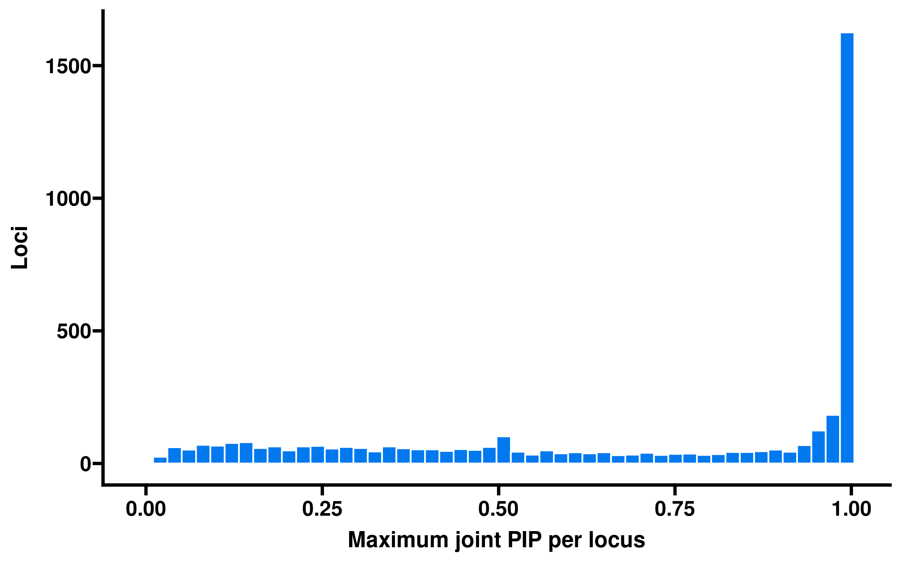
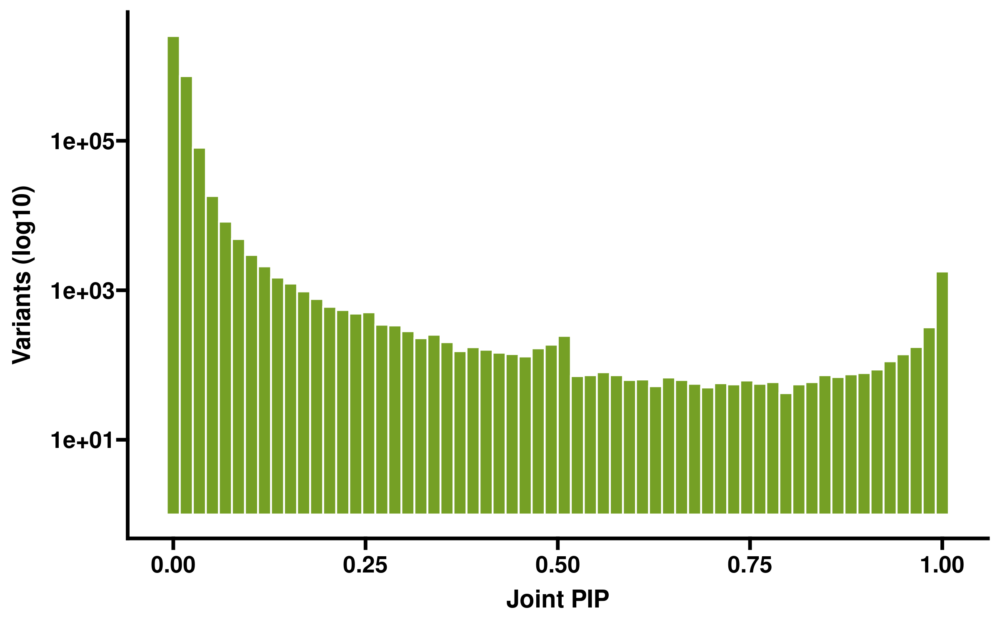
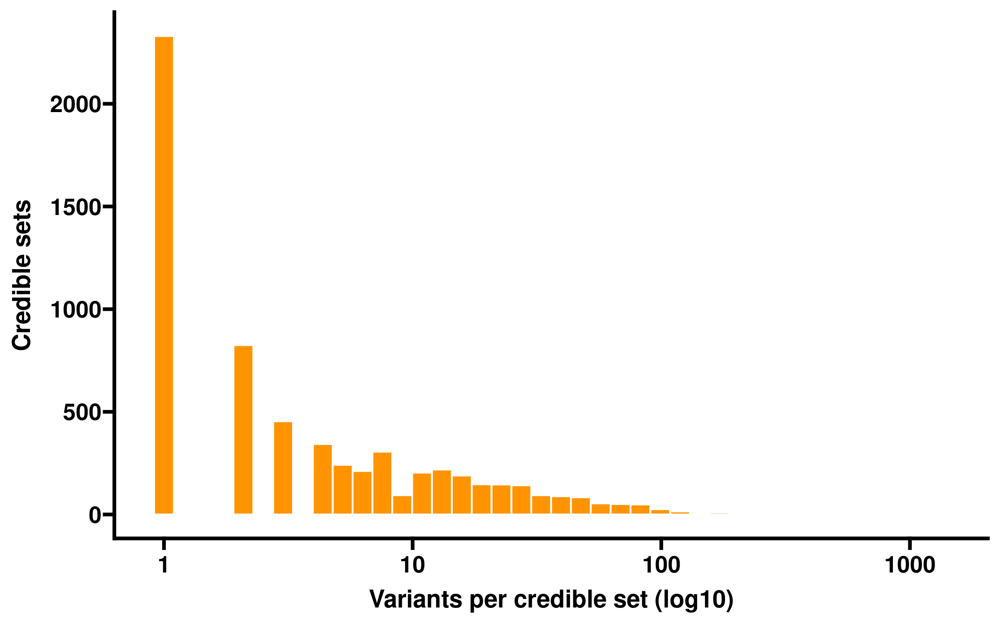
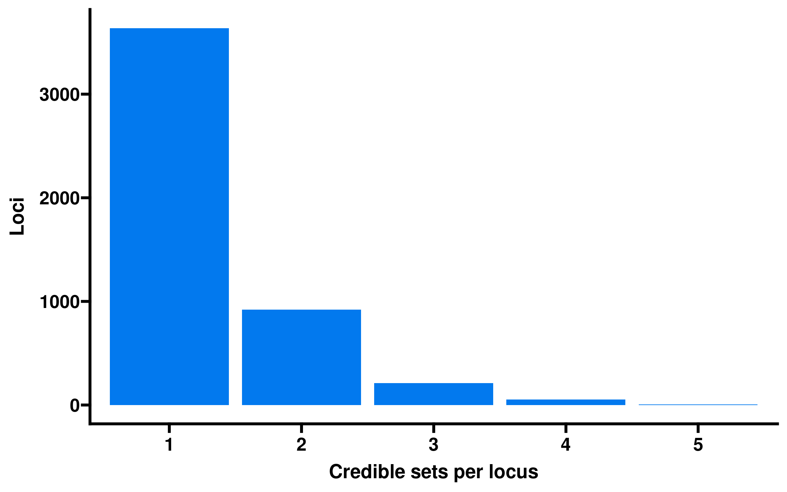
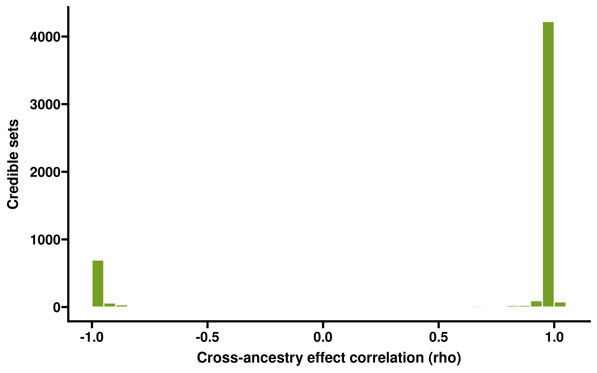
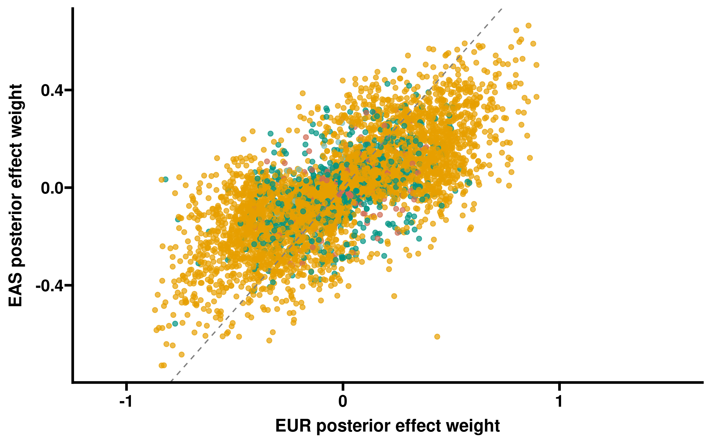
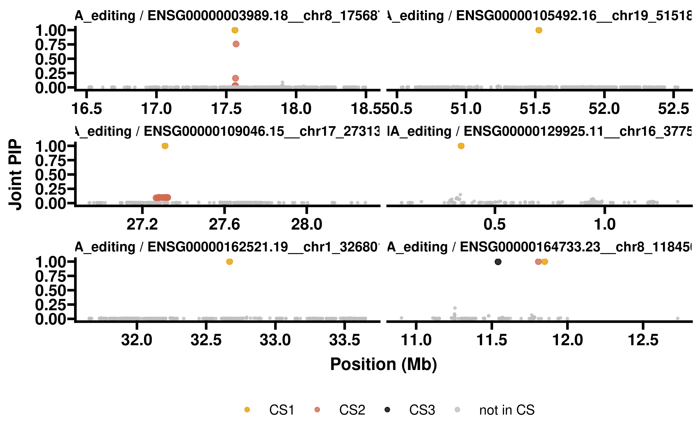
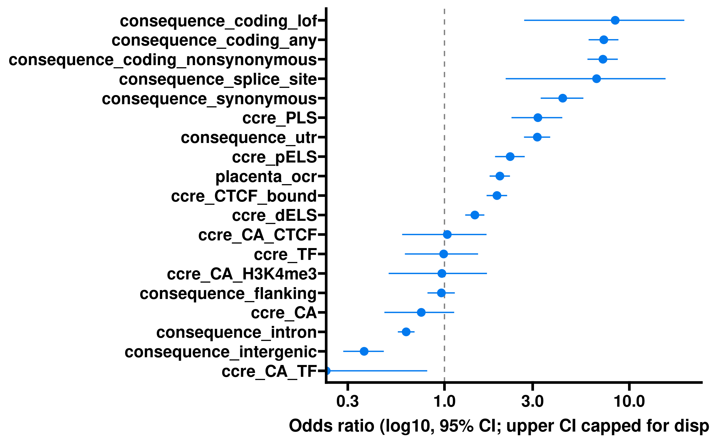
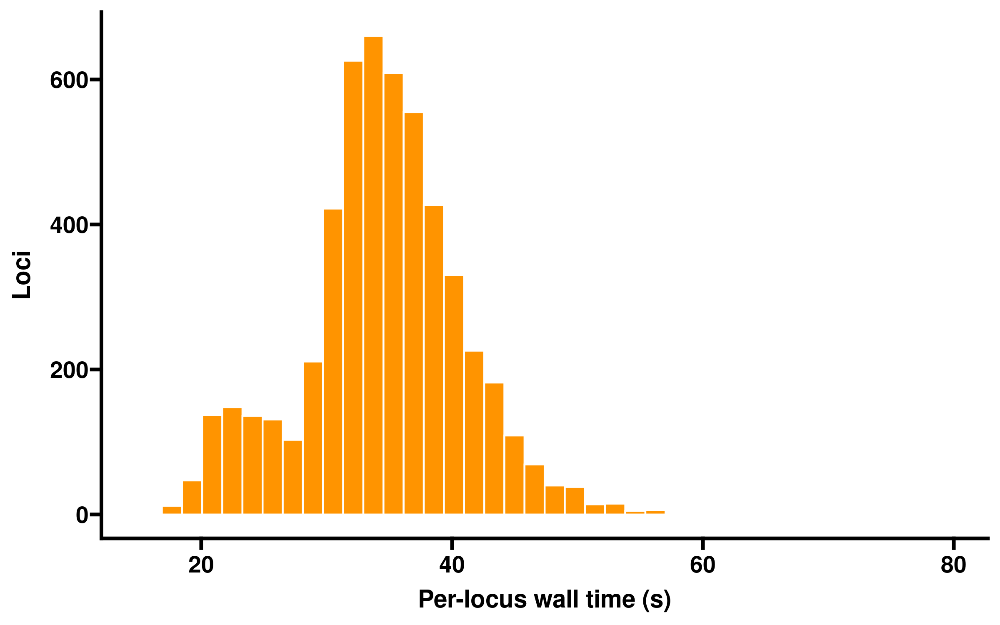

# Cross-ancestry fine-mapping {#fine-mapping}

## Overview

SuSHiE jointly fine-maps each significant xQTL locus across ancestry strata, leveraging ancestry-specific LD to refine 95% credible sets and estimate cross-ancestry effect correlations. This report summarizes run diagnostics, credible-set properties, cross-ancestry concordance, and functional annotation enrichment of high-PIP variants.

| Metric                                           |   Value |
|:-------------------------------------------------|--------:|
| Loci attempted                                   |    5529 |
| Loci fine-mapped                                 |    5269 |
| Converged (min-tolerance)                        |    5275 |
| Loci with \>=1 credible set                      |    4290 |
| Credible sets total                              |    6347 |
| Variants fine-mapped (unique locus-variant rows) | 3382937 |

## PIP diagnostics

Maximum joint PIP per locus.

Distribution of joint PIPs across all fine-mapped variants (log scale).

## Credible sets

Credible-set size distribution (number of variants per 95% CS).

Credible sets per locus.

## Cross-ancestry concordance

Cross-ancestry effect correlation (rho) per credible set. Values near 1 indicate shared causal effects; low/negative values indicate ancestry-specific effects.

Per-ancestry posterior effect weights for credible-set variants. Concordant effects lie along the diagonal.

## Top loci

Joint PIP by position for the six loci with the highest lead-variant PIP. Points in a credible set are colored by CS index.

## Functional-annotation enrichment

High-PIP variants (PIP \>= 0.9) tested for enrichment against fastVEP consequence classes, ENCODE SCREEN cCRE classes, and placenta open-chromatin peaks; background = all other fine-mapped variants. Odds ratios and 95% CIs are recomputed from the 2x2 cell counts; FDR is Benjamini-Hochberg across classes.

Annotation enrichment of high-PIP variants (Fisher exact odds ratio, 95% CI).

## Run diagnostics

| Status            | Loci |
|:------------------|-----:|
| failed            |  254 |
| ok                | 5269 |
| vcf_export_failed |    6 |

